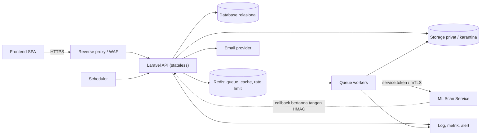
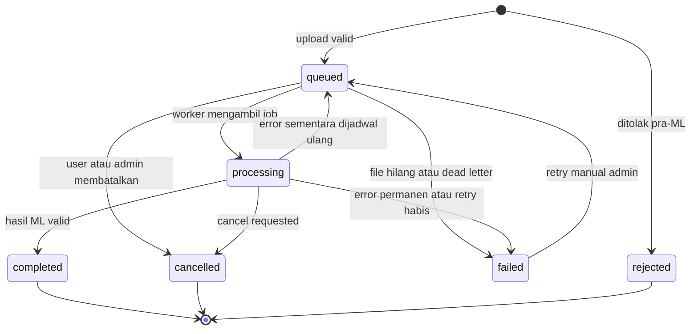
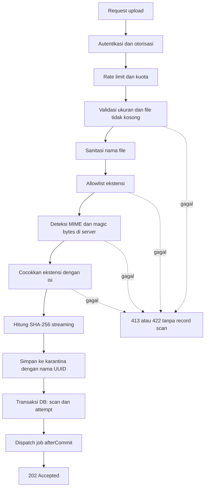
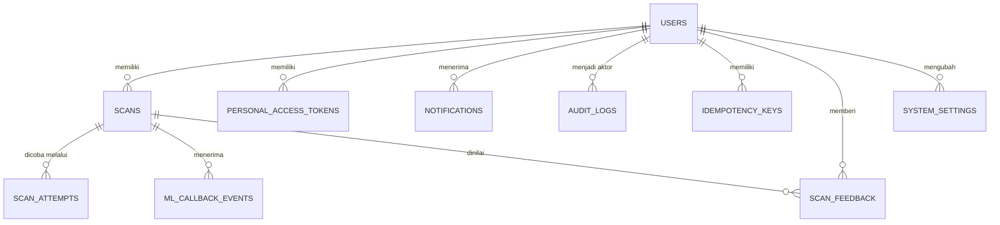

# PRODUCT REQUIREMENTS DOCUMENT (PRD)

## Backend — STIKSAFE-67

| | |
|---|---|
| **Nama Produk** | STIKSAFE-67 (angka 67 merujuk angkatan 2026–2027) |
| **Jenis Produk** | Website pemindaian file berbasis Machine Learning (ML) |
| **Komponen** | Backend API (Laravel) |
| **Pelaksana Backend** | Dedy Bhaskara (Head Project & Backend) dan Arya Putra “Tude” (Backend & Frontend) |
| **Dokumen terpisah** | PRD ML, PRD Frontend, PRD Pengujian, PRD Dokumentasi (lihat 0.3) |
| **Versi Dokumen** | 2.2 |
| **Status** | Draft awal (fokus tugas backend) |
| **Tanggal** | 14 November 2026 |
| **Menggantikan** | PRD Backend v1.0 (nama lama produk: STIKSAFE 6769) |

> **Cara membaca dokumen ini.** Setiap kebutuhan memiliki ID unik (contoh `FR-SCN-03`, `BR-07`, `NFR-PERF-02`) agar dapat dirujuk dalam tiket, test case, dan review. Prioritas: **P0** wajib rilis pertama, **P1** penting setelah fungsi inti stabil, **P2** pengembangan lanjutan. Nilai angka (batas, timeout, kuota) adalah **usulan awal** yang harus dikonfirmasi pada Decision Log (Bagian 23) dan disimpan sebagai konfigurasi, bukan angka tetap di kode.
---

## 0. Kontrol Dokumen

### 0.1 Riwayat Revisi

| Versi | Tanggal | Perubahan |
|---|---|---|
| 1.0 | 14 Nov 2026 | Draf awal |
| 2.0 | 14 Nov 2026 | Penambahan arsitektur, state machine, kontrak ML, model data, spesifikasi API |
| 2.1 | 14 Nov 2026 | Nama produk menjadi STIKSAFE-67; penambahan tim dan pembagian kerja |
| 2.2 | 14 Nov 2026 | Disederhanakan: hanya tugas backend (Dedy dan Arya). Pengujian dan dokumentasi dipisah ke PRD terpisah; fitur yang belum mendesak dipindah ke pengembangan lanjutan |

### 0.2 Pelaksana Backend dan Pembagian Tugas

PRD ini khusus **backend Laravel** dan dikerjakan oleh **Dedy Bhaskara** (Head Project & Backend) dan **Arya Putra "Tude"** (Backend & Frontend).

| Penanggung jawab | Modul / pekerjaan (usulan awal, dapat disesuaikan) |
|---|---|
| **Dedy Bhaskara** | Arsitektur dan konvensi kode; autentikasi, RBAC, policy, audit log; **inti pemindaian** (state machine, queue, worker, idempotensi, retry, watchdog); **integrasi ML** (klien, validasi respons, callback); keamanan; system settings dan scheduler; deployment |
| **Arya Putra** | **Upload dan validasi file**, storage privat, kuota; riwayat (daftar, detail, filter, hapus); profil dan akun; manajemen user oleh Admin; notifikasi dan dashboard; format respons API bersama sisi frontend |

**Titik serah-terima:** Arya menyediakan service `CreateScan` (validasi, simpan file, buat `scans` dan `scan_attempts`, dispatch afterCommit). Dedy menyediakan `ProcessScanJob` dan `ScanStateMachine` yang memproses scan tersebut. Antarmuka keduanya disepakati di Sprint 0 agar bisa dikerjakan paralel.

**Aturan kerja:** setiap perubahan lewat Pull Request dengan review silang (Dedy mereview Arya dan sebaliknya); perubahan di area Auth, Policy, Upload, State machine, dan ML direview keduanya; keputusan pada Decision Log (Bagian 23) dicatat.

Peran generik di dokumen ini: Product Owner, Backend Lead, dan DevOps dipegang Dedy; Frontend dipegang Arya; ML dipegang Dwi Yasa.

### 0.3 Dokumen Terpisah (di Luar PRD Ini)

| Dokumen | Penanggung jawab | Yang diharapkan dari backend |
|---|---|---|
| PRD ML | Dwi Yasa | Kontrak Backend ↔ ML (Bagian 7), label dan ambang confidence |
| PRD Frontend | Arya Putra | Kontrak API (Bagian 10) |
| PRD Pengujian | Dina | Masukan area berisiko dan dukungan dari backend (Bagian 18) |
| PRD Dokumentasi | Nofa Ardianto | Sumber alur kerja dan catatan teknis (Bagian 18) |
---

## 1. Ringkasan Eksekutif

### 1.1 Gambaran Produk

STIKSAFE-67 adalah aplikasi keamanan file berbasis web. Pengguna mengunggah file, lalu sistem memeriksanya dengan layanan deteksi ancaman berbasis Machine Learning dan mengembalikan klasifikasi hasil beserta riwayatnya. Backend Laravel adalah **pusat kendali aplikasi**: akun, autentikasi, otorisasi, penerimaan dan validasi file, orkestrasi antrean pemindaian, komunikasi dengan layanan ML, penyimpanan hasil, riwayat, notifikasi, administrasi, audit, dan operasional.

### 1.2 Tujuan Produk

1. Menyediakan sistem akun dengan peran **Admin** dan **User** yang aman.
2. Memungkinkan pengguna mengirim file untuk dipindai dan memantau progresnya.
3. Menghubungkan backend dengan layanan ML melalui **kontrak yang terdokumentasi, tervalidasi, dan dapat diuji dengan mock**.
4. Menyimpan hasil dan riwayat secara terstruktur, konsisten, dan dapat ditelusuri.
5. Menyediakan dashboard dan fungsi pengelolaan untuk Admin.
6. Menjaga keamanan file, privasi data, dan integritas proses pemindaian.
7. Beroperasi andal: tidak ada scan "tersangkut", tidak ada hasil palsu, dan kegagalan dapat dipulihkan.

### 1.3 Bukan Tujuan (Non-Goals) Versi 1

- Melatih, mengevaluasi, atau mengoptimalkan model ML (lihat PRD ML).
- Desain dan implementasi UI/UX (lihat PRD Frontend).
- Rencana dan pelaksanaan pengujian (lihat PRD Pengujian) serta dokumentasi proyek, README, dan penjelasan alur kerja (lihat PRD Dokumentasi).
- Aplikasi desktop/mobile native.
- Menggantikan antivirus endpoint atau memberi **jaminan mutlak** bahwa file aman. Hasil adalah prediksi model.
- Menjalankan/mendetonasi file (dynamic analysis) di sisi Laravel. Analisis dilakukan oleh layanan ML yang terisolasi.
- Multi-tenant/organisasi, penagihan, dan paket langganan (dicatat sebagai pengembangan masa depan).

### 1.4 Prinsip Produk

| Prinsip | Konsekuensi teknis |
|---|---|
| **Security first** | Semua akses privat lewat autentikasi + otorisasi di backend; *deny by default* |
| **Fail safely** | Kegagalan ML/timeout **tidak pernah** menghasilkan `safe`; hasil tidak valid ditolak |
| **Traceability** | Setiap scan, attempt, dan tindakan penting memiliki jejak dan `request_id` |
| **Separation of concerns** | Laravel mengelola aplikasi; ML menganalisis file; frontend menampilkan |
| **Privacy by default** | Data minimum, file tidak publik, retensi terbatas, akses Admin tercatat |
| **Idempotent & recoverable** | Retry/duplikasi request tidak membuat data ganda atau status rusak |
| **Configurable** | Batas, kuota, retensi, dan tipe file adalah konfigurasi, bukan konstanta kode |
| **Observable** | Metrik, log terstruktur, dan alert untuk antrean, ML, dan keamanan |
---

## 2. Ruang Lingkup

### 2.1 Termasuk dalam PRD Backend

| Area | Rincian |
|---|---|
| Identitas | Registrasi, login, logout, verifikasi email, reset password, 2FA Admin, manajemen token/sesi |
| Akun | Profil, ganti password, permintaan penghapusan akun, status akun |
| Otorisasi | RBAC Admin/User, policy per sumber daya, rate limit |
| File | Unggah, validasi berlapis, penyimpanan privat/karantina, retensi dan penghapusan |
| Pemindaian | Antrean, worker, attempt/retry, state machine, watchdog, circuit breaker |
| Integrasi ML | Klien ML, validasi respons, callback aman, health check, mock |
| Riwayat & hasil | Daftar, pencarian, filter, detail, laporan, umpan balik false positive/negative |
| Dashboard | Statistik User dan Admin dari data backend |
| Notifikasi | In-app (P1), email opsional |
| Administrasi | Manajemen user, seluruh scan, antrean/failed jobs, konfigurasi sistem, pengumuman |
| Audit & operasional | Audit log, scheduler, logging, monitoring, backup |

### 2.2 Tidak Termasuk

| Bagian | Penanggung jawab |
|---|---|
| Pembuatan, pelatihan, evaluasi, optimasi model ML | PRD ML |
| Algoritma klasifikasi dan ekstraksi fitur | PRD ML |
| Sandbox/isolasi analisis file di sisi ML | PRD ML (persyaratan minimum ada di Bagian 7.9) |
| Desain UI/UX, layout, animasi, komponen | PRD Frontend |
| Tampilan dashboard di browser | PRD Frontend |
| Rencana dan pelaksanaan pengujian | PRD Pengujian |
| Dokumentasi proyek, README, penjelasan alur kerja | PRD Dokumentasi |
| Aplikasi native desktop/mobile | Di luar ruang lingkup awal |
| Penagihan, paket langganan, multi-organisasi | Di luar ruang lingkup awal |

### 2.3 Pengembangan Lanjutan (Belum Dikerjakan Sekarang)

Fitur berikut dicatat sebagai backlog setelah fungsi inti stabil: ekspor data pribadi dan ekspor riwayat, *rescan* dengan model baru, reuse hasil berdasarkan hash, laporan PDF, unggah berpotongan (*chunked*), notifikasi real-time (SSE/WebSocket), pengumuman sistem, daftar sesi/perangkat dan ganti email, anti-enumerasi pada registrasi, integritas audit log (*hash chaining*), dan akses file oleh Admin secara *break-glass*.

### 2.4 Asumsi

- Tim backend berjumlah 2 orang (Dedy dan Arya); Dedy juga menangani deployment.
- Layanan ML terpisah dan dapat dijangkau lewat jaringan privat; kontrak final ditetapkan bersama Dwi Yasa.
- Tersedia Redis dan storage file privat (atau fallback driver database/disk lokal dengan kapasitas lebih rendah).
- Frontend dan API dapat berbagi cookie *same-site*; bila tidak, pakai bearer token (DEC-03).
- Waktu disimpan dalam **UTC**; zona waktu dikonversi di frontend.
- Kapasitas awal: ±500 user aktif/hari, ±5.000 scan/hari, puncak ±20 scan/menit, rata-rata file ±5 MB.
---

## 3. Aktor, Peran, dan Hak Akses

### 3.1 Daftar Aktor

| Aktor | Jenis | Deskripsi |
|---|---|---|
| **Guest** | Manusia | Pengunjung belum login; hanya boleh registrasi, login, reset password |
| **User** | Manusia | Pengguna umum layanan pemindaian |
| **Admin** | Manusia | Pengelola sistem; wajib akun individual dan 2FA (P1) |
| **ML Service** | Sistem | Layanan analisis; berinteraksi lewat kontrak service-to-service |
| **Scheduler/Worker** | Sistem | Proses internal Laravel (queue worker, scheduled command) |

### 3.2 Role: User

Hak akses:
- Mendaftar dan login; mengelola profil dan password sendiri.
- Mengunggah file dan memantau status pemindaian miliknya.
- Melihat, mencari, memfilter, dan mengurutkan riwayat miliknya; melihat detail hasil.
- Membatalkan scan miliknya yang masih `queued` (dan *best effort* saat `processing`).
- Menghapus item riwayat miliknya sesuai kebijakan retensi.
- Mengunduh laporan hasil miliknya (bila fitur aktif).
- Mengirim umpan balik atas hasil (false positive/negative).
- Meminta penghapusan akun.

Batasan: User **tidak boleh** melihat file, riwayat, profil, notifikasi, atau data privat pengguna lain, termasuk mendeteksi keberadaannya (lihat BR-03).

### 3.3 Role: Admin

Hak akses:
- Login ke area administrasi (dengan 2FA, P1).
- Melihat statistik sistem, seluruh scan, antrean, *failed jobs*, status ML.
- Mengelola akun: aktifkan, suspend, nonaktifkan, ubah role (dengan *step-up authentication*).
- Retry/cancel scan sesuai aturan; melihat audit log.
- Mengelola konfigurasi: batas file, tipe file, kuota, retensi, mode pemeliharaan.
- Mengelola pengumuman (P2).

Batasan: akun individual (tanpa akun bersama); Admin **tidak dapat** menurunkan/menangguhkan dirinya sendiri atau menghapus Admin aktif terakhir (BR-05); akses ke **isi file asli** secara default **tidak diberikan** (hanya metadata dan hasil), lihat DEC-12.

### 3.4 Matriks Hak Akses (per kemampuan)

Legenda: ✔ diizinkan · ✘ ditolak · ◐ bersyarat (lihat catatan)

| Kemampuan (permission) | Guest | User | Admin | Catatan |
|---|:--:|:--:|:--:|---|
| `auth.register` | ✔ | ✘ | ✘ | Role otomatis `user` |
| `auth.login` | ✔ | ✔ | ✔ | Throttled |
| `auth.2fa.manage` | ✘ | ◐ | ✔ | User opsional; Admin wajib (P1) |
| `profile.view` / `profile.update` | ✘ | ✔ | ✔ | Hanya milik sendiri |
| `profile.delete.request` | ✘ | ✔ | ◐ | Admin: tidak boleh jika Admin aktif terakhir |
| `scan.create` | ✘ | ✔ | ◐ | Admin mengikuti kuota sendiri (DEC-14) |
| `scan.view.own` | ✘ | ✔ | ✔ | |
| `scan.view.any` | ✘ | ✘ | ✔ | Metadata + hasil; alasan operasional; tercatat |
| `scan.cancel.own` | ✘ | ✔ | ✔ | |
| `scan.cancel.any` | ✘ | ✘ | ✔ | Tercatat di audit log |
| `scan.delete.own` | ✘ | ✔ | ✔ | Sesuai retensi |
| `scan.retry` | ✘ | ✘ | ✔ | Hanya status `failed` yang *retryable* |
| `scan.file.download.own` | ✘ | ◐ | ✔ | Hanya selama file belum dipurge; default dinonaktifkan |
| `scan.file.download.any` | ✘ | ✘ | ◐ | Default ✘; *break-glass* P2 (alasan wajib, tercatat, kedaluwarsa) |
| `report.view.own` | ✘ | ✔ | ✔ | Bila fitur laporan aktif |
| `feedback.create` | ✘ | ✔ | ✔ | Atas scan milik sendiri |
| `feedback.review` | ✘ | ✘ | ✔ | P1/P2 |
| `notification.manage.own` | ✘ | ✔ | ✔ | |
| `dashboard.view.own` | ✘ | ✔ | ✔ | |
| `dashboard.view.system` | ✘ | ✘ | ✔ | |
| `user.manage` (list, detail, suspend, role) | ✘ | ✘ | ✔ | Role change = *step-up auth* |
| `queue.view` / `failedjobs.view` | ✘ | ✘ | ✔ | |
| `audit.view` | ✘ | ✘ | ✔ | Read-only; tidak ada hapus/ubah |
| `settings.view` / `settings.update` | ✘ | ✘ | ✔ | Divalidasi, tercatat, rahasia dimasker |
| `ml.health.view` | ✘ | ✘ | ✔ | |

**Aturan implementasi:**
1. Otorisasi diterapkan di backend melalui **middleware + Policy/Gate**, bukan hanya menyembunyikan tombol di frontend.
2. Pola *deny by default*: route tanpa middleware otorisasi eksplisit dianggap bug.
3. Sumber daya milik user lain mengembalikan **404** (bukan 403) agar keberadaannya tidak bocor. Endpoint `/admin/*` bagi non-Admin mengembalikan **403**.
4. Token API (bila dipakai) dibatasi *abilities* minimum; ability tidak menggantikan policy.
5. Perubahan role dan status dicatat di audit log dengan nilai sebelum/sesudah.

### 3.5 Aktor Sistem: Hak ML Service

| Kemampuan | ML Service |
|---|:--:|
| Menerima file/referensi untuk dianalisis | ✔ (kredensial service) |
| Mengirim hasil melalui callback ke endpoint internal | ✔ (tanda tangan HMAC wajib) |
| Mengakses database/storage backend langsung | ✘ |
| Memanggil endpoint publik/Admin | ✘ |
| Mengubah status scan di luar callback tervalidasi | ✘ |

### 3.6 Siklus Hidup Status Akun

| Status | Arti | Dapat login | Dapat upload | Catatan |
|---|---|:--:|:--:|---|
| `pending_verification` | Registrasi selesai, email belum diverifikasi | Terbatas | ✘ | Hanya jika verifikasi email wajib (DEC-13) |
| `active` | Normal | ✔ | ✔ | |
| `suspended` | Dibatasi Admin (alasan wajib) | ✘ | ✘ | Semua token dicabut; scan yang sedang berjalan diselesaikan sesuai kebijakan |
| `inactive` | Dinonaktifkan (oleh user/Admin) | ✘ | ✘ | Dapat diaktifkan kembali |
| `pending_deletion` | Permintaan hapus akun, masa tenggang | ◐ | ✘ | Dapat dibatalkan selama masa tenggang |
| `deleted` | Data dianonimkan/dipurge | ✘ | ✘ | Jejak audit dipertahankan secara terpseudonim |
---

## 4. Arsitektur Sistem

### 4.1 Gambaran Komponen



### 4.2 Tanggung Jawab Komponen

| Komponen | Tanggung jawab | Tidak boleh |
|---|---|---|
| Laravel API | Auth, otorisasi, validasi, membuat scan, mengantre job, membaca hasil, administrasi | Menjalankan/mengeksekusi file; menunggu ML dalam request HTTP user |
| Queue worker | Mengambil job, memanggil ML, memvalidasi respons, menyimpan hasil | Membuat keputusan klasifikasi sendiri |
| ML Service | Menganalisis file dan mengembalikan prediksi | Mengakses DB/storage backend; mengubah data pengguna |
| Storage privat | Menyimpan file sementara dalam karantina | Berada di direktori publik; melayani file langsung ke internet |
| Redis | Antrean, cache, penghitung rate limit | Menjadi satu-satunya penyimpan data penting |
| Database | Sumber kebenaran data aplikasi | |
| Scheduler | Tugas berkala: watchdog, purge, agregasi | Berjalan ganda di banyak server tanpa `onOneServer` |

> **Prinsip utama:** file dari pengguna adalah **data tidak tepercaya** di setiap titik. Backend memperlakukannya sebagai blob buram: disimpan, di-hash, diteruskan — tidak pernah di-*parse*, di-*include*, atau dieksekusi oleh Laravel.

### 4.3 Teknologi yang Disarankan

| Kebutuhan | Pilihan | Catatan |
|---|---|---|
| Framework | Laravel versi stabil/LTS terbaru yang masih mendapat dukungan keamanan, PHP yang masih mendapat dukungan keamanan | Verifikasi versi saat kickoff (DEC-01) |
| Database | PostgreSQL (disarankan) atau MySQL 8 | Mendukung JSON, indeks parsial (PG), transaksi |
| Queue/cache | Redis + Laravel Horizon | Antrean terpantau; fallback driver database untuk dev |
| Autentikasi API | Laravel Sanctum (cookie SPA atau token) | DEC-03 |
| Storage | Laravel Storage disk privat (lokal terenkripsi atau S3-compatible dengan bucket privat + enkripsi) | Pre-signed URL singkat bila ML mengambil file |
| Otorisasi | Policies + Gates; paket permission hanya jika perlu granularitas lebih | |
| Validasi | Form Request + custom Rule untuk file | |
| Respons | API Resources (`JsonResource`) | Mencegah *excessive data exposure* |
| Kualitas kode | Larastan/PHPStan, Pint; Pest atau PHPUnit untuk test pengembang | Rencana pengujian lengkap ada di PRD Pengujian |
| Monitoring | Horizon, Sentry (opsional) | Bagian 16 |
---

## 5. Kebutuhan Fungsional

Format: **ID — Kebutuhan — Prioritas — Kriteria penerimaan ringkas**.

### 5.1 Autentikasi dan Sesi (`AUTH`)

| ID | Kebutuhan | Prio | Kriteria penerimaan |
|---|---|:--:|---|
| FR-AUTH-01 | Registrasi dengan `name`, `email`, `password`, `password_confirmation`, persetujuan syarat | P0 | `201`; email dinormalisasi (huruf kecil, trim); role = `user`; field `role`/`status` dari request **diabaikan** |
| FR-AUTH-02 | Login dengan email + password | P0 | Kredensial salah → pesan generik (tidak membocorkan apakah email terdaftar); akun `suspended` hanya diberi tahu **setelah** kredensial benar |
| FR-AUTH-03 | Logout mencabut token/sesi aktif | P0 | Token yang sama tidak bisa dipakai lagi (`401`) |
| FR-AUTH-04 | Logout semua perangkat | P1 | Seluruh token user dicabut |
| FR-AUTH-05 | Verifikasi email dengan tautan bertanda tangan (*signed URL*), kedaluwarsa 60 menit, dapat dikirim ulang dengan throttle | P0/P1 | Sesuai DEC-13; tautan kedaluwarsa/dimodifikasi ditolak |
| FR-AUTH-06 | Lupa & reset password: token acak sekali pakai, disimpan ter-hash, kedaluwarsa 60 menit; respons selalu generik | P0 | Setelah reset, **semua token lama dicabut**; token tidak bisa dipakai dua kali |
| FR-AUTH-07 | Ganti password dengan verifikasi password saat ini | P0 | Token lain dicabut; email pemberitahuan dikirim |
| FR-AUTH-08 | Kebijakan password: minimal 12 karakter, cek kebocoran (*uncompromised*), tidak boleh sama dengan email/nama; tanpa aturan komposisi paksa | P0 | Validasi di server; pesan jelas |
| FR-AUTH-09 | 2FA berbasis TOTP + kode pemulihan; **wajib untuk Admin** | P1 | Login Admin tanpa 2FA ditolak setelah masa transisi |
| FR-AUTH-11 | Pembuatan Admin hanya melalui perintah terproteksi (`artisan stiksafe:create-admin`) atau undangan Admin (P1) | P0 | Tidak ada pilihan role di registrasi publik |
| FR-AUTH-12 | Masa berlaku sesi/token: sesi SPA idle 120 menit; token API 24 jam (Admin 8 jam); dapat dikonfigurasi | P0 | Token kedaluwarsa → `401` |
| FR-AUTH-13 | Pembatasan percobaan: login 5/menit per (email+IP), eskalasi *lockout* sementara setelah kegagalan beruntun | P0 | `429` + `Retry-After`; kejadian tercatat |

### 5.2 Manajemen Akun dan Profil (`USR`)

| ID | Kebutuhan | Prio | Kriteria penerimaan |
|---|---|:--:|---|
| FR-USR-01 | Melihat dan memperbarui profil sendiri (`name`) | P0 | Mass assignment dibatasi (`$fillable`/Form Request `validated()`) |
| FR-USR-03 | Permintaan hapus akun dengan masa tenggang (default 14 hari) dan pembatalan | P1 | Status `pending_deletion`; setelah tenggang → anonimisasi + purge file |
| FR-USR-04 | Admin: daftar pengguna dengan pencarian, filter (status, role, tanggal), pagination | P0 | Hanya Admin; tidak menampilkan hash password/rahasia 2FA |
| FR-USR-05 | Admin: suspend/aktifkan akun dengan **alasan wajib** | P0 | Token dicabut seketika; audit log berisi alasan |
| FR-USR-06 | Admin: ubah role dengan *step-up auth* (konfirmasi password/2FA) | P0 | Tidak bisa mengubah role/status diri sendiri; tidak bisa menghapus Admin aktif terakhir |
| FR-USR-07 | Admin: paksa logout pengguna | P1 | Semua token dicabut |

### 5.3 Unggah dan Validasi File (`FILE`)

| ID | Kebutuhan | Prio | Kriteria penerimaan |
|---|---|:--:|---|
| FR-FILE-01 | Endpoint upload `multipart/form-data` satu file per request | P0 | Respons **`202 Accepted`** dengan `scan_id` dan `status=queued` |
| FR-FILE-02 | Validasi berlapis (Bagian 8.2): ukuran, ekstensi, magic bytes, MIME hasil deteksi server, nama file, file kosong | P0 | Pelanggaran → `413`/`422` dengan kode error spesifik; file **tidak** diteruskan ke ML |
| FR-FILE-03 | Penyimpanan di disk privat dengan nama acak (UUID/ULID) tanpa ekstensi asli | P0 | Tidak ada URL publik; path tidak berasal dari input user |
| FR-FILE-04 | Hash **SHA-256** dihitung saat upload (streaming) dan disimpan | P0 | Dipakai untuk integritas, dedup internal, dan verifikasi respons ML |
| FR-FILE-05 | Nama file asli disanitasi (hapus path, karakter kontrol, panjang maksimum 255) hanya untuk tampilan | P0 | Nama berbahaya (`../../x`, `file.php%00.pdf`) tidak memengaruhi penyimpanan |
| FR-FILE-06 | Pemeriksaan kuota sebelum menerima file (harian: jumlah & total byte; konkuren: scan aktif) | P0 | Melebihi → `429` kode `QUOTA_EXCEEDED` + info sisa kuota |
| FR-FILE-07 | `Idempotency-Key` pada `POST /scans`: request ulang dengan kunci sama mengembalikan hasil awal | P0 | Tidak membuat scan ganda; payload berbeda dengan kunci sama → `409` |
| FR-FILE-08 | Penghapusan file otomatis sesuai retensi (Bagian 13) | P1 | `file_purged_at` terisi; metadata hasil tetap ada |
| FR-FILE-09 | Pembersihan *orphan file* (ada di storage tanpa record DB, atau sebaliknya) | P1 | Scheduler melaporkan dan menghapus |

### 5.4 Pemindaian dan Orkestrasi (`SCN`)

| ID | Kebutuhan | Prio | Kriteria penerimaan |
|---|---|:--:|---|
| FR-SCN-01 | Setiap upload valid membuat satu record `scans` (status `queued`) dan satu `scan_attempts` pertama dalam **satu transaksi DB** | P0 | Tidak ada scan tanpa attempt; tidak ada attempt tanpa scan |
| FR-SCN-02 | Job didispatch **setelah commit** (`afterCommit`) | P0 | Worker tidak pernah memproses scan yang belum ada di DB |
| FR-SCN-03 | Pemrosesan asynchronous; request upload tidak menunggu ML | P0 | Latensi upload tidak bergantung pada durasi ML |
| FR-SCN-04 | Transisi status hanya melalui **satu titik** (`ScanStateMachine`) yang menolak transisi ilegal | P0 | Peta transisi (6.3) menjadi satu-satunya sumber aturan |
| FR-SCN-05 | Transisi bersifat atomik dan aman dari *race condition* (`lockForUpdate` atau `UPDATE ... WHERE status = :expected`) | P0 | Callback dan worker bersamaan tidak menghasilkan status rusak |
| FR-SCN-06 | Retry otomatis untuk kegagalan sementara dengan *backoff* dan batas percobaan | P0 | Default 3 percobaan; `backoff` 30 dtk → 2 mnt → 5 mnt (konfigurasi) |
| FR-SCN-07 | Setiap percobaan tercatat di `scan_attempts` dan tidak pernah dihapus | P0 | Riwayat percobaan lengkap |
| FR-SCN-08 | Circuit breaker terhadap ML: setelah N kegagalan beruntun, job ditunda tanpa menghabiskan jatah retry | P1 | Status breaker terlihat di `/admin/ml-health` |
| FR-SCN-09 | Watchdog: scan `processing` tanpa *heartbeat* melewati batas waktu dipulihkan (attempt ditandai gagal lalu dijadwal ulang/diakhiri) | P0 | |
| FR-SCN-10 | Pembatalan: `queued → cancelled` seketika; `processing → cancelled` *best effort* (hasil ML diabaikan) | P0/P1 | Hasil yang datang setelah pembatalan tidak mengubah status |
| FR-SCN-11 | Admin retry untuk scan `failed` yang *retryable*; membuat attempt baru (`trigger=manual_retry`) | P0 | Percobaan lama tetap tersimpan |
| FR-SCN-14 | Backpressure: jika kedalaman antrean melebihi ambang, upload baru ditolak `503 QUEUE_OVERLOADED` dengan `Retry-After` | P1 | Ambang dapat dikonfigurasi |
| FR-SCN-15 | Pemindaian hanya melaporkan progres **nyata** (status/tahap); tidak ada persentase palsu | P0 | Frontend tidak menampilkan angka yang dikarang backend |

### 5.5 Integrasi ML (`ML`)

| ID | Kebutuhan | Prio | Kriteria penerimaan |
|---|---|:--:|---|
| FR-ML-01 | Akses ke ML melalui antarmuka `ScanEngineClient` dengan implementasi `HttpScanEngineClient` dan `FakeScanEngineClient` | P0 | Fake dipakai untuk pengembangan lokal dan test pengembang |
| FR-ML-02 | Seluruh respons ML divalidasi terhadap skema (Bagian 7.4) sebelum disimpan | P0 | Respons tak valid → attempt gagal `ML_INVALID_RESPONSE`; tidak pernah menjadi `safe` |
| FR-ML-03 | Backend mencatat `model_version`, `ml_request_id`, durasi, dan kode error per attempt | P0 | Terlihat pada detail Admin |
| FR-ML-04 | Autentikasi service-to-service dan transport terenkripsi | P0 | Tanpa kredensial valid → ditolak |
| FR-ML-05 | Callback (bila Mode B) diverifikasi HMAC, timestamp, dan *replay protection* | P0 (bila dipakai) | Callback palsu/replay → `401`, tercatat |
| FR-ML-06 | Health check berkala ke ML dan endpoint Admin `GET /admin/ml-health` | P1 | Menampilkan status, latensi, versi model, status circuit breaker |
| FR-ML-07 | Fake ML Server (mock HTTP) untuk dev/staging dengan skenario: aman, berbahaya, mencurigakan, lambat, error 5xx, respons rusak, callback ganda | P0 | Skenario terdaftar |

### 5.6 Riwayat dan Hasil (`HIS`)

| ID | Kebutuhan | Prio | Kriteria penerimaan |
|---|---|:--:|---|
| FR-HIS-01 | Daftar riwayat milik sendiri dengan pagination (default 20, maks 100) | P0 | Query **selalu** dibatasi `user_id` dari identitas login (global scope/policy) |
| FR-HIS-02 | Detail scan: metadata file, status, hasil, waktu, jumlah attempt, ketersediaan file | P0 | Tidak mengembalikan `stored_path` |
| FR-HIS-03 | Pencarian `q` (nama file, ID, prefix SHA-256) dan filter `status`, `result`, `from`, `to`, `file_type` | P0 | Kombinasi filter bekerja bersama; indeks mendukung |
| FR-HIS-04 | Pengurutan `created_at`/`completed_at`/`file_size` naik/turun | P0 | Default terbaru dulu |
| FR-HIS-05 | Hapus item riwayat (*soft delete* + purge file segera; anonimisasi metadata sesuai retensi) | P0 | Hilang dari daftar user; audit log tetap |
| FR-HIS-06 | Laporan hasil per scan (JSON pada P1, PDF pada P2) | P1/P2 | Memuat disclaimer bahwa hasil adalah prediksi |
| FR-HIS-07 | Umpan balik *false positive/negative* per scan | P1 | Satu umpan balik aktif per scan per user; dapat ditinjau Admin |
| FR-HIS-08 | Admin: riwayat seluruh sistem dengan filter user/status/hasil/tanggal | P0 | Setiap akses detail lintas-user mencatat audit (sampling/penuh sesuai kebijakan) |

### 5.7 Dashboard Statistik (`DSH`)

| ID | Kebutuhan | Prio | Definisi / kriteria |
|---|---|:--:|---|
| FR-DSH-01 | Dashboard User | P1 | Total scan; hitungan per `result_label` (`safe`, `suspicious`, `malicious`, `unknown`); jumlah `queued`+`processing`; jumlah `failed`; 10 aktivitas terakhir |
| FR-DSH-02 | Dashboard Admin | P1 | Total akun per status; scan per hari (30 hari); distribusi hasil; rasio gagal; kedalaman & usia tertua antrean; status ML; aktivitas sistem terbaru |
| FR-DSH-03 | Seluruh angka dihitung dari database backend | P1 | Frontend bukan sumber kebenaran |
| FR-DSH-04 | Performa: cache pendek (30–60 dtk) atau tabel agregat `daily_scan_stats` untuk menghindari *full scan* | P1 | Dashboard p95 < 500 ms pada 1 juta baris scan |
| FR-DSH-05 | Definisi metrik eksplisit: scan `failed`/`cancelled`/`rejected` **tidak** dihitung sebagai `safe` maupun `malicious` | P1 | Tercantum di dokumentasi API |

### 5.8 Notifikasi (`NTF`)

| ID | Kebutuhan | Prio | Kriteria penerimaan |
|---|---|:--:|---|
| FR-NTF-01 | Notifikasi in-app untuk `scan.completed`, `scan.failed`, `account.suspended`, `account.password_changed` | P1 | Tersimpan di tabel `notifications` |
| FR-NTF-02 | Daftar, jumlah belum dibaca, tandai dibaca, tandai semua dibaca | P1 | Hanya milik pemilik |
| FR-NTF-03 | Email opsional per preferensi pengguna (kecuali email keamanan wajib) | P1 | Queue `notifications` terpisah dari queue scan |
| FR-NTF-04 | Pembaruan status awal via **polling** `/scans/{id}/status` dengan `ETag` dan petunjuk `poll_after_ms` | P0 | `304` bila tidak berubah |

### 5.9 Audit Log (`AUD`)

| ID | Kebutuhan | Prio | Kriteria penerimaan |
|---|---|:--:|---|
| FR-AUD-01 | Mencatat katalog peristiwa pada Tabel 5.9.1 | P1 (P0 untuk peristiwa keamanan & Admin) | Aktor, aksi, target, hasil, waktu, `request_id` |
| FR-AUD-02 | Log **append-only**: akun DB aplikasi tidak memiliki hak `UPDATE/DELETE` pada tabel | P1 | Dijaga lewat izin DB |
| FR-AUD-03 | Tidak mencatat password, token, isi file, rahasia 2FA, atau header otorisasi | P0 | Diterapkan lewat daftar redaksi log (12.2) |
| FR-AUD-04 | Pencarian/filter audit log oleh Admin (aktor, aksi, rentang waktu, target) dengan *cursor pagination* | P1 | |

**Tabel 5.9.1 — Katalog peristiwa audit**

| Kunci aksi | Aktor | Target | Severity |
|---|---|---|---|
| `auth.login.success` / `auth.login.failed` | user/guest | user | info/warn |
| `auth.logout`, `auth.logout_all` | user | user | info |
| `auth.password.changed` / `reset.requested` / `reset.completed` | user | user | warn |
| `auth.2fa.enabled` / `disabled` / `failed` | user | user | warn |
| `account.suspended` / `reactivated` | admin | user | warn |
| `account.role.changed` | admin | user | critical |
| `account.deletion.requested` / `cancelled` / `completed` | user/system | user | warn |
| `scan.created` / `deleted` | user | scan | info |
| `scan.viewed_by_admin` | admin | scan | info |
| `scan.retried` / `cancelled_by_admin` | admin | scan | warn |
| `settings.updated` | admin | setting | critical |
| `ml.callback.rejected` | system | scan | critical |
| `ml.circuit.opened` / `closed` | system | — | warn |
| `file.purged` | system | scan | info |

### 5.10 Pengaturan Sistem dan Pengumuman (`SET`)

| ID | Kebutuhan | Prio | Kriteria penerimaan |
|---|---|:--:|---|
| FR-SET-01 | Admin mengelola konfigurasi pada Bagian 17 | P1 | Validasi tipe & rentang; perubahan masuk audit dengan nilai lama/baru (rahasia dimasker) |
| FR-SET-02 | Mode pemeliharaan: upload ditolak `503 MAINTENANCE_MODE`, endpoint baca tetap hidup | P1 | |
| FR-SET-03 | Konfigurasi di-*cache* dan di-*invalidate* saat berubah | P1 | Efektif ≤ 1 menit tanpa deploy |
---

## 6. Siklus Hidup Scan (State Machine)

### 6.1 Status

| Status | Arti | Terminal? |
|---|---|:--:|
| `queued` | Menunggu worker | Tidak |
| `processing` | Sedang dianalisis (ada attempt aktif) | Tidak |
| `completed` | Hasil ML valid tersimpan | Ya |
| `failed` | Gagal setelah retry habis atau kegagalan permanen | Ya* |
| `cancelled` | Dibatalkan user/Admin | Ya |
| `rejected` | File ditolak oleh validasi **mendalam pasca-penerimaan** | Ya |

\* `failed` dapat kembali ke `queued` hanya melalui retry manual Admin.

**Klarifikasi `rejected` vs respons `4xx`:** pelanggaran validasi sinkron (ukuran, ekstensi, magic bytes) langsung dijawab `413/422` **tanpa** record scan (dicatat sebagai metrik `upload_rejected_total{reason}`). Status `rejected` dipakai bila pemeriksaan pra-ML di worker (mis. inspeksi arsip, kebijakan konten) menolak file yang sudah diterima.

**Pemisahan konsep:** `status` = proses; `result_label` = vonis model (`safe`/`suspicious`/`malicious`/`unknown`) dan **hanya terisi bila `status=completed`**. Kegagalan **bukan** `unknown`; `unknown` adalah hasil sah dari model yang tidak dapat menyimpulkan.

### 6.2 Diagram Transisi



### 6.3 Tabel Transisi dan Guard

| Dari | Ke | Pemicu | Aktor | Guard / efek samping |
|---|---|---|---|---|
| (baru) | `queued` | Upload lolos validasi | User | Kuota OK; buat attempt #1; dispatch afterCommit |
| (baru) | `rejected` | Pra-ML menolak | System | Simpan `error_code`; purge file |
| `queued` | `processing` | Job diambil | Worker | `attempt.status=running`, set `started_at`, heartbeat |
| `processing` | `completed` | Hasil ML valid | Worker/Callback | Skema valid, `sha256` cocok, simpan hasil, buat notifikasi |
| `processing` | `queued` | Kegagalan sementara & `attempts < max` | Worker | Attempt ditutup `failed`; job dijadwal ulang dengan *backoff* |
| `processing` | `failed` | Error permanen / retry habis / timeout total | Worker/Watchdog | Simpan `error_code` aman; notifikasi |
| `queued` | `failed` | File hilang dari storage / dead letter | System | Alert operasional |
| `queued` | `cancelled` | Batal | User/Admin | Hapus job dari antrean bila ada; purge file sesuai kebijakan |
| `processing` | `cancelled` | Batal *best effort* | User/Admin | Set `cancel_requested_at`; hasil ML yang datang **diabaikan** |
| `failed` | `queued` | Retry manual | Admin | Hanya jika `error_code` *retryable* dan file masih ada; attempt baru `manual_retry`; audit |

**Transisi lain apa pun ditolak** dengan `409 SCAN_INVALID_STATE` dan dicatat sebagai peringatan. Hasil `completed` bersifat **immutable**; koreksi dilakukan lewat scan baru atau catatan Admin yang ter-audit, bukan menimpa hasil (BR-09).

### 6.4 Jaminan Konsistensi

1. Satu *state machine service* sebagai satu-satunya pintu perubahan status.
2. Update bersyarat: `UPDATE scans SET status=:new WHERE id=:id AND status=:expected` dan periksa jumlah baris terpengaruh.
3. Job bersifat idempoten: `ShouldBeUnique` per `scan_id` + `WithoutOverlapping`; mengecek status saat mulai (job untuk scan non-`queued` langsung selesai tanpa efek).
4. Callback/respons ML duplikat dideduplikasi lewat `ml_request_id` (tabel `ml_callback_events`).
5. `retry_after` antrean **lebih besar** dari `timeout` job agar job tidak diambil ganda.
---

## 7. Kontrak Integrasi Backend ↔ ML

> Seluruh isi bagian ini adalah **usulan kontrak** dari sisi Backend. Bentuk final ditetapkan bersama PRD ML dan dibekukan sebagai OpenAPI sebelum Tahap 2 selesai. Backend **tidak mengarang** hasil klasifikasi; semua nilai hasil berasal dari ML.

### 7.1 Mode Integrasi

| Mode | Cara kerja | Kelebihan | Kekurangan | Rekomendasi |
|---|---|---|---|---|
| **A. Sinkron di dalam worker** | Worker memanggil ML dan menunggu respons (timeout terbatas) | Paling sederhana; tanpa callback | Worker terikat selama ML bekerja | **Default MVP** bila ML < ±60 dtk |
| **B. Asinkron + callback** | ML membalas `202`, lalu mengirim hasil ke endpoint callback | Worker tidak terblokir | Perlu keamanan callback & penanganan callback hilang | Bila durasi ML panjang |
| **C. Asinkron + polling** | ML membalas `202`, worker menjadwalkan polling `GET` hasil | Tanpa endpoint publik masuk | Latensi tambahan, beban polling | Fallback Mode B / jaringan terbatas |

Backend dirancang agar mode dapat diganti melalui konfigurasi (`ml.mode = sync | callback | poll`) tanpa mengubah state machine.

### 7.2 Autentikasi dan Transport

- Jaringan privat antar layanan; TLS wajib. mTLS opsional (disarankan bila lintas jaringan).
- Header `Authorization: Bearer <service_token>` dengan token khusus per lingkungan, dapat dirotasi tanpa downtime (mendukung dua token aktif sementara).
- ML hanya menerima koneksi dari worker/API (IP allowlist/security group).
- Token tidak pernah masuk log, respons, atau pesan error.

### 7.3 Endpoint ML (Usulan)

| Method | Endpoint ML | Fungsi |
|---|---|---|
| `POST` | `/v1/scans` | Mengirim file untuk dianalisis (multipart: `metadata` + `file`) |
| `GET` | `/v1/scans/{request_id}` | Polling hasil (Mode C) / pemulihan callback hilang |
| `GET` | `/v1/health` | Liveness dan kesiapan model |
| `GET` | `/v1/model-info` | Versi model, label yang didukung, tipe file didukung, batas ukuran |

**Request header (dari backend):**

| Header | Isi |
|---|---|
| `Authorization` | `Bearer <service_token>` |
| `X-Request-ID` | `correlation_id` untuk tracing lintas layanan |
| `Idempotency-Key` | `ml_request_id` (UUID) — retry dengan kunci sama tidak menggandakan pekerjaan |

**Metadata request (JSON part):**

```json
{
  "scan_id": "01JCX7Y2K9M4N6P8Q0R3S5T7V9",
  "request_id": "7f0c1d5e-4b7a-4a39-9c62-0e5a3d1b2f10",
  "sha256": "9f86d081884c7d659a2feaa0c55ad015a3bf4f1b2b0b822cd15d6c15b0f00a08",
  "size_bytes": 482113,
  "declared_extension": "pdf",
  "detected_mime": "application/pdf",
  "submitted_at": "2026-11-14T02:00:00Z",
  "callback_url": "https://api.example.com/internal/v1/ml/callback"
}
```

Prinsip **data minimum**: tidak mengirim `user_id`, email, atau nama file asli ke ML. `callback_url` hanya ada pada Mode B.

**Respons sukses ML:**

```json
{
  "request_id": "7f0c1d5e-4b7a-4a39-9c62-0e5a3d1b2f10",
  "scan_id": "01JCX7Y2K9M4N6P8Q0R3S5T7V9",
  "status": "completed",
  "sha256": "9f86d081884c7d659a2feaa0c55ad015a3bf4f1b2b0b822cd15d6c15b0f00a08",
  "result": {
    "label": "suspicious",
    "confidence": 0.82,
    "threat_name": null,
    "threat_category": null
  },
  "model_version": "stiksafe-ml-1.4.2",
  "scanned_at": "2026-11-14T02:00:12Z",
  "duration_ms": 11840
}
```

**Respons gagal ML:**

```json
{
  "request_id": "7f0c1d5e-4b7a-4a39-9c62-0e5a3d1b2f10",
  "scan_id": "01JCX7Y2K9M4N6P8Q0R3S5T7V9",
  "status": "failed",
  "error": {
    "code": "ML_UNSUPPORTED_FILE",
    "message": "Tipe file tidak didukung oleh model.",
    "retryable": false
  }
}
```

### 7.4 Validasi Respons oleh Backend

Respons dianggap **valid** hanya jika seluruh aturan terpenuhi:

| # | Aturan | Jika dilanggar |
|---|---|---|
| 1 | Body JSON valid, ukuran ≤ batas (mis. 64 KB) | `ML_INVALID_RESPONSE` |
| 2 | `request_id` dan `scan_id` cocok dengan permintaan | `ML_INVALID_RESPONSE` + alert (potensi tertukar/spoof) |
| 3 | `sha256` yang di-*echo* ML sama dengan hash backend | `ML_INTEGRITY_MISMATCH` + alert |
| 4 | `status` ∈ {`completed`, `failed`} | `ML_INVALID_RESPONSE` |
| 5 | Bila `completed`: `result.label` ∈ {`safe`,`suspicious`,`malicious`,`unknown`} | `ML_INVALID_RESPONSE` |
| 6 | `confidence` bertipe numerik dalam rentang 0–1 (bila ada) | `ML_INVALID_RESPONSE` |
| 7 | `model_version` tidak kosong | `ML_INVALID_RESPONSE` |
| 8 | `scanned_at` berupa ISO-8601 dan wajar (tidak di masa depan jauh / tidak lebih tua dari waktu submit) | `ML_INVALID_RESPONSE` |
| 9 | Field tak dikenal diabaikan (kompatibilitas ke depan), tidak disimpan mentah | — |

Respons tidak valid **tidak pernah** dipetakan ke `safe` maupun `unknown`; hasilnya adalah attempt `failed` dan retry sesuai kebijakan.

### 7.5 Semantik Label di Sisi Backend

| Label | Arti | Perlakuan backend |
|---|---|---|
| `safe` | Model tidak mendeteksi ancaman | Simpan apa adanya; **tidak** dijamin aman mutlak (disclaimer pada respons API) |
| `suspicious` | Hasil belum meyakinkan / perlu pemeriksaan lanjut | Simpan; tampil sebagai peringatan |
| `malicious` | Model mengklasifikasikan berbahaya | Simpan; peringatan tertinggi |
| `unknown` | Model tidak dapat menentukan | Simpan sebagai hasil **sah**; bukan kegagalan |
| *(tidak ada)* | Proses gagal | `status=failed`, `result_label=NULL` |

Ambang confidence untuk menetapkan label **bukan** tanggung jawab backend; ditetapkan di PRD ML. Backend hanya menyimpan dan menampilkan.

### 7.6 Pemetaan Error ML → Perilaku Backend

| Kode error | Sumber | *Retryable* | Perilaku |
|---|---|:--:|---|
| `ML_TIMEOUT` | Backend (timeout klien) | Ya | Retry dengan backoff |
| `ML_UNAVAILABLE` (koneksi gagal, 502/503/504) | Backend/ML | Ya | Retry; hitung ke circuit breaker |
| `ML_OVERLOADED` (429 dari ML) | ML | Ya | Retry dengan jeda ≥ `Retry-After` |
| `ML_INTERNAL_ERROR` (5xx) | ML | Ya | Retry terbatas |
| `ML_INVALID_RESPONSE` | Backend | Ya (terbatas) | Retry; jika berulang → `failed` + alert |
| `ML_INTEGRITY_MISMATCH` | Backend | Tidak | `failed` + alert keamanan |
| `ML_UNSUPPORTED_FILE` | ML | Tidak | `failed` (pesan aman ke user) |
| `ML_FILE_CORRUPT` | ML | Tidak | `failed` |
| `ML_AUTH_FAILED` (401/403) | ML | Tidak | `failed` + alert kritikal (kredensial salah) |
| `SCAN_TIMEOUT` | Watchdog | Admin dapat retry | Melewati batas waktu total scan |

### 7.7 Timeout dan Batas Waktu (usulan, dapat dikonfigurasi)

| Parameter | Default | Keterangan |
|---|---|---|
| `ml.connect_timeout` | 5 dtk | |
| `ml.request_timeout` | 120 dtk | Mode A |
| `job.timeout` | 150 dtk | Lebih besar dari `request_timeout` |
| `queue.retry_after` | 180 dtk | **Harus** > `job.timeout` |
| `scan.max_total_duration` | 15 menit | Dari `queued_at` hingga terminal; lewat → `SCAN_TIMEOUT` |
| `ml.callback_wait` | 10 menit | Mode B; lewat → polling pemulihan lalu `failed` |
| `ml.max_attempts_auto` | 3 | Retry otomatis |

### 7.8 Keamanan Callback (Mode B)

- Endpoint terpisah: `POST /internal/v1/ml/callback` (bukan bagian API publik; dapat dibatasi di level jaringan).
- Header: `X-Stiksafe-Timestamp`, `X-Stiksafe-Signature` = `HMAC-SHA256(secret, timestamp + "." + raw_body)`.
- Verifikasi **waktu-konstan**; toleransi waktu ±5 menit; `request_id` dipakai sekali (tabel `ml_callback_events`) untuk menolak *replay*.
- Callback hanya diterima untuk scan berstatus `processing` yang `ml_request_id`-nya sesuai.
- `callback_url` dibangun dari konfigurasi server, **bukan** dari input pengguna (mencegah SSRF).
- Callback gagal verifikasi → `401`, audit `ml.callback.rejected` (tanpa menyimpan body mentah), rate limit per sumber.

### 7.9 Persyaratan yang Diminta kepada PRD ML

| # | Persyaratan | Alasan |
|---|---|---|
| 1 | Analisis dilakukan di **sandbox terisolasi** tanpa akses jaringan keluar dan tanpa eksekusi file di host | Mencegah kompromi layanan ML |
| 2 | File dihapus dari ML segera setelah analisis (retensi ML ≤ jam, bukan hari) | Privasi |
| 3 | Menjamin `request_id` idempoten | Retry aman |
| 4 | Mengembalikan `model_version` pada setiap hasil | Traceability |
| 5 | Menetapkan daftar tipe file didukung, ukuran maksimum, dan batas arsip (kedalaman, rasio kompresi, jumlah entri) | Selaras validasi backend |
| 6 | Menetapkan label, ambang confidence, dan arti `unknown` | Konsistensi tampilan |
| 7 | Target latensi dan throughput (p50/p95, scan paralel) | Dimensi worker dan SLA |
| 8 | Endpoint `/health` dan `/model-info` | Monitoring |
| 9 | Kontrak versi (`/v1`) dan kebijakan kompatibilitas mundur | Evolusi aman |
| 10 | Penyediaan OpenAPI dan contoh respons untuk semua skenario | Contract testing |
---

## 8. Validasi, Penyimpanan, dan Retensi File

### 8.1 Pipeline Penerimaan File



### 8.2 Lapisan Validasi

| # | Pemeriksaan | Aturan | Kode error |
|---|---|---|---|
| 1 | Ukuran | `0 < size ≤ max_file_size` (konfigurasi); selaras dengan `upload_max_filesize`, `post_max_size`, `client_max_body_size` | `FILE_TOO_LARGE` (413), `FILE_EMPTY` (422) |
| 2 | Jumlah file | Tepat satu bagian `file` | `VALIDATION_FAILED` |
| 3 | Nama file | Hapus path, byte NUL, karakter kontrol, Unicode *bidi override*; maks 255; ganda ekstensi (`a.pdf.exe`) dinilai berdasarkan ekstensi terakhir | `FILE_NAME_INVALID` |
| 4 | Ekstensi | Harus ada pada **allowlist** aktif | `FILE_TYPE_NOT_ALLOWED` |
| 5 | MIME server | Dideteksi dari isi (`finfo`), **bukan** dari header browser | `FILE_TYPE_NOT_ALLOWED` |
| 6 | Konsistensi | Ekstensi ↔ MIME ↔ magic bytes harus kompatibel menurut tabel pemetaan | `FILE_CONTENT_MISMATCH` |
| 7 | Arsip | Backend **tidak mengekstrak**. Batas metadata sederhana (bila diaktifkan): jumlah entri/rasio kompresi dibaca dari header saja; arsip terenkripsi ditandai | `FILE_ARCHIVE_UNSAFE` |
| 8 | Duplikat | Hash sama milik user sama dalam jendela singkat → kembalikan scan sebelumnya atau buat baru sesuai kebijakan (jangan memblokir) | — |
| 9 | Kuota | Lihat Bagian 8.4 | `QUOTA_EXCEEDED` |

> **Catatan desain:** karena sistem ini memindai file *yang mungkin berbahaya*, daftar tipe file yang diizinkan mencakup tipe berisiko (mis. executable, skrip, dokumen Office/PDF, arsip). Allowlist menentukan **apa yang boleh dipindai**, bukan apa yang aman dibuka. Isi allowlist ditetapkan bersama PRD ML (DEC-05).

### 8.3 Usulan Kategori Allowlist (awal, dapat diubah Admin)

| Kategori | Contoh ekstensi | Default aktif | Catatan |
|---|---|:--:|---|
| Dokumen | `pdf`, `doc`, `docx`, `xls`, `xlsx`, `ppt`, `pptx`, `rtf`, `txt` | Ya | Vektor makro dan eksploit umum |
| Executable | `exe`, `dll`, `msi`, `apk`, `elf`, `bin` | Sesuai kemampuan model | Bergantung dukungan ML |
| Skrip | `js`, `ps1`, `vbs`, `bat`, `sh`, `py` | Sesuai kemampuan model | |
| Arsip | `zip`, `rar`, `7z`, `tar`, `gz` | Tidak (sampai ML siap) | Risiko *zip bomb*; butuh batas ML |
| Gambar | `jpg`, `png`, `gif` | Opsional | |

### 8.4 Kuota dan Batas

| Batas | Default usulan | Dimensi |
|---|---|---|
| Ukuran file maksimum | 25 MB | Global |
| Scan per hari | 50 | Per user |
| Total byte per hari | 500 MB | Per user |
| Scan aktif bersamaan (`queued`+`processing`) | 5 | Per user |
| Upload per menit | 10 | Per user (rate limit) |
| Upload per jam | 60 | Per IP+user |

Kuota dihitung dengan jendela hari berdasarkan UTC (atau zona konfigurasi), dapat dioverride per user oleh Admin (P2).

### 8.5 Penyimpanan

- Disk privat (`visibility=private`); direktori tidak berada di `public/` dan tidak dilayani web server.
- Struktur: `quarantine/{yyyy}/{mm}/{uuid}` tanpa ekstensi; izin file `0640`, tanpa bit eksekusi; *mount* `noexec` bila memungkinkan.
- Enkripsi *at rest* (disk/bucket); enkripsi level aplikasi opsional untuk file sensitif.
- Akses file hanya lewat service backend terotorisasi; tidak ada URL publik. Bila ML mengambil file, gunakan URL pre-signed berumur pendek (≤ 5 menit) atau streaming langsung oleh worker.
- File tidak pernah di-`include`, di-`require`, di-render sebagai HTML, atau dikembalikan dengan `Content-Type` aslinya. Bila unduhan diizinkan: `Content-Disposition: attachment`, `X-Content-Type-Options: nosniff`, `Content-Type: application/octet-stream`.
- Scheduler memeriksa *orphan file* dan *orphan record*.

### 8.6 Retensi dan Penghapusan (Usulan)

| Data | Retensi default | Pemicu penghapusan |
|---|---|---|
| File asli | 7 hari setelah scan terminal (rentang 0–30, konfigurasi) | Scheduler `scans:purge-expired-files`; atau segera saat user menghapus riwayat |
| Metadata & hasil scan | 12 bulan | Anonimisasi/penghapusan oleh scheduler |
| Scan yang dihapus user | File dipurge segera; metadata dianonimkan setelah 30 hari | |
| Audit log | 24 bulan (peristiwa keamanan), 12 bulan lainnya | Arsip/purge terjadwal |
| Notifikasi | 90 hari | Scheduler |
| `idempotency_keys` | 24 jam | Scheduler |
| Token reset password | 60 menit | Kedaluwarsa + prune |
| Akun terhapus | Anonimisasi setelah masa tenggang 14 hari | `accounts:process-deletions` |

Setelah file dipurge, scan tetap menampilkan hasil dengan `file_available=false`; unduhan file tidak tersedia (`410 SCAN_FILE_EXPIRED`).
---

## 9. Model Data

### 9.1 Konvensi

- Primary key publik memakai **ULID** (`HasUlids`) untuk `scans`, `users`, dll. agar tidak dapat ditebak berurutan (mengurangi enumerasi). Autoincrement boleh dipakai untuk tabel internal.
- Semua timestamp disimpan **UTC**; enum disimpan sebagai `VARCHAR` + *cast* enum PHP (+ `CHECK` constraint bila DB mendukung).
- *Foreign key* eksplisit dengan `ON DELETE` yang disengaja; *soft delete* hanya di tabel yang memerlukan.
- Semua perubahan skema lewat migration; strategi *expand/contract* untuk perubahan berisiko (Bagian 19).

### 9.2 Diagram Relasi



### 9.3 `users`

| Kolom | Tipe | Constraint | Keterangan |
|---|---|---|---|
| id | ULID | PK | |
| name | VARCHAR(120) | NOT NULL | |
| email | VARCHAR(254) | UNIQUE, NOT NULL | Disimpan huruf kecil |
| email_verified_at | TIMESTAMP | NULL | |
| password | VARCHAR | NOT NULL | Hash Laravel (bcrypt/argon2id) |
| role | VARCHAR(16) | NOT NULL, default `user` | `admin` \| `user`; **tidak** mass-assignable |
| status | VARCHAR(24) | NOT NULL, default `active` | Lihat 3.6 |
| status_reason | VARCHAR(255) | NULL | Alasan suspend |
| two_factor_secret | TEXT | NULL | Terenkripsi |
| two_factor_recovery_codes | TEXT | NULL | Terenkripsi/ter-hash |
| two_factor_confirmed_at | TIMESTAMP | NULL | |
| last_login_at | TIMESTAMP | NULL | |
| last_login_ip | VARCHAR(45) | NULL | Sesuai kebijakan privasi (dipotong/di-hash) |
| deletion_requested_at | TIMESTAMP | NULL | |
| deletion_scheduled_at | TIMESTAMP | NULL | |
| created_at / updated_at | TIMESTAMP | | |
| deleted_at | TIMESTAMP | NULL | Soft delete/anonimisasi |

Indeks: `UNIQUE(email)`, `(role, status)`, `(created_at)`, `(deletion_scheduled_at) WHERE NOT NULL`.

### 9.4 `scans`

| Kolom | Tipe | Constraint | Keterangan |
|---|---|---|---|
| id | ULID | PK | |
| user_id | FK → users | NOT NULL, indeks | Pemilik |
| original_filename | VARCHAR(255) | NOT NULL | Sudah disanitasi |
| extension | VARCHAR(16) | NOT NULL | |
| mime_type | VARCHAR(127) | NOT NULL | Hasil deteksi server |
| file_size | BIGINT | NOT NULL | Byte |
| sha256 | CHAR(64) | NOT NULL | |
| storage_disk | VARCHAR(32) | NOT NULL | |
| stored_path | VARCHAR(255) | NULL | NULL setelah dipurge; **tidak pernah** diekspos API |
| status | VARCHAR(16) | NOT NULL | Bagian 6 |
| result_label | VARCHAR(16) | NULL | Hanya bila `completed` |
| confidence | DECIMAL(5,4) | NULL | 0–1 |
| threat_name | VARCHAR(255) | NULL | |
| threat_category | VARCHAR(64) | NULL | |
| model_version | VARCHAR(64) | NULL | |
| ml_request_id | CHAR(36) | NULL, UNIQUE | Attempt aktif/terakhir |
| error_code | VARCHAR(64) | NULL | |
| error_message | VARCHAR(500) | NULL | Aman untuk ditampilkan |
| attempts_count | SMALLINT | default 0 | |
| cancel_requested_at | TIMESTAMP | NULL | |
| queued_at / started_at / completed_at | TIMESTAMP | NULL | |
| file_purged_at | TIMESTAMP | NULL | |
| file_expires_at | TIMESTAMP | NULL | Dasar retensi file |
| user_deleted_at | TIMESTAMP | NULL | Hilang dari riwayat user |
| created_at / updated_at | TIMESTAMP | | |

**Constraint:** `CHECK (result_label IS NULL OR status = 'completed')`; `CHECK (confidence IS NULL OR confidence BETWEEN 0 AND 1)`.

**Indeks:** `(user_id, created_at DESC)`, `(user_id, status)`, `(user_id, result_label)`, `(status, created_at)` (antrean/watchdog), `(sha256)`, `(file_expires_at) WHERE file_purged_at IS NULL` (purge, PG), `(created_at)`.

### 9.5 `scan_attempts`

| Kolom | Tipe | Keterangan |
|---|---|---|
| id | BIGINT PK | |
| scan_id | FK → scans | `ON DELETE CASCADE` |
| attempt_number | SMALLINT | `UNIQUE(scan_id, attempt_number)` |
| trigger | VARCHAR(16) | `initial` \| `auto_retry` \| `manual_retry` |
| status | VARCHAR(16) | `running` \| `succeeded` \| `failed` \| `timed_out` \| `cancelled` |
| ml_request_id | CHAR(36) | |
| worker_host | VARCHAR(64) | NULL |
| http_status | SMALLINT | NULL |
| error_code / error_message | VARCHAR | NULL; pesan aman |
| started_at / heartbeat_at / finished_at | TIMESTAMP | Heartbeat untuk watchdog |
| duration_ms | INT | NULL |
| triggered_by | FK → users | NULL; terisi untuk `manual_retry` |
| created_at / updated_at | TIMESTAMP | |

### 9.6 Tabel Pendukung

| Tabel | Kolom utama | Tujuan |
|---|---|---|
| `personal_access_tokens` | Standar Sanctum + `expires_at`, `last_used_at` | Token API |
| `password_reset_tokens` | `email`, `token` (hash), `created_at` | Reset password |
| `notifications` | `id` (UUID), `type`, `notifiable_*`, `data` (JSON: `title`, `message`, `scan_id`), `read_at`, `created_at` | Notifikasi in-app; indeks `(notifiable_id, read_at, created_at)` |
| `audit_logs` | `id`, `occurred_at`, `actor_type` (`user`\|`admin`\|`system`\|`service`), `actor_user_id` NULL, `action`, `target_type`, `target_id`, `outcome` (`success`\|`failure`), `severity`, `ip_address`, `user_agent` (dipotong), `request_id`, `metadata` JSON | Append-only; indeks `(actor_user_id, occurred_at)`, `(action, occurred_at)`, `(target_type, target_id)`; partisi bulanan (P2) |
| `system_settings` | `key` UNIQUE, `value` JSON, `value_type`, `description`, `is_sensitive`, `updated_by`, timestamps | Konfigurasi dinamis |
| `idempotency_keys` | `user_id`, `key`, `endpoint`, `request_hash`, `response_code`, `response_body`, `scan_id`, `expires_at` | `UNIQUE(user_id, endpoint, key)` |
| `ml_callback_events` | `ml_request_id` UNIQUE, `scan_id`, `signature_valid`, `payload_hash`, `received_at`, `processed_at` | Dedup & anti-replay |
| `scan_feedback` | `scan_id`, `user_id`, `type` (`false_positive`\|`false_negative`\|`other`), `comment`, `status`, `reviewed_by`, timestamps | Umpan balik ke tim ML (P1) |
| `daily_scan_stats` | `date`, `user_id` NULL (NULL = global), hitungan per label/status, `avg_duration_ms` | Agregat dashboard; `UNIQUE(date, user_id)` (P1) |
| `jobs`, `failed_jobs`, `job_batches`, `cache`, `sessions` | Standar Laravel (sesuai driver) | Infrastruktur |

### 9.7 Aturan Integritas Data

1. Menghapus user tidak menghapus fisik `audit_logs`; `actor_user_id` dipseudonimkan saat anonimisasi.
2. `scans.attempts_count` selalu sama dengan jumlah `scan_attempts` (dijaga di service, diuji).
3. Hanya satu attempt `running` per scan (`UNIQUE` parsial di PG atau pengecekan terkunci).
4. `stored_path` dan `sha256` tidak pernah dikembalikan ke role selain yang berhak (API Resource eksplisit).
---

## 10. Spesifikasi API

### 10.1 Konvensi Umum

| Aspek | Ketentuan |
|---|---|
| Base URL & versi | `/api/v1`. Perubahan *breaking* → `/api/v2`; penambahan field bersifat *additive* dan tidak dianggap breaking |
| Format | JSON (`Accept: application/json`); upload memakai `multipart/form-data` |
| Autentikasi | Cookie sesi Sanctum (SPA, dengan CSRF) **atau** `Authorization: Bearer <token>` (DEC-03) |
| Waktu | ISO-8601 **UTC** (`2026-11-14T02:00:12Z`) |
| ID | ULID (string 26 karakter) |
| Tracing | Klien boleh mengirim `X-Request-ID`; server selalu mengembalikannya di header dan `meta.request_id` |
| Pagination | `?page=1&per_page=20` (maks 100) → `meta.pagination`; `cursor` untuk daftar besar (audit log) |
| Filter & sort | `filter[status]`, `filter[result]`, `filter[from]`, `filter[to]`, `filter[file_type]`, `q`, `sort=-created_at` |
| Idempotensi | Header `Idempotency-Key` (UUID) pada `POST /scans`; disimpan 24 jam |
| Cache | `ETag`/`If-None-Match` untuk `GET /scans/{id}/status` |
| Rate limit | Header `X-RateLimit-Limit`, `X-RateLimit-Remaining`, `Retry-After` pada `429` |
| Bahasa pesan | `message` bahasa Indonesia; `error.code` stabil dan **bukan** untuk diterjemahkan (frontend memetakan kode ke teks) |
| Keamanan respons | Selalu lewat API Resource eksplisit (*allowlist field*); tidak pernah `->toArray()` model mentah |

### 10.2 Format Respons

**Sukses:**

```json
{
  "success": true,
  "message": "Scan berhasil dibuat dan masuk antrean.",
  "data": { "id": "01JCX7Y2K9M4N6P8Q0R3S5T7V9", "status": "queued" },
  "meta": { "request_id": "b6a1c0f2-8d2e-4c1a-9f55-3a1e7c0d9e11" }
}
```

**Daftar dengan pagination:**

```json
{
  "success": true,
  "data": [ { "id": "01JCX7...", "filename": "laporan.pdf", "status": "completed", "result_label": "safe" } ],
  "meta": {
    "request_id": "…",
    "pagination": { "current_page": 1, "per_page": 20, "total": 134, "last_page": 7 }
  }
}
```

**Validasi gagal (`422`):**

```json
{
  "success": false,
  "message": "Data yang dikirim tidak valid.",
  "error": { "code": "VALIDATION_FAILED" },
  "errors": { "file": ["Ukuran file melebihi batas yang diizinkan."] },
  "meta": { "request_id": "…" }
}
```

**Error umum:**

```json
{
  "success": false,
  "message": "Batas kuota harian tercapai.",
  "error": {
    "code": "QUOTA_EXCEEDED",
    "details": { "limit": 50, "used": 50, "resets_at": "2026-11-15T00:00:00Z" }
  },
  "meta": { "request_id": "…" }
}
```

**Detail hasil scan (`GET /scans/{id}`):**

```json
{
  "success": true,
  "data": {
    "id": "01JCX7Y2K9M4N6P8Q0R3S5T7V9",
    "filename": "laporan.pdf",
    "file": {
      "size_bytes": 482113,
      "extension": "pdf",
      "mime_type": "application/pdf",
      "sha256": "9f86d081884c7d659a2feaa0c55ad015a3bf4f1b2b0b822cd15d6c15b0f00a08",
      "available": true
    },
    "status": "completed",
    "result": {
      "label": "suspicious",
      "confidence": 0.82,
      "threat_name": null,
      "model_version": "stiksafe-ml-1.4.2",
      "disclaimer": "Hasil merupakan prediksi model dan bukan jaminan mutlak."
    },
    "timestamps": {
      "uploaded_at": "2026-11-14T02:00:00Z",
      "started_at": "2026-11-14T02:00:01Z",
      "completed_at": "2026-11-14T02:00:12Z"
    },
    "attempts_count": 1,
    "links": {
      "self": "/api/v1/scans/01JCX7Y2K9M4N6P8Q0R3S5T7V9",
      "status": "/api/v1/scans/01JCX7Y2K9M4N6P8Q0R3S5T7V9/status"
    }
  },
  "meta": { "request_id": "…" }
}
```

> Nilai `result` berasal dari layanan ML, bukan nilai tetap di backend. Pada scan yang belum `completed`, objek `result` bernilai `null`. Field `result.label` **tidak pernah** diisi `safe` sebagai default.

**Status ringan untuk polling (`GET /scans/{id}/status`):**

```json
{
  "success": true,
  "data": {
    "id": "01JCX7Y2K9M4N6P8Q0R3S5T7V9",
    "status": "processing",
    "result_label": null,
    "is_terminal": false,
    "poll_after_ms": 2000,
    "updated_at": "2026-11-14T02:00:01Z"
  },
  "meta": { "request_id": "…" }
}
```

### 10.3 Katalog Kode Error

| Kode | HTTP | *Retryable* oleh klien | Keterangan |
|---|:--:|:--:|---|
| `VALIDATION_FAILED` | 422 | Tidak | Detail per field di `errors` |
| `AUTH_UNAUTHENTICATED` | 401 | Setelah login | Token/sesi tidak ada atau kedaluwarsa |
| `AUTH_INVALID_CREDENTIALS` | 401 | Tidak | Pesan generik |
| `AUTH_FORBIDDEN` | 403 | Tidak | Role tidak berhak |
| `AUTH_ACCOUNT_SUSPENDED` | 403 | Tidak | Setelah kredensial benar |
| `AUTH_EMAIL_UNVERIFIED` | 403 | Setelah verifikasi | |
| `AUTH_2FA_REQUIRED` | 403/401 | Setelah 2FA | |
| `AUTH_STEP_UP_REQUIRED` | 403 | Setelah konfirmasi | Aksi sensitif |
| `RESOURCE_NOT_FOUND` | 404 | Tidak | Termasuk sumber daya milik orang lain |
| `SCAN_INVALID_STATE` | 409 | Tidak | Transisi tidak diizinkan |
| `SCAN_NOT_RETRYABLE` | 409 | Tidak | |
| `IDEMPOTENCY_CONFLICT` | 409 | Tidak | Kunci sama, payload beda |
| `SCAN_FILE_EXPIRED` | 410 | Tidak | File sudah dipurge |
| `FILE_TOO_LARGE` | 413 | Tidak | |
| `FILE_EMPTY` / `FILE_NAME_INVALID` / `FILE_TYPE_NOT_ALLOWED` / `FILE_CONTENT_MISMATCH` / `FILE_ARCHIVE_UNSAFE` | 422 | Tidak | |
| `RATE_LIMITED` | 429 | Ya (setelah `Retry-After`) | |
| `QUOTA_EXCEEDED` | 429 | Setelah reset kuota | |
| `QUEUE_OVERLOADED` | 503 | Ya | Backpressure; `Retry-After` |
| `MAINTENANCE_MODE` | 503 | Ya | |
| `ML_UNAVAILABLE` | 503 | Ya | Hanya untuk endpoint yang memerlukan ML langsung (mis. health) |
| `INTERNAL_ERROR` | 500 | Ya (hati-hati) | Pesan umum; detail hanya di log |

Kode error ML internal (`ML_*`, `SCAN_TIMEOUT`) muncul sebagai `error_code` pada scan, bukan sebagai kode HTTP.

### 10.4 Rate Limit (Named Limiters)

| Limiter | Cakupan | Batas awal |
|---|---|---|
| `auth.login` | email + IP | 5 / menit; lockout bertahap setelah kegagalan beruntun |
| `auth.register` | IP | 5 / jam |
| `auth.forgot` | email + IP | 3 / jam |
| `auth.verify-resend` | user | 3 / jam |
| `api.default` | user | 120 / menit |
| `scans.upload` | user | 10 / menit, 60 / jam |
| `scans.status` | user | 60 / menit (polling) |
| `admin.default` | admin | 240 / menit |
| `internal.callback` | sumber | 300 / menit |

### 10.5 Authentication

| Method | Endpoint | Fungsi | Akses | Prio | Sukses |
|---|---|---|---|:--:|:--:|
| POST | `/api/v1/auth/register` | Registrasi User | Guest | P0 | 201 |
| POST | `/api/v1/auth/login` | Login | Guest | P0 | 200 |
| POST | `/api/v1/auth/logout` | Logout sesi/token ini | Auth | P0 | 204 |
| POST | `/api/v1/auth/logout-all` | Cabut semua token | Auth | P1 | 204 |
| GET | `/api/v1/auth/me` | Data akun login | Auth | P0 | 200 |
| POST | `/api/v1/auth/forgot-password` | Minta reset password (respons selalu generik) | Guest | P0 | 202 |
| POST | `/api/v1/auth/reset-password` | Reset password | Guest | P0 | 200 |
| GET | `/api/v1/auth/email/verify/{id}/{hash}` | Verifikasi email (signed URL) | Auth | P0/P1 | 200 |
| POST | `/api/v1/auth/email/resend` | Kirim ulang verifikasi | Auth | P1 | 202 |
| POST | `/api/v1/auth/2fa/enable` · `/confirm` · `/disable` | Kelola 2FA | Auth | P1 | 200 |
| POST | `/api/v1/auth/2fa/challenge` | Verifikasi kode 2FA saat login | Setengah-auth | P1 | 200 |
| POST | `/api/v1/auth/confirm-password` | *Step-up* untuk aksi sensitif | Auth | P0 | 200 |

### 10.6 Profile

| Method | Endpoint | Fungsi | Akses | Prio |
|---|---|---|---|:--:|
| GET | `/api/v1/profile` | Melihat profil | Auth | P0 |
| PUT | `/api/v1/profile` | Memperbarui profil | Auth | P0 |
| PUT | `/api/v1/profile/password` | Mengubah password | Auth | P0 |
| DELETE | `/api/v1/profile` | Meminta penghapusan akun (masa tenggang) | Auth | P1 |
| POST | `/api/v1/profile/deletion/cancel` | Membatalkan permintaan hapus | Auth | P1 |

### 10.7 Scan dan File

| Method | Endpoint | Fungsi | Akses | Prio | Sukses |
|---|---|---|---|:--:|:--:|
| POST | `/api/v1/scans` | Upload file dan buat scan | User/Admin | P0 | 202 + `Location` |
| GET | `/api/v1/scans` | Riwayat milik sendiri | User/Admin | P0 | 200 |
| GET | `/api/v1/scans/{scan}` | Detail scan milik sendiri | Pemilik | P0 | 200 |
| GET | `/api/v1/scans/{scan}/status` | Status ringan (polling, ETag) | Pemilik | P0 | 200/304 |
| POST | `/api/v1/scans/{scan}/cancel` | Batalkan scan | Pemilik | P0/P1 | 200 |
| DELETE | `/api/v1/scans/{scan}` | Hapus item riwayat | Pemilik | P0 | 204 |
| GET | `/api/v1/scans/{scan}/report` | Laporan (JSON/PDF) | Pemilik | P1/P2 | 200 |
| POST | `/api/v1/scans/{scan}/feedback` | Umpan balik hasil | Pemilik | P1 | 201 |
| GET | `/api/v1/dashboard` | Statistik User | Auth | P1 | 200 |

**Contoh `POST /api/v1/scans`:**

```
POST /api/v1/scans
Authorization: Bearer <token>
Idempotency-Key: 3b2f1d8e-6a40-4f4f-8a52-1c0e7d3a9b10
Content-Type: multipart/form-data; boundary=----x

(file: laporan.pdf)
```

Respons `202 Accepted`:

```json
{
  "success": true,
  "message": "File diterima dan masuk antrean pemindaian.",
  "data": {
    "id": "01JCX7Y2K9M4N6P8Q0R3S5T7V9",
    "status": "queued",
    "links": { "status": "/api/v1/scans/01JCX7Y2K9M4N6P8Q0R3S5T7V9/status" }
  },
  "meta": { "request_id": "…" }
}
```

### 10.8 Notifications

| Method | Endpoint | Fungsi | Akses | Prio |
|---|---|---|---|:--:|
| GET | `/api/v1/notifications` | Daftar notifikasi (`filter[unread]`) | Pemilik | P1 |
| GET | `/api/v1/notifications/unread-count` | Jumlah belum dibaca | Pemilik | P1 |
| PATCH | `/api/v1/notifications/{notification}/read` | Tandai dibaca | Pemilik | P1 |
| PATCH | `/api/v1/notifications/read-all` | Tandai semua dibaca | Pemilik | P1 |
| DELETE | `/api/v1/notifications/{notification}` | Hapus notifikasi | Pemilik | P1 |
| GET/PUT | `/api/v1/notifications/preferences` | Preferensi email/in-app | Pemilik | P1 |

### 10.9 Admin

| Method | Endpoint | Fungsi | Prio |
|---|---|---|:--:|
| GET | `/api/v1/admin/dashboard` | Statistik sistem | P1 |
| GET | `/api/v1/admin/users` | Daftar pengguna (cari, filter) | P0 |
| GET | `/api/v1/admin/users/{user}` | Detail pengguna | P0 |
| POST | `/api/v1/admin/users` | Buat/undang Admin atau User | P1 |
| PATCH | `/api/v1/admin/users/{user}/status` | Ubah status (alasan wajib) | P0 |
| PATCH | `/api/v1/admin/users/{user}/role` | Ubah role (*step-up*) | P0 |
| POST | `/api/v1/admin/users/{user}/force-logout` | Cabut semua token | P1 |
| POST | `/api/v1/admin/users/{user}/reset-2fa` | Reset 2FA (*step-up*) | P1 |
| GET | `/api/v1/admin/scans` | Seluruh riwayat scan | P0 |
| GET | `/api/v1/admin/scans/{scan}` | Detail scan + attempts | P0 |
| POST | `/api/v1/admin/scans/{scan}/retry` | Retry scan gagal | P0 |
| POST | `/api/v1/admin/scans/{scan}/cancel` | Batalkan scan | P1 |
| GET | `/api/v1/admin/queue` | Statistik antrean (kedalaman, usia tertua, worker) | P1 |
| GET | `/api/v1/admin/failed-scans` | Daftar scan gagal + ringkasan error | P0 |
| GET | `/api/v1/admin/audit-logs` | Audit log (cursor pagination) | P1 |
| GET/PUT | `/api/v1/admin/system-settings` | Lihat/ubah konfigurasi | P1 |
| GET | `/api/v1/admin/ml-health` | Status ML, versi, latensi, circuit breaker | P1 |
| GET | `/api/v1/admin/feedback` | Umpan balik pengguna | P1/P2 |

### 10.10 Endpoint Internal dan Operasional

| Method | Endpoint | Fungsi | Perlindungan |
|---|---|---|---|
| POST | `/internal/v1/ml/callback` | Callback hasil dari ML (Mode B) | HMAC + timestamp + anti-replay + IP allowlist |
| GET | `/api/v1/health/live` | Liveness (proses hidup) | Publik, tanpa detail |
| GET | `/api/v1/health/ready` | Kesiapan (DB, Redis, storage) | Publik terbatas/jaringan internal; tanpa detail sensitif |

### 10.11 Kontrak Perilaku Penting

1. `POST /scans` mengembalikan **202** (bukan 201) karena sumber daya diterima tetapi belum selesai diproses.
2. `GET /scans/{id}` milik pengguna lain → **404**.
3. `DELETE` pada scan `processing` dilakukan sebagai *cancel* lalu hapus; hasil yang terlambat diabaikan.
4. Seluruh endpoint daftar menetapkan `per_page` maksimum dan menolak nilai di luar rentang.
5. Field sensitif (`stored_path`, rahasia 2FA, hash password, token) tidak pernah ada pada respons mana pun.
6. Spesifikasi OpenAPI dibangkitkan dari kode agar frontend memiliki acuan kontrak yang sama dengan implementasi.
---

## 11. Aturan Bisnis

| ID | Aturan |
|---|---|
| BR-01 | Setiap akun yang mendaftar publik memperoleh role `user`; input `role`/`status` pada registrasi diabaikan. |
| BR-02 | Role `admin` hanya diberikan melalui proses terotorisasi (perintah CLI/undangan Admin) dan selalu dicatat. |
| BR-03 | User hanya dapat mengakses data milik sendiri; sumber daya milik orang lain tidak boleh dapat dibedakan dari sumber daya yang tidak ada (404). |
| BR-04 | Setiap upload yang lolos validasi menghasilkan tepat satu record scan dan satu attempt awal. |
| BR-05 | Minimal satu Admin aktif harus selalu ada. Admin tidak boleh mengubah role/status dirinya sendiri atau menghapus Admin aktif terakhir. |
| BR-06 | File yang ditolak validasi tidak pernah dikirim ke ML. |
| BR-07 | Status scan hanya berubah mengikuti peta transisi (Bagian 6.3). |
| BR-08 | Kegagalan/timeout/respons tidak valid dari ML **tidak pernah** ditafsirkan atau disimpan sebagai `safe`. |
| BR-09 | Hasil `completed` bersifat immutable; koreksi hanya lewat scan baru atau catatan Admin yang ter-audit. |
| BR-10 | Retry membuat attempt baru; attempt lama tidak boleh dihapus atau ditimpa. |
| BR-11 | Setiap scan melibatkan maksimum satu attempt aktif pada satu waktu. |
| BR-12 | Penghapusan riwayat oleh user menghapus file segera dan menyembunyikan scan dari user; tidak menghapus audit log. |
| BR-13 | Akses Admin lintas-pengguna hanya untuk kebutuhan operasional dan tercatat; akses isi file asli tidak diberikan secara default. |
| BR-14 | Semua endpoint privat memerlukan autentikasi; endpoint Admin memerlukan role Admin (dan 2FA bila diwajibkan). |
| BR-15 | Akun `suspended`/`inactive` tidak dapat login atau mengunggah; seluruh token dicabut saat status berubah. |
| BR-16 | Kuota dan rate limit berlaku per akun termasuk Admin (kecuali dikecualikan eksplisit melalui konfigurasi). |
| BR-17 | Konfigurasi sistem yang dapat diubah Admin divalidasi dan setiap perubahan tercatat dengan nilai lama dan baru (nilai rahasia dimasker). |
| BR-18 | Setiap hasil yang ditampilkan wajib disertai informasi bahwa hasil adalah prediksi model, bukan jaminan mutlak. |
| BR-19 | Pemicu notifikasi dikirim sekali per perubahan status terminal (idempoten terhadap retry job). |
---

## 12. Keamanan

### 12.1 Kontrol Keamanan Wajib

**Autentikasi dan sesi**
- Hash password Laravel (bcrypt/argon2id); tidak ada password plaintext di mana pun.
- Pencabutan token saat: logout, ganti/reset password, suspend, perubahan role.
- Cookie sesi: `HttpOnly`, `Secure`, `SameSite=Lax/Strict`; CSRF aktif untuk mode cookie.
- Aksi sensitif (ubah role, reset 2FA, ganti email) memerlukan *step-up* (konfirmasi password/2FA berumur pendek).

**Transport dan header**
- HTTPS wajib di produksi; HSTS aktif.
- `X-Content-Type-Options: nosniff`, `Referrer-Policy: no-referrer`, `Cache-Control: no-store` untuk respons sensitif.
- CORS: daftar origin eksplisit; tidak memakai `*` bersama kredensial.

**Data dan secret**
- Secret melalui environment/secret manager; tidak ada secret di repositori (pemindaian *secret scanning* di CI).
- Enkripsi *at rest* untuk DB, backup, dan storage; kolom rahasia (2FA) memakai enkripsi aplikasi.
- Akun DB terpisah: akun aplikasi (CRUD terbatas, tanpa DDL) dan akun migrasi; `audit_logs` tanpa `UPDATE/DELETE`.
- Rotasi: service token ML, secret HMAC, `APP_KEY` (dengan prosedur rotasi terdokumentasi).

**Upload dan eksekusi**
- Lihat Bagian 8. File tidak pernah dieksekusi/diinterpretasikan oleh Laravel.
- Worker berjalan dengan pengguna OS non-privileged, tanpa hak tulis ke kode aplikasi.
- Tidak ada shell-exec yang menyertakan nama file/input user (hindari `exec` dengan data pengguna).

**Rantai pasok dan proses**
- `composer audit` dan pemindaian dependensi di CI; pembaruan keamanan berkala.
- Analisis statis (PHPStan/Larastan), format (Pint), peninjauan kode wajib untuk perubahan di Auth/Policy/Upload/ML.

### 12.2 Keamanan Log

- Log terstruktur JSON dengan `request_id`; daftar *redaction* untuk: `password`, `token`, `authorization`, `cookie`, `secret`, `two_factor_*`, isi file.
- Log aplikasi tidak menyimpan isi request upload; hanya metadata (ukuran, tipe, hash).
- Akses log dibatasi; retensi sesuai kebijakan.
---

## 13. Privasi dan Kepatuhan Data

> Bagian ini adalah panduan teknis dan **perlu ditinjau oleh pihak hukum/DPO** untuk kesesuaian dengan regulasi yang berlaku (antara lain UU No. 27 Tahun 2022 tentang Pelindungan Data Pribadi di Indonesia). Dokumen ini bukan nasihat hukum.

### 13.1 Penghapusan Akun (Alur)

1. User meminta hapus → status `pending_deletion`, `deletion_scheduled_at = now + 14 hari`; token tetap valid hanya untuk membatalkan.
2. Selama masa tenggang: dapat dibatalkan; upload dinonaktifkan.
3. Setelah jatuh tempo (`accounts:process-deletions`): purge semua file; anonimisasi `users` (nama/email diganti nilai tak teridentifikasi); hapus notifikasi; anonimisasi metadata scan; `audit_logs` dipertahankan dengan aktor terpseudonim; catat `account.deletion.completed`.
4. Backup mengikuti siklus retensinya sendiri; dokumentasikan penundaan penghapusan dari backup.

### 13.2 Akses Admin ke Data Pengguna

- Default: **metadata dan hasil saja**, tidak termasuk isi file.
- *Break-glass* (P2): akses file dengan alasan tertulis, persetujuan kedua (opsional), berumur pendek, notifikasi ke audit; tidak dilakukan tanpa kebijakan yang disepakati (DEC-12).
---

## 14. Kebutuhan Non-Fungsional

> Seluruh angka adalah **target awal** berdasarkan asumsi kapasitas AS-04 dan harus divalidasi di staging.

| ID | Kategori | Kebutuhan | Target / ukuran |
|---|---|---|---|
| NFR-PERF-01 | Performa | `POST /scans` p95 (setelah body diterima) | < 1,5 dtk |
| NFR-PERF-02 | Performa | Endpoint baca (riwayat, detail, status) p95 | < 300 ms |
| NFR-PERF-03 | Performa | Dashboard p95 | < 500 ms pada 1 juta baris `scans` |
| NFR-PERF-04 | Performa | Waktu tunggu antrean (queued → processing) p95 saat beban normal | < 10 dtk |
| NFR-CAP-01 | Kapasitas | Beban normal | 5.000 scan/hari; puncak 20 scan/menit |
| NFR-CAP-02 | Kapasitas | Storage karantina | Estimasi = `scan/hari × rata-rata ukuran × hari retensi` → 5.000 × 5 MB × 7 ≈ **175 GB** (sisakan margin ≥ 30%) |
| NFR-CAP-03 | Kapasitas | Skala horizontal | API stateless; worker dapat ditambah tanpa perubahan kode |
| NFR-REL-01 | Keandalan | Ketersediaan API bulanan | ≥ 99,5% (fase awal) |
| NFR-REL-02 | Keandalan | Kegagalan satu job tidak menghentikan antrean | Antrean tetap berjalan |
| NFR-REL-03 | Keandalan | Tidak ada scan tersangkut | Watchdog memulihkan scan tersangkut |
| NFR-REL-04 | Keandalan | RPO / RTO | RPO ≤ 24 jam (backup harian), RTO ≤ 4 jam; latih *restore* berkala |
| NFR-REL-05 | Keandalan | Konsistensi scan ↔ antrean | `afterCommit`, idempotensi, transaksi |
| NFR-SEC-01 | Keamanan | Semua kontrol Bagian 12 | Diterapkan dan ditinjau silang oleh Dedy dan Arya |
| NFR-PRV-01 | Privasi | Retensi dan penghapusan berjalan otomatis | Dipantau lewat log scheduler |
| NFR-MNT-01 | Maintainability | Standar kode | Pint + PHPStan/Larastan (level ≥ 6) lulus di CI |
| NFR-MNT-02 | Maintainability | Arsitektur berlapis | Controller tipis; logika di Service/Action; model tanpa logika jaringan |
| NFR-OBS-01 | Observability | Metrik, log, alert | Bagian 16 |
| NFR-I18N-01 | Lokalisasi | Pesan error bahasa Indonesia; kode error stabil | Frontend memetakan kode |
---

## 15. Antrean, Scheduler, dan Operasional

### 15.1 Rancangan Antrean

| Antrean | Isi | Prioritas | Catatan |
|---|---|---|---|
| `scans` | `ProcessScanJob` | Tinggi | Jumlah worker disesuaikan dengan kapasitas paralel ML |
| `scans-retry` | Job retry tertunda | Sedang | Mencegah retry mengganggu scan baru |
| `notifications` | Notifikasi & email | Rendah | Terpisah agar tidak memblokir scan |
| `maintenance` | Purge, agregasi | Terendah | Dijalankan terjadwal |

### 15.2 Parameter Job Pemindaian

| Parameter | Nilai usulan | Alasan |
|---|---|---|
| `tries` | 3 (+ percobaan manual Admin) | Menahan kegagalan sementara |
| `backoff` | 30 dtk, 120 dtk, 300 dtk | Memberi waktu pemulihan ML |
| `timeout` | 150 dtk | > `ml.request_timeout` |
| `failOnTimeout` | true | Mencegah job menggantung |
| `retry_after` (koneksi antrean) | ≥ 180 dtk | > `timeout` |
| Keunikan | `ShouldBeUnique` per `scan_id` | Cegah job ganda |
| Middleware | `WithoutOverlapping(scan_id)`, `RateLimited('ml')`, `CircuitBreaker` | Lindungi ML dan konsistensi |
| `afterCommit` | true | Konsistensi dengan DB |
| Penutupan | `queue:restart` saat deploy; `--max-time`; `stopwaitsecs` supervisor ≥ timeout | Graceful shutdown |

### 15.3 Backpressure dan Perlindungan Antrean

| Kondisi | Ambang (usulan) | Tindakan |
|---|---|---|
| Kedalaman antrean `scans` | > 500 | Alert peringatan |
| Kedalaman antrean `scans` | > 2.000 | Tolak upload baru `503 QUEUE_OVERLOADED` + `Retry-After` |
| Usia job tertua | > 5 menit | Alert; periksa worker/ML |
| Scan aktif per user | > 5 | Tolak `QUOTA_EXCEEDED` |
| Circuit breaker ML terbuka | N = 5 gagal beruntun / 60 dtk | Tunda job (`release` dengan jeda) tanpa menghabiskan `tries`; *half-open* setelah 30 dtk |

### 15.4 Scheduler

| Perintah | Frekuensi | Fungsi |
|---|---|---|
| `scans:watchdog` | Tiap menit | Pulihkan scan `processing` tanpa heartbeat; tandai `SCAN_TIMEOUT` melewati batas total |
| `ml:health-check` | Tiap menit | Cek ML, perbarui status & circuit breaker |
| `scans:purge-expired-files` | Tiap jam | Hapus file lewat retensi; isi `file_purged_at` |
| `files:reconcile-orphans` | Harian | Cocokkan storage ↔ DB |
| `accounts:process-deletions` | Harian | Eksekusi penghapusan akun jatuh tempo |
| `stats:aggregate` | Tiap jam/harian | Isi `daily_scan_stats` |
| `idempotency:prune` | Tiap jam | Hapus kunci kedaluwarsa |
| `sanctum:prune-expired` | Harian | Hapus token kedaluwarsa |
| `notifications:prune` | Harian | Hapus notifikasi > 90 hari |
| `queue:prune-failed` | Harian | Bersihkan failed jobs lama |
| `audit:archive` | Bulanan (P2) | Arsip/partisi audit log |

Semua perintah memakai `onOneServer()` dan `withoutOverlapping()`; hasil dan durasi dicatat sebagai metrik.
---

## 16. Logging dan Monitoring Minimum

- **Log** berformat JSON dengan field: `timestamp`, `level`, `request_id`, `user_id`, `scan_id`, `route`, `status`, `duration_ms`. Aturan redaksi pada 12.2.
- **Health endpoint:** `GET /health/live` (proses hidup), `GET /health/ready` (DB, Redis, storage), `GET /admin/ml-health` (detail ML, hanya Admin).
- **Metrik minimum:** jumlah scan per status, kedalaman antrean dan usia job tertua, durasi dan error panggilan ML, jumlah upload ditolak per alasan, login gagal dan rate limit.

| Alert minimum | Kondisi |
|---|---|
| ML tidak sehat | Health check gagal > 3 menit atau circuit breaker terbuka |
| Antrean menumpuk | Usia job tertua > 5 menit |
| Scan tersangkut | Scan non-terminal melewati `scan.max_total_duration` |
| Scheduler berhenti | Tidak ada eksekusi sukses selama 2× interval |
| Keamanan ML | `ML_INTEGRITY_MISMATCH` atau callback ditolak |
| Storage hampir penuh | Pemakaian > 80% |
---

## 17. Konfigurasi

Prinsip: nilai operasional disimpan sebagai konfigurasi (`system_settings` untuk yang boleh diubah Admin saat runtime; `.env`/secret manager untuk rahasia dan infrastruktur). Tidak ada angka tetap tersebar di kode.

| Kunci | Tipe | Default usulan | Rentang | Sumber | Efek |
|---|---|---|---|---|---|
| `upload.max_file_size_mb` | int | 25 | 1–100 | DB | Batas ukuran file |
| `upload.allowed_extensions` | array | Lihat 8.3 | — | DB | Allowlist |
| `upload.daily_scan_quota` | int | 50 | 1–10.000 | DB | Kuota harian per user |
| `upload.daily_bytes_quota_mb` | int | 500 | — | DB | Total byte per hari |
| `upload.max_active_scans` | int | 5 | 1–50 | DB | Konkuren per user |
| `rate.upload_per_minute` | int | 10 | 1–120 | DB | Rate limit upload |
| `retention.file_days` | int | 7 | 0–30 | DB | Retensi file asli |
| `retention.scan_metadata_months` | int | 12 | 1–60 | DB | Retensi metadata |
| `retention.audit_months` | int | 24 | 6–84 | DB | Retensi audit |
| `maintenance.enabled` | bool | false | — | DB | Mode pemeliharaan |
| `queue.overload_threshold` | int | 2000 | 100–100.000 | DB | Backpressure |
| `scan.max_total_duration_min` | int | 15 | 1–120 | DB | Batas total |
| `ml.mode` | enum | `sync` | `sync`/`callback`/`poll` | ENV | Mode integrasi |
| `ml.base_url` | url | — | — | ENV | Alamat ML (tidak ditampilkan penuh) |
| `ml.service_token` | secret | — | — | Secret manager | Autentikasi ke ML |
| `ml.callback_secret` | secret | — | — | Secret manager | HMAC callback |
| `ml.request_timeout_sec` | int | 120 | 5–600 | ENV/DB | Timeout |
| `ml.max_attempts_auto` | int | 3 | 1–10 | DB | Retry otomatis |
| `ml.circuit.failure_threshold` | int | 5 | 2–50 | DB | Ambang breaker |
| `auth.token_ttl_minutes` | int | 1440 (Admin 480) | — | ENV | Masa token |
| `auth.require_email_verification` | bool | true | — | DB | DEC-13 |
| `auth.require_admin_2fa` | bool | true | — | DB | |
| `account.deletion_grace_days` | int | 14 | 0–60 | DB | Masa tenggang |

Validasi perubahan: tipe, rentang, dan ketergantungan (mis. `upload.max_file_size_mb` tidak boleh melebihi batas PHP/web server yang terdeteksi — peringatan saat disimpan). Setiap perubahan → audit `settings.updated`.
---

## 18. Dukungan Backend untuk Pengujian dan Dokumentasi

Rencana pengujian dan dokumentasi proyek dikerjakan dalam **PRD terpisah** (PRD Pengujian oleh Dina, PRD Dokumentasi oleh Nofa Ardianto). Backend hanya menyediakan hal berikut agar kedua pekerjaan itu dapat berjalan:

| Kebutuhan | Yang disediakan backend |
|---|---|
| Menguji tanpa ML nyata | **Fake ML Server** dengan skenario: hasil `safe`, `suspicious`, `malicious`, `unknown`; lambat; timeout; error 5xx/429; respons JSON rusak; `sha256` salah; callback ganda |
| Data uji | Seeder data demo (akun User dan Admin, scan dengan berbagai status) **hanya untuk lingkungan non-produksi** |
| Melacak error | `request_id` pada setiap respons dan log; kode error stabil (10.3) |
| Acuan kontrak API | OpenAPI yang dibangkitkan dari kode (Bagian 10) |
| Bahan alur kerja dan README | Bagian 5, 6, 8, dan 10 dokumen ini; catatan teknis singkat dari Dedy/Arya setiap fitur selesai |

**Masukan area berisiko untuk PRD Pengujian:**
1. Akses lintas akun tidak boleh terjadi (BR-03).
2. Transisi status hanya sesuai peta (6.3); hasil `completed` tidak dapat ditimpa (BR-09).
3. Kegagalan ML tidak pernah menjadi `safe` (BR-08).
4. Validasi file berlapis dan penyimpanan non-eksekusi (Bagian 8).
5. Retry, idempotensi, dan konkurensi (6.4).
6. Rate limit, kuota, dan lockout login (10.4, 8.4).
7. Keamanan callback ML (7.8).

Pengembang (Dedy dan Arya) tetap menulis test untuk aturan bisnis pada modul masing-masing (lihat Definition of Done).
---

## 19. Deployment (Ringkas)

| Lingkungan | Tujuan | Catatan |
|---|---|---|
| Local | Pengembangan | Docker Compose: app, DB, Redis, Fake ML Server, Mailpit |
| Staging | Integrasi dengan ML nyata | Data sintetis; konfigurasi menyerupai produksi |
| Production | Layanan pengguna | Proses terpisah: web/API, worker, scheduler; secret dari secret manager |

- **Langkah deploy:** build → migrasi → `queue:restart` → cek `health/ready` → pantau pasca-deploy.
- **Migrasi aman:** tambah kolom nullable/default → deploy kode → backfill → constraint baru → hapus yang lama pada rilis berikutnya.
- **Backup:** DB harian, terenkripsi; uji *restore* berkala. File karantina bersifat sementara dan tidak perlu di-backup.
- **Rollback:** kembali ke versi sebelumnya; migrasi destruktif tidak digabung dengan kode yang bergantung padanya.
- **PIC:** Dedy Bhaskara.
---

## 20. Kriteria Selesai Backend

Backend versi pertama dianggap memenuhi PRD bila:

### Autentikasi dan Otorisasi
- [ ] User dapat registrasi, login, dan logout; role selalu `user` dan input `role` diabaikan.
- [ ] Password ter-hash; reset password memakai token sekali pakai dan mencabut token lama.
- [ ] Rate limit login/registrasi/upload berfungsi (`429`).
- [ ] Endpoint privat menolak request tanpa autentikasi (`401`); endpoint Admin menolak User (`403`).
- [ ] User tidak dapat mengakses data pengguna lain (`404`).
- [ ] Perubahan role/status tercatat di audit log dan Admin aktif terakhir terlindungi.

### Upload dan Pemindaian
- [ ] File valid diterima dengan `202`; `scan_id` dan status `queued` dikembalikan.
- [ ] File yang melanggar ukuran/tipe/isi ditolak dengan kode error tepat dan tidak dikirim ke ML.
- [ ] File tersimpan privat dengan nama acak dan tidak dapat diakses publik.
- [ ] Scan diproses lewat queue; hasil ML divalidasi skema sebelum disimpan.
- [ ] Kegagalan, timeout, atau respons tidak valid ML **tidak pernah** menjadi `safe`.
- [ ] Retry otomatis dengan batas; setiap attempt tercatat; transisi status sesuai peta.
- [ ] Tidak ada scan tersangkut (watchdog memulihkan).
- [ ] Idempotency-Key mencegah scan ganda; kuota harian dan konkuren ditegakkan.

### Riwayat dan Admin
- [ ] User melihat riwayat miliknya dengan pagination, pencarian, filter, dan pengurutan.
- [ ] Detail scan menampilkan hasil dengan disclaimer, tanpa `stored_path`.
- [ ] Hapus riwayat menghapus file dan menyembunyikan scan; audit log tetap.
- [ ] Admin melihat seluruh riwayat, scan gagal, dan dapat retry; attempt lama tetap tersimpan.

### Operasional
- [ ] Retensi file otomatis berjalan; penghapusan akun mengikuti 13.1.
- [ ] Admin dapat mengubah konfigurasi dengan validasi dan jejak audit; status ML dapat dilihat.
- [ ] *(P1)* Dashboard, notifikasi, dan 2FA Admin tersedia sesuai kapasitas tim.
---

## 21. Rencana Pengembangan Bertahap

> Estimasi kasar: sprint 2 minggu, 2 pengembang backend (Dedy dan Arya). Dikonfirmasi ulang setelah keputusan DEC prioritas dan kontrak ML final.

| Tahap | Sprint | Prio | Pekerjaan Dedy | Pekerjaan Arya | Kriteria keluar |
|---|:--:|:--:|---|---|---|
| **0. Penyiapan** | 0 | P0 | Repositori, struktur Laravel, Docker Compose + Fake ML Server, kontrak ML v0, keputusan DEC prioritas | Kerangka OpenAPI, format respons, antarmuka `CreateScan` | DEC-01..05, 09, 10 diputuskan |
| **1. Fondasi** | 1–2 | P0 | Registrasi/login/logout, reset password, RBAC (middleware, policy), audit dasar | Profil, Form Request, rate limit, OpenAPI v0 | Auth dan RBAC berjalan; frontend dapat mulai integrasi |
| **2. Inti Pemindaian** | 3–4 | P0 | State machine, queue/worker, klien ML (+ Fake), idempotensi, retry | Upload dan validasi, storage privat, kuota, pembuatan scan | Alur upload → hasil berjalan (Fake ML, lalu ML nyata di staging) |
| **3. Riwayat dan Admin** | 5 | P0 | Admin scans, scan gagal, retry, `ml-health` | Riwayat, detail, filter, hapus; Admin users | Fungsi inti lengkap |
| **4. Operasional** | 6 | P1 | Watchdog, circuit breaker, scheduler, system settings, audit lengkap, 2FA Admin | Dashboard, notifikasi, umpan balik hasil | Sesuai kapasitas tim |
| **5. Hardening dan Rilis** | 7 | P0 | Review keamanan (Bagian 12), konfigurasi produksi, deployment | Perbaikan, dukungan integrasi frontend | Backend siap rilis beta |

**Prioritas:** seluruh P0 wajib. Urutan P1 bila waktu terbatas: audit log → watchdog dan circuit breaker → dashboard → notifikasi → settings → 2FA Admin. Pengembangan lanjutan (2.3) masuk backlog setelah rilis.

**Dependensi kritis:** kontrak ML final sebelum akhir Sprint 2; staging (Redis, storage, TLS) sebelum Sprint 3; OpenAPI v0 sebelum Sprint 1 selesai agar frontend tidak menunggu.
---

## 22. Risiko dan Mitigasi

Skala: Probabilitas (R/S/T) × Dampak (R/S/T) = Rendah/Sedang/Tinggi.

| ID | Risiko | Prob. | Dampak | Mitigasi | Pemilik |
|---|---|:--:|:--:|---|---|
| R-01 | Layanan ML tidak tersedia / lambat | S | T | Queue, timeout, retry, circuit breaker, alert, mode pemeliharaan, status error jelas | Dedy + Dwi |
| R-02 | Kontrak ML berubah/terlambat final | S | T | Kontrak v0 + Fake ML + versioning | Dedy + Dwi |
| R-03 | Akses riwayat lintas akun (BOLA/IDOR) | R | T | Policy, global scope, 404, ULID | Dedy dan Arya |
| R-04 | File berbahaya mengkompromikan server | R | T | Storage privat, tanpa eksekusi, `noexec`, worker non-privileged, ML tersandbox | Dedy |
| R-05 | *Zip bomb* / file besar membebani sistem | S | S | Batas ukuran, batas arsip di ML, timeout, kuota, backpressure | Dedy + Dwi |
| R-06 | Hasil ML tidak valid / tertukar | S | T | Validasi skema, echo `sha256`, cek `request_id`, tidak default ke `safe` | Dedy dan Arya |
| R-07 | Retry membuat scan/attempt ganda atau status rusak | S | S | Idempotensi, job unik, update bersyarat, attempt terpisah | Dedy dan Arya |
| R-08 | Penyalahgunaan endpoint (spam upload/registrasi, brute force) | T | S | Rate limit, kuota, lockout, verifikasi email, monitoring | Dedy |
| R-09 | Penyalahgunaan akun Admin | R | T | Akun individual, 2FA, *step-up*, audit, least privilege | Dedy |
| R-10 | Kebocoran secret/token | R | T | Secret manager, rotasi, secret scanning, redaksi log | Dedy |
| R-11 | Storage penuh | S | S | Retensi pendek, purge terjadwal, alert kapasitas, estimasi (NFR-CAP-02) | Dedy |
| R-14 | Scan tersangkut karena worker/Redis mati | S | S | Watchdog, `retry_after` > `timeout`, monitoring, reconcile | Dedy dan Arya |
| R-18 | Tim backend kecil (2 orang) dan Arya juga mengerjakan frontend | T | T | Fokus P0 lebih dulu, P1 sebagai tambahan (Bagian 21), pembagian modul jelas (0.2), review silang efisien | Dedy |
| R-19 | Ketergantungan pada satu orang: Dedy merangkap pimpinan, backend, dan deployment | S | T | Review silang, catatan teknis per fitur ke tim dokumentasi, akses repositori dan secret terdokumentasi | Dedy |
---

## 23. Keputusan Terbuka (Decision Log)

Setiap keputusan memiliki rekomendasi default agar pengembangan tidak terhenti; keputusan akhir dicatat sebagai ADR.

| ID | Pertanyaan | Opsi | **Rekomendasi default** | Pemilik | Batas waktu |
|---|---|---|---|---|---|
| DEC-01 | Versi Laravel dan PHP | Versi stabil/LTS terbaru vs terdahulu | Versi stabil terbaru yang masih mendapat dukungan keamanan; verifikasi saat kickoff | Backend Lead | Sprint 0 |
| DEC-02 | Database | MySQL / PostgreSQL | **PostgreSQL** (indeks parsial, JSON, constraint) | Backend Lead + DevOps | Sprint 0 |
| DEC-03 | Metode autentikasi | Sanctum cookie SPA / bearer token | **Cookie SPA** bila FE & API *same-site*; **token** bila beda domain | Backend + Frontend | Sprint 0 |
| DEC-04 | Ukuran file maksimum | 10 / 25 / 50 MB | **25 MB**, konfigurasi; selaraskan PHP & web server | Product + ML | Sprint 1 |
| DEC-05 | Allowlist ekstensi & MIME | Lihat 8.3 | Mulai dari dokumen + tipe yang didukung model; arsip ditunda | Product + ML | Sprint 1 |
| DEC-06 | Kuota upload per user | — | 50 scan/hari, 500 MB/hari, 5 aktif | Product | Sprint 2 |
| DEC-07 | Retensi file asli dan metadata | — | File 7 hari; metadata 12 bulan; audit 24 bulan | Product + Legal | Sebelum Sprint 2 |
| DEC-08 | User boleh hapus riwayat mandiri | Ya / Tidak | **Ya** (sembunyikan + purge file) | Product + Legal | Sprint 2 |
| DEC-09 | Bentuk integrasi ML | Sinkron / callback / polling | **Sinkron di worker** untuk MVP; callback bila ML > ±60 dtk | Backend + ML | Sprint 1 |
| DEC-10 | Format label dan confidence | — | `safe/suspicious/malicious/unknown`; confidence 0–1 opsional; ambang di PRD ML | ML | Sprint 1 |
| DEC-11 | Laporan hasil dapat diunduh | Tidak / JSON / PDF | JSON (P1), PDF (P2) | Product | Sprint 4 |
| DEC-12 | Admin boleh akses file asli | Tidak / *break-glass* | **Tidak** (metadata & hasil); *break-glass* (P2) dengan kebijakan | Product + Legal | Sprint 3 |
| DEC-13 | Verifikasi email wajib | Ya / Tidak | **Ya** di produksi; opsional di dev/staging | Product | Sprint 1 |
| DEC-14 | Admin boleh mengunggah file | Ya / Tidak | **Ya**, dengan kuota sendiri | Product | Sprint 2 |
| DEC-16 | Backend storage file | Disk lokal terenkripsi / S3-compatible privat | S3-compatible privat bila tersedia | DevOps | Sprint 1 |
---

## 24. Definition of Done (Backend)

Sebuah fitur backend dianggap selesai bila:
- Sesuai kebutuhan dan aturan bisnis dalam PRD; peta transisi status tidak dilanggar.
- Validasi input (Form Request) dan otorisasi (Policy/middleware) diterapkan.
- Respons memakai API Resource, format konsisten, kode error dari katalog 10.3.
- Tidak ada secret atau data sensitif di log.
- Test pengembang untuk aturan bisnis modul tersebut lulus.
- Perubahan database memiliki migration (dan indeks dipertimbangkan).
- Aksi penting tercatat di audit log.
- Direview silang oleh anggota backend lain dan diuji di lingkungan pengembangan.
- Catatan teknis singkat diberikan ke tim dokumentasi; fitur siap diuji oleh tim pengujian.
---

## Lampiran A — Glosarium

| Istilah | Arti |
|---|---|
| **Scan** | Satu permintaan pemindaian untuk satu file, memiliki siklus status |
| **Attempt** | Satu percobaan pemrosesan atas sebuah scan (awal, retry otomatis, retry manual) |
| **Karantina** | Area penyimpanan privat sementara tempat file diterima dan dianalisis |
| **ML Service** | Layanan terpisah yang menganalisis file dan mengembalikan prediksi |
| **Label** | Hasil klasifikasi model: `safe`, `suspicious`, `malicious`, `unknown` |
| **Confidence** | Keyakinan model (0–1), opsional, ditentukan PRD ML |
| **BOLA/IDOR** | Akses objek milik pengguna lain karena otorisasi tingkat objek lemah |
| **Idempotensi** | Pengulangan operasi yang sama tidak mengubah hasil melebihi pelaksanaan pertama |
| **Backpressure** | Pembatasan penerimaan pekerjaan baru saat sistem kelebihan beban |
| **Circuit breaker** | Mekanisme menghentikan sementara panggilan ke layanan yang terus gagal |
| **Step-up auth** | Konfirmasi ulang identitas sebelum aksi sensitif |
| **Break-glass** | Akses darurat berizin khusus, berumur pendek, dan diaudit |
| **ULID** | Identifier unik yang dapat diurutkan, sulit ditebak |
| **Fake ML Server** | Layanan tiruan yang meniru kontrak ML untuk pengembangan dan pengujian |

---

## Penutup

PRD Backend STIKSAFE-67 v2.2 menjadi acuan awal pengembangan sisi server dengan Laravel oleh **Dedy Bhaskara dan Arya Putra**. Fokus versi pertama: autentikasi dan otorisasi yang ketat, penanganan file yang aman, pemindaian asynchronous yang andal melalui layanan ML, dan riwayat yang dapat dipercaya. Prinsip yang tidak boleh dikompromikan: kegagalan tidak pernah tampil sebagai "aman", dan data pengguna tidak bocor lintas akun.

Langkah berikutnya: (1) putuskan DEC prioritas di Sprint 0, (2) sepakati kontrak ML v0 dengan Dwi Yasa dan kerangka OpenAPI dengan sisi frontend, (3) mulai Tahap 1.
