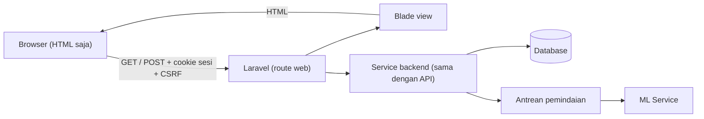

# PRODUCT REQUIREMENTS DOCUMENT (PRD)

## HTML Frontend — STIKSAFE-67

| | |
|---|---|
| **Nama Produk** | STIKSAFE-67 (angka 67 merujuk angkatan 2026–2027) |
| **Jenis Produk** | Website pemindaian file berbasis Machine Learning (ML) |
| **Komponen** | Struktur HTML (Laravel Blade): **tanpa CSS dan tanpa JavaScript** |
| **Pelaksana HTML** | 1 orang (dikerjakan sendiri) |
| **Mitra** | Backend Laravel (kontrak route, field, dan data tampilan) |
| **Dokumen terpisah** | PRD Backend, PRD ML, PRD Pengujian, PRD Dokumentasi (lihat 0.3) |
| **Versi Dokumen** | 2.0 |
| **Status** | Draft siap digunakan sebagai acuan pengembangan |
| **Tanggal** | 20 November 2026 |
| **Menggantikan** | PRD HTML v1.0 (nama lama produk: STIKSAFE 6769) |
| **Sinkron dengan** | PRD Backend STIKSAFE-67 v2.2 dan PRD ML STIKSAFE-67 v2.0 |

> **Cara membaca dokumen ini.** Dokumen ini hanya mengatur **struktur dan makna HTML**. **Tidak ada CSS** (tidak ada `<style>`, atribut `style`, berkas stylesheet, atau framework CSS) dan **tidak ada JavaScript**, sehingga halaman akan tampil polos; itu memang diharapkan pada tahap ini. Setiap kebutuhan memiliki ID (contoh `FR-WEB-USR-02`, `BR-WEB-03`). Prioritas: **P0** wajib versi pertama, **P1** penting setelah fungsi inti, **P2** lanjutan. Kolom **Rujukan** menunjuk kebutuhan pada PRD Backend/ML (ID berawalan `BR-ML` atau `FR-INF/FMT/…` berasal dari PRD ML; lainnya dari PRD Backend). Teks antarmuka berbahasa Indonesia.

---

## 0. Kontrol Dokumen

### 0.1 Riwayat Revisi

| Versi | Tanggal | Perubahan |
|---|---|---|
| 1.0 | 20 Nov 2026 | Draf awal |
| 2.0 | 20 Nov 2026 | Disusun ulang mengikuti format PRD Backend v2.2. Diselaraskan dengan kontrak terbaru: status scan (`cancelled`, `rejected`), kuota dan rate limit, kode error ke teks pengguna, halaman reset password dan verifikasi email, aksi Admin (suspend, ubah role, retry scan), umpan balik hasil. Penambahan: pola *Post/Redirect/Get*, pengganti fitur JavaScript yang murni HTML (halaman konfirmasi, `<details>`, penyegaran status), halaman error 419/429/503, teks standar, pemeriksaan mandiri, risiko, dan keputusan terbuka. Hasil scan dengan status "Menunggu Hasil ML" dihapus karena bukan status backend |

### 0.2 Pelaksana dan Ruang Kerja

PRD ini khusus **struktur HTML (Blade)** dan dikerjakan **sendiri oleh satu orang**.

| Pekerjaan | Keterangan |
|---|---|
| Struktur halaman publik, autentikasi, User, dan Admin | Seluruh halaman pada Bagian 4 |
| Form, field, dan tabel | Nama field mengikuti kontrak backend (Bagian 12) |
| Layout dan komponen Blade | Layout bersama, alert, empty state, pagination, konfirmasi |
| Teks standar | Label status, label hasil, pesan error (Bagian 10) |
| Pemeriksaan mandiri | Bagian 15 |

**Titik serah-terima dengan backend:** route dan nama field (Bagian 12.1) serta data yang tersedia pada tiap view (12.2) disepakati sebelum halaman dibuat. Perubahan route, field, atau kode error di backend diberitahukan agar HTML ikut diperbarui.

**Karena dikerjakan sendiri:** tidak ada review silang otomatis. Sebagai gantinya, pelaksana memakai checklist pemeriksaan mandiri (Bagian 15), pihak backend meninjau kesesuaian route dan nama field, dan alur lengkapnya diuji lewat PRD Pengujian.

### 0.3 Dokumen Terpisah (di Luar PRD Ini)

| Dokumen | Hubungan dengan PRD HTML |
|---|---|
| PRD Backend | Sumber route, field, status scan, kode error, dan aturan bisnis yang ditampilkan |
| PRD ML | Tidak berinteraksi langsung; HTML hanya menampilkan label hasil dan keterbatasan model |
| PRD Pengujian | Menguji alur lewat halaman ini; pemeriksaan HTML murni ada di Bagian 15 dokumen ini |
| PRD Dokumentasi | Menerima bahan penjelasan alur dan peta halaman |
| Tahap CSS dan JavaScript | **Belum ada.** Dikerjakan terpisah pada tahap lanjutan (2.3) |

---

## 1. Ringkasan Eksekutif

### 1.1 Gambaran Dokumen

STIKSAFE-67 memungkinkan pengguna mengunggah file, memindainya lewat layanan ML, lalu melihat hasil dan riwayat. Dokumen ini menetapkan **seluruh halaman, elemen HTML, field form, tabel, dan teks** untuk sisi tampilan. Halaman dirender server-side oleh Laravel Blade; browser **tidak** memanggil ML dan **tidak** menjalankan skrip apa pun.

### 1.2 Tujuan

1. Menentukan seluruh halaman dan struktur elemen HTML.
2. Menentukan field form, tabel, navigasi, pesan, dan area data.
3. Menetapkan standar semantic HTML dan aksesibilitas.
4. Menyamakan kontrak tampilan dengan backend dan hasil ML.
5. Memastikan setiap fungsi dapat berjalan **tanpa CSS dan tanpa JavaScript**.

### 1.3 Bukan Tujuan

- CSS dalam bentuk apa pun: warna, font, layout visual, animasi, *responsive styling*, dan framework CSS.
- JavaScript, termasuk polling otomatis, dialog interaktif, dan validasi sisi klien.
- Implementasi backend, API, dan algoritma ML.
- Menentukan hasil scan secara manual atau membuat hasil tiruan di produksi.
- Pengujian dengan malware sungguhan.

### 1.4 Prinsip

| Prinsip | Konsekuensi |
|---|---|
| **HTML semantik** | Elemen dipilih menurut makna; tiap halaman punya `<title>` unik dan satu `<main>` |
| **Terbaca tanpa CSS** | Urutan DOM sudah logis; informasi tidak bergantung pada warna atau posisi |
| **Cukup HTML** | Fitur yang biasanya memakai JavaScript diganti pola HTML murni (10.6) |
| **Data dari Laravel** | Semua data dinamis berasal dari backend; tidak ada angka atau hasil yang ditulis tetap |
| **Jujur tentang hasil** | Tidak pernah menyatakan file aman sebelum hasil valid; selalu menyertakan keterbatasan (BR-18) |
| **Kegagalan bukan `safe`** | Status gagal/dibatalkan/ditolak ditampilkan sebagai proses yang tidak selesai, bukan sebagai hasil |
| **Aman dari tampilan** | Semua data di-*escape*; tidak ada path server, token, atau stack trace |
| **Backend sebagai penegak** | HTML hanya mengatur tampilan; otorisasi dan validasi akhir ada di Laravel |

---

## 2. Ruang Lingkup

### 2.1 Termasuk dalam PRD HTML

| Area | Rincian |
|---|---|
| Kerangka dokumen | `<!DOCTYPE html>`, `lang="id"`, charset, viewport, title, header, nav, main, footer |
| Halaman publik dan autentikasi | Landing, login, registrasi, lupa/reset password, verifikasi email |
| Halaman User | Dashboard, upload/scan, detail dan hasil scan, riwayat, notifikasi, profil |
| Halaman Admin | Dashboard, pengguna, scan, audit log, pengaturan |
| Halaman sistem | Konfirmasi aksi, error 403/404/419/429/500/503 |
| Form dan tabel | Field, tipe input, atribut HTML, validasi dasar browser, tabel semantik |
| Teks standar | Label status, label hasil, pesan error, disclaimer |
| Layout Blade | Layout bersama dan komponen berulang |

### 2.2 Tidak Termasuk

| Bagian | Keterangan |
|---|---|
| CSS (`<style>`, `style=`, `<link rel="stylesheet">`, framework CSS) | Tahap terpisah |
| JavaScript (`<script>`, atribut `onclick`, dan sejenisnya) | Tahap terpisah |
| Backend, API, dan ML | PRD Backend dan PRD ML |
| Pengujian lengkap alur | PRD Pengujian |
| Gambar, ikon, font, atau sumber daya eksternal (CDN) | Tidak dipakai pada tahap ini |

### 2.3 Pengembangan Lanjutan

Tahap CSS (tampilan dan responsif), tahap JavaScript (penyegaran status otomatis, dialog konfirmasi, validasi sisi klien), halaman bantuan, dukungan beberapa bahasa, dan penyempurnaan halaman 2FA.

### 2.4 Asumsi

- Laravel merender halaman dengan Blade (*server-side*) memakai sesi cookie dan CSRF (DEC-HTML-01). Route web memakai *service* yang sama dengan API backend sehingga aturan bisnis dan kode error identik.
- Backend menyediakan variabel yang dibutuhkan tiap view (12.2).
- Pengguna memakai browser modern; fitur tidak bergantung pada JavaScript.
- Waktu disimpan UTC oleh backend; HTML menampilkan waktu yang sudah diformat Laravel dengan zona yang disebut jelas (DEC-HTML-05).
- Pelaksana HTML satu orang.

---

## 3. Aktor, Peran, dan Hak Akses

### 3.1 Peran

| Peran | Keterangan |
|---|---|
| **Pengunjung** | Belum login; hanya halaman publik dan autentikasi |
| **User** | Pengguna layanan pemindaian |
| **Admin** | Pengelola sistem |

Penguji memakai akun User/Admin yang sama (akun uji pada PRD Pengujian); tidak ada peran khusus di HTML.

### 3.2 Akses Halaman

Legenda: ✔ boleh · ✘ ditolak

| Halaman | Pengunjung | User | Admin |
|---|:--:|:--:|:--:|
| Landing, login, registrasi, lupa/reset password | ✔ | ✘ (diarahkan ke dashboard) | ✘ (diarahkan ke dashboard) |
| Verifikasi email | ✘ | ✔ | ✔ |
| Dashboard, scan, detail scan, riwayat, notifikasi, profil | ✘ | ✔ (milik sendiri) | ✔ (milik sendiri) |
| Halaman `/admin/*` | ✘ | ✘ | ✔ |

**Aturan:**
1. HTML hanya menampilkan menu sesuai peran; **Laravel tetap memeriksa autentikasi dan otorisasi pada setiap halaman dan aksi**.
2. Halaman privat tanpa login mengarahkan ke login.
3. User yang membuka `/admin/*` mendapat halaman **403**.
4. Scan milik pengguna lain mendapat halaman **404** (sama dengan scan yang tidak ada; BR-03).

---

## 4. Arsitektur dan Peta Halaman

### 4.1 Alur Komponen



Browser hanya berbicara dengan Laravel. ML tidak pernah dipanggil dari HTML.

### 4.2 Pola Dasar

| Pola | Aturan |
|---|---|
| **Post/Redirect/Get** | Setiap `POST` berakhir dengan *redirect* ke halaman `GET`, agar muat ulang halaman tidak mengirim form dua kali |
| **Flash message** | Pesan sukses/error dari aksi dibawa lewat sesi Laravel dan ditampilkan sekali di halaman tujuan |
| **Filter dan pagination** | Memakai form `method="get"` dan tautan, bukan skrip |
| **Aksi berisiko** | Memakai halaman konfirmasi, bukan dialog JavaScript (10.6) |

### 4.3 Peta Halaman

```text
STIKSAFE-67
├── Publik
│   ├── Landing Page            (/)
│   ├── Login                   (/login)
│   ├── Registrasi              (/register)
│   ├── Lupa Password           (/forgot-password)
│   ├── Reset Password          (/reset-password/{token})
│   └── Verifikasi Email        (/email/verify)
├── User
│   ├── Dashboard               (/dashboard)
│   ├── Scan File               (/scan)
│   ├── Detail & Hasil Scan     (/scans/{id})
│   ├── Riwayat                 (/history)
│   ├── Notifikasi              (/notifications)
│   ├── Profil                  (/profile)
│   └── Konfirmasi Aksi         (/confirm)
├── Admin
│   ├── Dashboard               (/admin)
│   ├── Pengguna                (/admin/users)
│   ├── Detail Pengguna         (/admin/users/{id})
│   ├── Pemantauan Scan         (/admin/scans)
│   ├── Detail Scan             (/admin/scans/{id})
│   ├── Audit Log               (/admin/audit-logs)
│   └── Pengaturan              (/admin/settings)
└── Halaman Sistem
    └── Error 403, 404, 419, 429, 500, 503
```

Nama route dapat disesuaikan dengan implementasi Laravel selama fungsinya sama dan disepakati dengan backend (12.1). Halaman **detail scan** memiliki tiga varian tampilan menurut status (7.3), sehingga halaman terpisah "processing" dan "result" pada v1.0 digabung (DEC-HTML-04).

---

## 5. Kerangka Dokumen HTML dan Layout

### 5.1 Kerangka Dasar

Seluruh halaman memakai layout Blade berikut (tanpa CSS dan tanpa skrip):

```html
<!DOCTYPE html>
<html lang="id">
<head>
    <meta charset="UTF-8">
    <meta name="viewport" content="width=device-width, initial-scale=1.0">
    <title>@yield('title') | STIKSAFE-67</title>
</head>
<body>
    <a href="#main-content">Lewati ke konten utama</a>

    <header>
        <p>STIKSAFE-67</p>
        <nav aria-label="Navigasi utama">
            <!-- Menu sesuai peran -->
        </nav>
    </header>

    <main id="main-content">
        @include('components.alert')
        @yield('content')
    </main>

    <footer>
        <p>STIKSAFE-67 — angkatan 2026–2027</p>
    </footer>
</body>
</html>
```

### 5.2 Aturan Kerangka

| Aturan | Keterangan |
|---|---|
| `lang="id"`, charset UTF-8, viewport | Wajib di setiap halaman |
| `<title>` | Unik, format `Judul Halaman | STIKSAFE-67` |
| Satu `<main id="main-content">` | Tautan "Lewati ke konten utama" ada di awal `<body>` |
| Satu `<h1>` | Heading berurutan (`h1` → `h2` → `h3`) tanpa melompat |
| Tidak ada `<style>`, `style=`, `<link rel="stylesheet">`, `<script>`, atribut event (`onclick`, dst.) | Diperiksa pada 15 |
| Tidak ada atribut presentasional lama | Tanpa `<font>`, `<center>`, `align`, `bgcolor`, `border` |
| Tidak ada sumber daya eksternal | Tanpa CDN, font web, atau gambar dari luar |
| `class` | Tidak diperlukan pada tahap ini; `id` hanya untuk label–input, `aria-*`, dan anchor |

### 5.3 Navigasi Menurut Peran

| Peran | Item navigasi (urut) |
|---|---|
| Pengunjung | Beranda, Masuk, Daftar |
| User | Dashboard, Scan File, Riwayat, Notifikasi (dengan jumlah belum dibaca), Profil, Keluar |
| Admin | Dashboard Admin, Pengguna, Scan, Audit Log, Pengaturan, serta menu User bila Admin juga memakai fitur scan; Keluar |

- Menu berupa daftar tautan (`<ul><li><a>`); halaman aktif ditandai `aria-current="page"`.
- **Keluar** adalah **form `POST`** dengan CSRF dan `<button>`, bukan tautan `GET`.
- Tautan dipakai untuk pindah halaman; `<button>` dipakai untuk aksi.

---

## 6. Spesifikasi Halaman Publik dan Autentikasi

Setiap form yang mengubah data memakai `method="post"` dan `@csrf`. Pesan kesalahan ditampilkan di atas form (ringkasan) dan di dekat field terkait (10.1).

### 6.1 Landing Page

`FR-WEB-PUB-01` · `/` · **P0**

- Header dengan identitas STIKSAFE-67 dan navigasi: Beranda, Fitur, Alur, Tentang, Kontak (tautan anchor ke bagian yang memang ada); tautan **Masuk** dan **Daftar**.
- Hero `<section>` dengan **satu** `<h1>`, deskripsi singkat, dan tautan **Daftar**.
- `<section id="fitur">`: unggah file, analisis ML, klasifikasi hasil (`safe`, `suspicious`, `malicious`, `unknown`), dan riwayat.
- `<section id="alur">`: `<ol>` langkah penggunaan (daftar/masuk → unggah file → antre dan dianalisis → lihat hasil → buka riwayat).
- Bagian keterbatasan: hasil adalah **prediksi model**, bukan jaminan keamanan mutlak.
- Footer dengan identitas proyek.

**Penerimaan:** tautan Masuk/Daftar berfungsi; tidak ada tombol palsu; tidak ada klaim keamanan mutlak; tidak ada angka statistik yang ditulis tetap.

### 6.2 Login

`FR-WEB-PUB-02` · `/login` · **P0** · Rujukan: FR-AUTH-02, FR-AUTH-13

| Label | `name` | `type` | Atribut | Ketentuan |
|---|---|---|---|---|
| Email | `email` | `email` | `required`, `autocomplete="username"` | Wajib |
| Kata sandi | `password` | `password` | `required`, `autocomplete="current-password"` | Wajib; tidak pernah ditampilkan ulang |

- Heading "Masuk", form `POST`, tombol "Masuk", tautan ke Registrasi dan Lupa Password.
- Pesan gagal login **sama** untuk email salah maupun email tidak terdaftar (tidak membocorkan keberadaan akun): "Email atau kata sandi salah."
- Kasus lain: terlalu banyak percobaan (`RATE_LIMITED`), akun dibatasi (`AUTH_ACCOUNT_SUSPENDED`), email belum diverifikasi (arahkan ke 6.6); teks pada 10.4.
- Email boleh diisi ulang setelah gagal; kata sandi tidak.

### 6.3 Registrasi

`FR-WEB-PUB-03` · `/register` · **P0** · Rujukan: FR-AUTH-01, FR-AUTH-08, BR-01

| Label | `name` | `type` | Atribut | Ketentuan |
|---|---|---|---|---|
| Nama lengkap | `name` | `text` | `required`, `maxlength="120"`, `autocomplete="name"` | Wajib |
| Email | `email` | `email` | `required`, `maxlength="254"`, `autocomplete="email"` | Wajib dan unik |
| Kata sandi | `password` | `password` | `required`, `minlength="12"`, `autocomplete="new-password"` | Sesuai kebijakan |
| Konfirmasi kata sandi | `password_confirmation` | `password` | `required`, `minlength="12"`, `autocomplete="new-password"` | Harus sama |
| Setuju dengan syarat penggunaan | `accept_terms` | `checkbox` | `required` | Wajib |

- Petunjuk kebijakan di dekat field kata sandi (dihubungkan dengan `aria-describedby`): minimal 12 karakter, tidak sama dengan email, hindari kata sandi umum.
- **Tidak ada** pilihan role. Role akun baru ditetapkan backend sebagai User.
- Setelah sukses: *redirect* ke halaman verifikasi email (bila diwajibkan, DEC-13 Backend) atau ke dashboard.

### 6.4 Lupa Password

`FR-WEB-PUB-04` · `/forgot-password` · **P1** · Rujukan: FR-AUTH-06

- Field `email` (`type="email"`, `required`).
- Respons **selalu** generik: "Jika email terdaftar, tautan untuk mengatur ulang kata sandi telah dikirim." (tidak membedakan email terdaftar atau tidak).
- Pembatasan percobaan ditampilkan sebagai pesan jeda (`RATE_LIMITED`).

### 6.5 Reset Password

`FR-WEB-PUB-05` · `/reset-password/{token}` · **P1** · Rujukan: FR-AUTH-06

- Field: `token` (hidden), `email`, `password`, `password_confirmation` (kedua kata sandi: `required`, `minlength="12"`, `autocomplete="new-password"`).
- Token tidak valid/kedaluwarsa/sudah dipakai: "Tautan tidak valid atau sudah kedaluwarsa. Minta tautan baru." dengan tautan ke 6.4.
- Karena token ada di URL, halaman ini **tidak boleh** memuat tautan atau sumber daya ke situs luar; backend mengirim header `Referrer-Policy: no-referrer`.
- Setelah sukses: *redirect* ke login dengan pesan sukses.

### 6.6 Verifikasi Email

`FR-WEB-PUB-06` · `/email/verify` · **P1** (P0 bila verifikasi diwajibkan) · Rujukan: FR-AUTH-05

- Penjelasan bahwa email verifikasi telah dikirim dan langkah selanjutnya.
- Form `POST` dengan tombol "Kirim ulang email verifikasi" (dibatasi laju; pesan jeda bila `RATE_LIMITED`).
- Form `POST` "Keluar".
- Tautan verifikasi di email ditangani Laravel; halaman hasil menampilkan sukses atau tautan tidak valid/kedaluwarsa.

### 6.7 Verifikasi Dua Langkah (Admin)

`FR-WEB-PUB-07` · `/two-factor-challenge` · **P2** · Rujukan: FR-AUTH-09

- Field `code` (`type="text"`, `inputmode="numeric"`, `autocomplete="one-time-code"`, `required`) dan opsi `recovery_code`. Nama field dikonfirmasi dengan backend.
- Kode salah: "Kode tidak valid." tanpa detail lain.

---

## 7. Spesifikasi Halaman User

Semua halaman di bagian ini memerlukan login. Data selalu dibatasi pada akun yang sedang login.

### 7.1 Dashboard User

`FR-WEB-USR-01` · `/dashboard` · **P0** · Rujukan: FR-DSH-01, FR-DSH-05

- Heading "Dashboard" dan sapaan memakai nama dari backend (di-*escape*).
- Ringkasan memakai `<dl>` atau tabel: total scan; jumlah `safe`, `suspicious`, `malicious`, `unknown`; sedang berjalan (`queued` + `processing`); tidak selesai (`failed`/`cancelled`/`rejected`, **dihitung terpisah** dan tidak masuk hitungan hasil).
- Sisa kuota scan hari ini bila disediakan backend.
- Tautan "Scan File".
- Tabel **scan terbaru** (10 baris): nama file, waktu, status/hasil, tautan "Lihat Detail".
- Empty state: "Belum ada scan. Mulai dengan memindai file pertama Anda."
- Keterangan "Diperbarui pada" memakai `<time>`.

### 7.2 Scan File (Upload)

`FR-WEB-USR-02` · `/scan` · **P0** · Rujukan: FR-FILE-01, FR-FILE-02, FR-FILE-06, FR-FILE-07

| Label | `name` | `type` | Atribut | Ketentuan |
|---|---|---|---|---|
| Pilih file | `file` | `file` | `required`, `accept` (petunjuk dari backend) | Satu file; tanpa `multiple` |
| (tersembunyi) | `idempotency_key` | `hidden` | — | Dibuat Laravel per tampilan form (DEC-HTML-03) |

- Heading "Scan File", penjelasan singkat proses (file diterima → antre → dianalisis → hasil).
- Form `method="post"` dengan `enctype="multipart/form-data"` dan `@csrf`; tombol "Mulai Scan".
- Informasi dari backend: **format yang didukung**, **batas ukuran**, dan **sisa kuota**; tidak ditulis tetap di HTML.
- Peringatan: unggah hanya file yang Anda berhak analisis; hasil adalah prediksi model; jangan menutup halaman sampai konfirmasi muncul (tidak ada indikator progres tanpa JavaScript).
- `accept` hanya petunjuk browser, **bukan pengaman**; backend memvalidasi ulang ekstensi, isi, dan ukuran.
- Setelah sukses: *redirect* ke `/scans/{id}` dengan pesan "File diterima dan masuk antrean."
- Keadaan yang disediakan: belum memilih file (validasi browser), format ditolak, file kosong, ukuran melebihi batas, kuota habis, antrean penuh, mode pemeliharaan, dan upload gagal. Teks pada 10.4.

### 7.3 Detail dan Hasil Scan

`FR-WEB-USR-03` · `/scans/{id}` · **P0** · Rujukan: FR-HIS-02, FR-SCN-15, BR-08, BR-18

**Bagian umum (semua varian):** heading "Detail Scan", ID scan, nama file (di-*escape*), ukuran, jenis file terdeteksi, waktu upload (`<time>`), status proses (label 10.2), dan tautan kembali ke Riwayat.

| Varian | Status backend | Isi tambahan |
|---|---|---|
| **A. Berjalan** | `queued`, `processing` | Heading "Pemindaian Sedang Berlangsung"; pesan agar tidak mengirim file yang sama berulang dan bahwa hasil akan tersedia di Riwayat; tautan/tombol **"Segarkan status"** (`GET`); aksi **Batalkan** (menuju konfirmasi); opsional penyegaran otomatis `<meta http-equiv="refresh">` (DEC-HTML-06). **Tidak** menampilkan hasil dan **tidak** ada persentase progres |
| **B. Selesai** | `completed` | Heading "Hasil Pemindaian"; label hasil (10.2) berupa teks; skor model bila tidak kosong; versi model; waktu mulai dan selesai; ketersediaan file ("File asli: tersedia" / "sudah dihapus sesuai kebijakan retensi"); disclaimer (10.3); form umpan balik (P1, di bawah); aksi Hapus dari riwayat (konfirmasi) |
| **C. Tidak selesai** | `failed`, `cancelled`, `rejected` | Heading "Pemindaian Tidak Selesai"; status dan **pesan aman** dari kode error (10.4); **tanpa** label hasil; tidak disamakan dengan `unknown`; tautan "Pindai file lain" |

**Aturan:**
- Skor model ditampilkan sebagai angka 0–1 dengan keterangan bahwa itu *skor model, bukan persentase peluang*, selama belum dinyatakan terkalibrasi (DEC-HTML-09). Bila kosong, tidak ada angka yang dibuat-buat.
- Tidak menampilkan path server, token, stack trace, atau informasi sensitif. Hash SHA-256 boleh ditampilkan dalam `<code>`.
- Tidak ada status "Menunggu Hasil ML": backend hanya mengenal `queued`/`processing`.
- Pengguna yang bukan pemilik mendapat halaman **404**.

**Form umpan balik (P1)** · Rujukan: FR-HIS-07: `type` (radio: `false_positive`, `false_negative`, `other`; label "Hasil terlalu curiga/berbahaya", "Hasil melewatkan ancaman", "Lainnya"), `comment` (`textarea`, `maxlength="1000"`), tombol "Kirim Umpan Balik". Satu umpan balik aktif per scan; pesan sukses setelah *redirect*.

### 7.4 Riwayat Scan

`FR-WEB-USR-04` · `/history` · **P0** · Rujukan: FR-HIS-01, FR-HIS-03, FR-HIS-04, FR-HIS-05

**Form pencarian dan filter** (`method="get"`, dalam `<fieldset>` dengan `<legend>` "Cari dan saring"):

| Label | `name` | `type` |
|---|---|---|
| Cari nama file atau ID | `q` | `search` |
| Status | `filter[status]` | `select` (semua, menunggu antrean, sedang dianalisis, selesai, gagal, dibatalkan, ditolak) |
| Hasil | `filter[result]` | `select` (semua, `safe`, `suspicious`, `malicious`, `unknown`) |
| Dari tanggal | `filter[from]` | `date` |
| Sampai tanggal | `filter[to]` | `date` |
| Urutkan | `sort` | `select` (`-created_at` terbaru, `created_at` terlama) |

Tombol "Terapkan" dan tautan "Atur ulang".

**Tabel** (`<caption>`, `<thead>`, `<tbody>`, `<th scope="col">`): No, Nama file, Waktu upload, Status, Hasil (strip "—" bila belum ada hasil), Aksi (**Lihat Detail**, **Hapus**).

- Pagination (`?page=`): "Halaman X dari Y", tautan Sebelumnya/Berikutnya dan nomor halaman; default 20 per halaman, maksimum 100.
- Empty state: "Belum ada riwayat scan." atau "Tidak ada hasil untuk pencarian ini."
- **Hapus** menuju halaman konfirmasi (7.7). Hanya riwayat akun yang sedang login.

### 7.5 Notifikasi

`FR-WEB-USR-05` · `/notifications` · **P1** · Rujukan: FR-NTF-01, FR-NTF-02

- Daftar `<ul>`: judul, pesan, waktu, tautan ke scan, dan status baca dalam teks ("Belum dibaca"/"Sudah dibaca").
- Form `POST` per item "Tandai dibaca" dan satu form "Tandai semua dibaca".
- Jumlah belum dibaca juga tampil pada navigasi.
- Empty state: "Belum ada notifikasi." Pagination seperti 7.4.

### 7.6 Profil

`FR-WEB-USR-06` · `/profile` · **P1** · Rujukan: FR-USR-01, FR-AUTH-07, FR-USR-03

- **Data akun:** nama, email (teks, tidak dapat diubah pada tahap ini), tanggal akun dibuat.
- **Form ubah nama:** `name` (`required`, `maxlength="120"`).
- **Form ganti kata sandi:** `current_password`, `password`, `password_confirmation` (semuanya `type="password"`, `required`, atribut `autocomplete` yang sesuai; `minlength="12"` pada dua yang baru). Keterangan bahwa sesi di perangkat lain akan diakhiri.
- **Hapus akun:** keterangan masa tenggang (default 14 hari) dan tautan ke konfirmasi; bila sudah diminta, tampil status dan tombol "Batalkan penghapusan".
- Kata sandi tersimpan tidak pernah ditampilkan.

### 7.7 Konfirmasi Aksi

`FR-WEB-USR-07` · `/confirm` (satu template Blade, route per aksi) · **P0** · Pengganti dialog JavaScript

Dipakai untuk: hapus riwayat, batalkan scan, hapus akun, dan (Admin) suspend/aktifkan akun, ubah role, retry/batalkan scan.

- Heading judul aksi; penjelasan konsekuensi; ringkasan target (mis. nama file/ID).
- Form `POST` (dengan `@method` bila perlu) berisi field yang diperlukan (mis. `reason`, `password`), tombol "Ya, lanjutkan", dan tautan "Batal" yang kembali ke halaman sebelumnya.
- Setelah aksi: *redirect* dengan pesan hasil.

---

## 8. Spesifikasi Halaman Admin

Seluruh halaman `/admin/*` hanya untuk Admin (403 bagi lainnya). Setiap aksi yang mengubah data memakai form `POST` + `@csrf` dan, untuk aksi berisiko, halaman konfirmasi (7.7). Aksi hanya ditampilkan bila backend sudah menyediakannya.

### 8.1 Dashboard Admin

`FR-WEB-ADM-01` · `/admin` · **P0** · Rujukan: FR-DSH-02, FR-ML-06

- Total akun per status, total scan, distribusi hasil (`safe`/`suspicious`/`malicious`/`unknown`), jumlah scan tidak selesai (`failed`, `cancelled`, `rejected`).
- **Scan 30 hari terakhir** dalam tabel (tanggal | jumlah); tanpa grafik.
- **Antrean:** kedalaman dan usia job tertua.
- **Status layanan ML:** tersedia/tidak, versi model, status *circuit breaker*, waktu pengecekan terakhir.
- Aktivitas terbaru (ringkas) dan keterangan "Diperbarui pada".
- Seluruh angka berasal dari backend.

### 8.2 Manajemen Pengguna

`FR-WEB-ADM-02` · `/admin/users` · **P1** · Rujukan: FR-USR-04

- Filter `method="get"`: `q` (nama/email), `filter[status]`, `filter[role]`, `filter[from]`, `filter[to]`.
- Tabel: ID, nama, email, role, status, tanggal registrasi, aksi **Detail**; pagination.
- Tidak menampilkan hash kata sandi, rahasia 2FA, atau token.

### 8.3 Detail Pengguna

`FR-WEB-ADM-03` · `/admin/users/{id}` · **P1** · Rujukan: FR-USR-05, FR-USR-06, FR-USR-07, BR-05

- Data: ID, nama, email, role, status dan alasan status, tanggal dibuat, login terakhir, ringkasan jumlah scan per status.
- **Suspend:** form dengan `reason` (`textarea`, `required`) lalu konfirmasi; **Aktifkan kembali** dengan konfirmasi.
- **Ubah role:** form dengan `role` (`select`: User/Admin) dan `password` (konfirmasi kata sandi Admin; `type="password"`, `required`, `autocomplete="current-password"`).
- **Paksa logout** dengan konfirmasi.
- Penolakan dari backend ditampilkan apa adanya sebagai pesan jelas (mis. tidak boleh mengubah akun sendiri atau Admin terakhir).
- Admin tidak melihat kata sandi pengguna.

### 8.4 Pemantauan Scan

`FR-WEB-ADM-04` · `/admin/scans` · **P0** · Rujukan: FR-HIS-08

- Filter `method="get"`: `q`, `filter[status]` (termasuk `failed`), `filter[result]`, `filter[user]`, `filter[from]`, `filter[to]`.
- Tabel: ID scan, pemilik, nama file, waktu dibuat, status, hasil, durasi, kode error (untuk yang gagal), aksi **Detail**; pagination.
- Status yang dipetakan: `queued`, `processing`, `completed`, `failed`, `cancelled`, `rejected` (label 10.2).

### 8.5 Detail Scan (Admin)

`FR-WEB-ADM-05` · `/admin/scans/{id}` · **P0** · Rujukan: FR-SCN-11, FR-ML-03, BR-10, BR-13

- Informasi scan, pemilik, status, hasil, skor, versi model, `error_code` dan pesan aman, waktu antre/mulai/selesai, durasi, jumlah percobaan.
- **Daftar percobaan** di dalam `<details><summary>`: nomor, pemicu (`initial`/`auto_retry`/`manual_retry`), status, kode error, mulai, selesai, durasi.
- Aksi: **Retry** (hanya untuk `failed` yang dapat diulang) dan **Batalkan** (untuk `queued`/`processing`), keduanya lewat konfirmasi.
- **Tidak** ada tombol untuk mengeksekusi atau mengunduh isi file asli (kebijakan default).

### 8.6 Audit Log

`FR-WEB-ADM-06` · `/admin/audit-logs` · **P1** · Rujukan: FR-AUD-01, FR-AUD-03, FR-AUD-04

- Filter `method="get"`: `actor`, `action` (`select` dari katalog peristiwa), `outcome`, `from`, `to`.
- Tabel: waktu, aktor, aksi, target, hasil, severity, `request_id`.
- Navigasi **kursor**: tautan "Sebelumnya"/"Berikutnya" (bukan nomor halaman).
- Tidak ada aksi ubah/hapus. Password, token, dan isi file tidak pernah tampil; metadata tambahan hanya bila kebijakan mengizinkan.

### 8.7 Pengaturan Sistem

`FR-WEB-ADM-07` · `/admin/settings` · **P2** · Rujukan: FR-SET-01, FR-SET-02, BR-17

- Form dengan `<fieldset>`/`<legend>` per kelompok. Hanya pengaturan yang benar-benar didukung backend:

| Kelompok | Kunci pengaturan | `type` |
|---|---|---|
| Upload | `upload.max_file_size_mb`, `upload.daily_scan_quota`, `upload.max_active_scans` | `number` (dengan `min`/`max` dari backend) |
| Laju | `rate.upload_per_minute` | `number` |
| Retensi | `retention.file_days` | `number` |
| Antrean | `queue.overload_threshold` | `number` |
| Pemeliharaan | `maintenance.enabled` | `checkbox` |

- Atribut `name` memakai notasi larik, mis. `settings[upload.max_file_size_mb]`, karena PHP mengubah titik pada nama field di luar kurung siku menjadi garis bawah.
- Perubahan dikonfirmasi; validasi dilakukan server; peringatan bila nilai melebihi batas PHP/web server.
- **Tidak pernah** menampilkan secret key, kata sandi database, token API, `ml.service_token`, `ml.callback_secret`, atau kredensial lain.

---

## 9. Komponen HTML Standar

| Komponen | Aturan |
|---|---|
| **Navigasi** | `<nav aria-label="Navigasi utama">` berisi daftar tautan; halaman aktif memakai `aria-current="page"` |
| **Form** | Setiap input memiliki `<label for>` yang terlihat; tipe input tepat; `<fieldset>`/`<legend>` untuk kelompok field; bantuan dan pesan error dihubungkan dengan `aria-describedby`; form pengubah data memakai `@csrf` |
| **Tabel** | `<caption>`, `<thead>`, `<tbody>`, `<th scope="col">`; tidak dipakai untuk layout |
| **Pesan** | Struktur untuk sukses, informasi, peringatan, dan error (10.1) |
| **Pagination** | Tautan "Sebelumnya", "Berikutnya", dan nomor halaman dengan teks "Halaman X dari Y" di dalam `<nav aria-label="Navigasi halaman">` |
| **Waktu** | `<time datetime="2026-11-20T02:00:12Z">teks terformat beserta zona</time>` |
| **Detail tambahan** | `<details><summary>` untuk isi yang boleh disembunyikan (mis. daftar percobaan) |
| **Daftar ringkasan** | `<dl><dt><dd>` untuk pasangan label–nilai (mis. ringkasan dashboard) |
| **Konfirmasi** | Halaman konfirmasi (7.7) |
| **Komponen Blade** | `alert`, `empty-state`, `pagination`, `navigation`, `footer` (Bagian 14) |

**Contoh form login** (tanpa CSS dan skrip):

```html
<h1>Masuk</h1>
<form method="post" action="{{ route('login') }}">
    @csrf
    <p>
        <label for="email">Email</label>
        <input id="email" name="email" type="email" value="{{ old('email') }}"
               required autocomplete="username" aria-describedby="email-error">
        @error('email')<span id="email-error">{{ $message }}</span>@enderror
    </p>
    <p>
        <label for="password">Kata sandi</label>
        <input id="password" name="password" type="password"
               required autocomplete="current-password">
    </p>
    <button type="submit">Masuk</button>
</form>
```

**Contoh tabel riwayat:**

```html
<table>
    <caption>Daftar scan milik Anda</caption>
    <thead>
        <tr>
            <th scope="col">No</th>
            <th scope="col">Nama file</th>
            <th scope="col">Waktu upload</th>
            <th scope="col">Status</th>
            <th scope="col">Hasil</th>
            <th scope="col">Aksi</th>
        </tr>
    </thead>
    <tbody>
        @foreach ($scans as $scan)
        <tr>
            <td>{{ $loop->iteration }}</td>
            <td>{{ $scan->filename }}</td>
            <td><time datetime="{{ $scan->uploaded_at_iso }}">{{ $scan->uploaded_at_label }}</time></td>
            <td>{{ $scan->status_label }}</td>
            <td>{{ $scan->result_label ?? '—' }}</td>
            <td><a href="{{ route('scans.show', $scan->id) }}">Lihat Detail</a></td>
        </tr>
        @endforeach
    </tbody>
</table>
```

Seluruh data memakai `{{ }}` (otomatis di-*escape*); `{!! !!}` **tidak dipakai** untuk data pengguna (13).

---

## 10. Pesan, Status, dan Keadaan Halaman

### 10.1 Struktur Pesan

| Jenis | Struktur HTML |
|---|---|
| **Ringkasan error form** | Di atas form: `<section role="alert" aria-labelledby="error-title">` dengan `<h2 id="error-title">Terjadi kesalahan</h2>` dan `<ul>` berisi tautan ke field (`<a href="#email">`) |
| **Error per field** | `<span id="…-error">` di dekat field, dihubungkan lewat `aria-describedby` |
| **Sukses (flash)** | `<p role="status">` di atas konten, tampil sekali |
| **Informasi/peringatan** | `<p>` dengan awalan teks yang jelas ("Perhatian:") |
| **Empty state** | `<p>` dengan kalimat dan tautan tindakan berikutnya |

`role="alert"` hanya untuk error; `role="status"` untuk sukses/pembaruan. Status tidak dibedakan hanya dengan warna atau ikon (tidak ada CSS pada tahap ini; teks selalu menjelaskan).

### 10.2 Label Status Proses dan Hasil

**Status proses scan** (dari backend):

| Nilai backend | Label tampilan |
|---|---|
| `queued` | Menunggu antrean |
| `processing` | Sedang dianalisis |
| `completed` | Selesai |
| `failed` | Gagal |
| `cancelled` | Dibatalkan |
| `rejected` | Ditolak |

**Hasil klasifikasi** (hanya bila `completed`; `null` ditampilkan sebagai "—"):

| Nilai backend | Label tampilan |
|---|---|
| `safe` | **Safe** — tidak ditemukan indikator berbahaya berdasarkan analisis sistem |
| `suspicious` | **Suspicious** — perlu pemeriksaan lebih lanjut |
| `malicious` | **Malicious** — diklasifikasikan berbahaya |
| `unknown` | **Unknown** — sistem tidak dapat menentukan klasifikasi |

Label hasil selalu berupa teks. `unknown` **tidak pernah** diubah menjadi `safe`; `failed`/`cancelled`/`rejected` bukan hasil dan tidak diberi label hasil.

### 10.3 Teks Standar

| Teks | Isi |
|---|---|
| Disclaimer hasil (wajib pada setiap tampilan hasil, BR-18) | "Hasil ini adalah prediksi model dan bukan jaminan keamanan mutlak. Tetap berhati-hati terhadap file yang tidak Anda kenal." |
| Keterangan skor | "Skor model berada pada skala 0–1 dan bukan persentase peluang." |
| Peringatan upload | "Unggah hanya file yang Anda berhak analisis. Jangan menutup halaman sampai konfirmasi muncul." |
| Empty riwayat | "Belum ada riwayat scan." |
| Empty hasil pencarian | "Tidak ada hasil untuk pencarian ini." |
| Empty notifikasi | "Belum ada notifikasi." |
| File dihapus | "File asli sudah dihapus sesuai kebijakan retensi. Hasil scan tetap tersimpan." |

### 10.4 Pemetaan Kode Error ke Pesan Pengguna

Backend mengirim kode error yang stabil; HTML memetakan ke teks Indonesia berikut (detail teknis tidak ditampilkan).

| Kode | Pesan untuk pengguna |
|---|---|
| `AUTH_INVALID_CREDENTIALS` | Email atau kata sandi salah. |
| `RATE_LIMITED` | Terlalu banyak percobaan. Coba lagi dalam {detik} detik. |
| `AUTH_ACCOUNT_SUSPENDED` | Akun Anda sedang dibatasi. Hubungi pengelola. |
| `AUTH_EMAIL_UNVERIFIED` | Email belum diverifikasi. Periksa kotak masuk Anda. |
| `AUTH_STEP_UP_REQUIRED` | Masukkan kata sandi Anda untuk melanjutkan. |
| `VALIDATION_FAILED` | Pesan per field dari backend. |
| `FILE_EMPTY` | File kosong tidak dapat dipindai. |
| `FILE_TOO_LARGE` | Ukuran file melebihi batas {batas}. |
| `FILE_TYPE_NOT_ALLOWED` | Jenis file ini belum didukung. |
| `FILE_CONTENT_MISMATCH` | Isi file tidak sesuai dengan jenis ekstensinya. |
| `FILE_NAME_INVALID` | Nama file tidak valid. Ganti nama file lalu coba lagi. |
| `FILE_ARCHIVE_UNSAFE` | File arsip ini tidak dapat diproses. |
| `QUOTA_EXCEEDED` | Batas scan Anda tercapai. Kuota diperbarui pada {waktu}. |
| `QUEUE_OVERLOADED` | Layanan sedang padat. Coba lagi beberapa saat lagi. |
| `MAINTENANCE_MODE` | Layanan sedang dalam pemeliharaan. Unggah file belum dapat dilakukan. |
| `SCAN_INVALID_STATE`, `SCAN_NOT_RETRYABLE` | Aksi ini tidak dapat dilakukan pada status scan saat ini. |
| `SCAN_FILE_EXPIRED` | File asli sudah dihapus sesuai kebijakan retensi. |
| `INTERNAL_ERROR` | Terjadi kesalahan pada sistem. Coba lagi nanti. |

**Alasan scan tidak selesai** (`error_code` pada scan berstatus `failed`/`rejected`):

| Kode | Pesan untuk User |
|---|---|
| `ML_UNSUPPORTED_FILE` | Jenis file ini belum dapat dianalisis oleh model. |
| `ML_FILE_CORRUPT` | File tidak dapat dibaca atau rusak. |
| `ML_PREPROCESSING_FAILED` | File tidak dapat diproses untuk dianalisis. |
| `ML_TIMEOUT`, `SCAN_TIMEOUT` | Pemindaian melewati batas waktu. Silakan coba lagi. |
| `ML_UNAVAILABLE`, `ML_OVERLOADED` | Layanan analisis sedang tidak tersedia. Silakan coba lagi nanti. |
| Kode lain (`ML_INVALID_RESPONSE`, `ML_INTEGRITY_MISMATCH`, `ML_INTERNAL_ERROR`, dan seterusnya) | Pemindaian gagal karena kendala teknis. Silakan coba lagi nanti. |

Admin dapat melihat kode aslinya pada detail scan Admin (8.5); User tidak.

### 10.5 Keadaan Halaman

| Keadaan | Isi |
|---|---|
| Sukses | Data tampil; pesan sukses setelah aksi (flash) |
| Kosong (*empty*) | Teks dan tautan tindakan berikutnya |
| Error validasi | Ringkasan error dan pesan per field |
| Belum login | Diarahkan ke login |
| Terlarang (**403**) | "Anda tidak memiliki akses ke halaman ini." |
| Tidak ditemukan (**404**) | "Halaman atau data tidak ditemukan." (termasuk scan milik orang lain) |
| Halaman kedaluwarsa (**419**) | "Halaman telah kedaluwarsa. Muat ulang halaman lalu coba lagi." |
| Dibatasi (**429**) | "Terlalu banyak permintaan. Coba lagi dalam {detik} detik." |
| Berjalan | Varian A pada 7.3 |
| Tidak selesai | Varian C pada 7.3 |
| Pemeliharaan (**503**) | "Layanan sedang dalam pemeliharaan." dan perkiraan waktu bila ada |
| Kesalahan sistem (**500**) | "Terjadi kesalahan pada sistem." dan **kode rujukan** (`request_id`) agar mudah dilaporkan |

Tidak ada keadaan "loading" khusus: tanpa JavaScript, halaman dimuat penuh oleh server. Tidak pernah menampilkan stack trace, query database, path internal, secret, atau detail teknis sensitif.

### 10.6 Pengganti Fitur JavaScript (Murni HTML)

| Kebutuhan | Penyelesaian pada tahap ini |
|---|---|
| Dialog konfirmasi | Halaman konfirmasi (7.7) |
| Status scan diperbarui | Tautan "Segarkan status"; opsional `<meta http-equiv="refresh" content="N">` hanya pada varian A (DEC-HTML-06) |
| Validasi form | Atribut HTML (`required`, `type`, `minlength`, `maxlength`) + validasi server sebagai penentu |
| Filter, urut, halaman | Form `method="get"` dan tautan |
| Menyembunyikan detail | `<details><summary>` |
| Cegah kirim ganda | Pola *Post/Redirect/Get* + `idempotency_key` tersembunyi (DEC-HTML-03) |
| Indikator progres upload | Tidak ada; diganti peringatan "jangan menutup halaman" |
| Tampilkan/sembunyikan kata sandi | Tidak ada |

Penyegaran otomatis memengaruhi aksesibilitas; karena itu tautan "Segarkan status" **selalu** tersedia, jeda penyegaran tidak kurang dari 5 detik, dan penyegaran dihentikan begitu status terminal (`completed`/`failed`/`cancelled`/`rejected`).

---

## 11. Semantic HTML dan Aksesibilitas

1. `lang="id"` pada `<html>`.
2. Setiap halaman memiliki `<title>` unik dan **satu** `<h1>`.
3. Heading tersusun hierarkis tanpa melompat.
4. Satu `<main>`; ada tautan "Lewati ke konten utama".
5. Elemen dipilih menurut makna (`nav`, `section`, `article`, `table`, `ul`/`ol`, `dl`, `time`, `details`).
6. Semua input memiliki `<label>` yang terlihat dan terhubung lewat `for`/`id`.
7. Tautan dan tombol memiliki nama aksi yang jelas ("Lihat Detail", bukan "Klik di sini").
8. Tautan dipakai untuk berpindah halaman; `<button>` untuk aksi.
9. Pesan error dihubungkan ke field (`aria-describedby`) dan diringkas di awal form.
10. Status scan dan hasil dinyatakan dengan teks, bukan hanya warna/ikon.
11. Tabel memiliki header yang benar (`<th scope="col">`) dan `<caption>` bila perlu.
12. Urutan DOM masuk akal saat dibaca tanpa CSS dan dapat dijelajahi dengan keyboard (Tab, Shift+Tab, Enter).
13. Tautan ke halaman aktif ditandai `aria-current="page"`.
14. Gambar informatif (bila ada) punya `alt`; dekoratif memakai `alt=""`. Pada tahap ini tidak ada gambar.
15. ARIA hanya dipakai bila elemen native belum cukup.
16. Jangan memakai elemen hanya demi efek visual.

---

## 12. Integrasi dengan Laravel

### 12.1 Kontrak Route dan Field

Browser hanya dapat mengirim `GET`/`POST`; metode `PUT`/`PATCH`/`DELETE` dikirim lewat field tersembunyi (`@method`). Route di bawah mencerminkan fungsi API pada PRD Backend (10.5–10.9) dan **disepakati ulang dengan backend** sebelum dibuat.

| Fitur | Route (metode) | Field HTML | Tanggung jawab Laravel |
|---|---|---|---|
| Login / keluar | `/login` (POST), `/logout` (POST) | `email`, `password` | Autentikasi, sesi, CSRF, rate limit |
| Registrasi | `/register` (POST) | `name`, `email`, `password`, `password_confirmation`, `accept_terms` | Validasi, hash, role `user` |
| Lupa / reset password | `/forgot-password`, `/reset-password` (POST) | `email`; `token`, `email`, `password`, `password_confirmation` | Token sekali pakai, pencabutan sesi lama |
| Kirim ulang verifikasi | `/email/verification-notification` (POST) | — | Email, batas laju |
| Upload | `/scan` (POST) | `file`, `idempotency_key` | Validasi file, simpan privat, buat scan, antrean, *redirect* ke `/scans/{id}` |
| Detail scan | `/scans/{id}` (GET) | — | Otorisasi pemilik (404 bila bukan), data hasil |
| Batalkan / hapus scan | `/scans/{id}/cancel` (POST), `/scans/{id}` (DELETE) | — | Transisi status, hapus file |
| Umpan balik | `/scans/{id}/feedback` (POST) | `type`, `comment` | Simpan umpan balik |
| Riwayat | `/history` (GET) | `q`, `filter[status]`, `filter[result]`, `filter[from]`, `filter[to]`, `sort`, `page` | Filter hanya milik akun |
| Notifikasi | `/notifications` (GET), `/notifications/{id}/read`, `/notifications/read-all` (POST) | — | Hanya milik akun |
| Profil | `/profile` (PUT), `/profile/password` (PUT), `/profile` (DELETE), `/profile/deletion/cancel` (POST) | `name`; `current_password`, `password`, `password_confirmation` | Pembaruan akun, masa tenggang hapus |
| Admin: pengguna | `/admin/users` (GET), `/admin/users/{id}` (GET), `…/status` (PATCH), `…/role` (PATCH), `…/force-logout` (POST) | `status`, `reason`; `role`, `password` | Otorisasi Admin, *step-up*, audit |
| Admin: scan | `/admin/scans` (GET), `/admin/scans/{id}` (GET), `…/retry`, `…/cancel` (POST) | filter GET | Otorisasi Admin, attempt baru, audit |
| Admin: audit log | `/admin/audit-logs` (GET) | `actor`, `action`, `outcome`, `from`, `to`, `cursor` | Catat dan sajikan log |
| Admin: pengaturan | `/admin/settings` (GET, PUT) | `settings[…]` | Validasi rentang, audit, cache |

### 12.2 Data Minimum untuk Setiap View

| View | Data dari Laravel |
|---|---|
| Layout | Peran pengguna, nama, jumlah notifikasi belum dibaca, flash message |
| Dashboard User | Nama, ringkasan angka (per hasil, berjalan, tidak selesai), sisa kuota, 10 scan terbaru, waktu pembaruan |
| Scan File | Format didukung, batas ukuran, sisa kuota, `idempotency_key` |
| Detail Scan | `id`, `filename`, `file` (ukuran, ekstensi, MIME, `sha256`, `available`), `status`, `result` (`label`, `confidence`, `model_version`) atau `null`, `timestamps`, `error_code`, jeda penyegaran (`poll_after_ms`) untuk varian A |
| Riwayat | Paginator (halaman, total, per halaman), nilai filter terpilih, daftar scan |
| Admin Dashboard | Statistik sistem, antrean, status ML, aktivitas terbaru |
| Admin Scan | Daftar/filter; detail dengan daftar *attempts* |
| Admin Audit | Entri log dengan kursor |
| Error | Kode status, pesan aman, `request_id`, `Retry-After` bila ada |

### 12.3 Alur Integrasi

1. Browser mengirim file ke Laravel (`POST /scan`).
2. Laravel memvalidasi file, membuat scan berstatus `queued`, dan mengantrekannya.
3. Laravel melakukan *redirect* ke `/scans/{id}` (*Post/Redirect/Get*).
4. Worker dan layanan ML memproses sesuai arsitektur backend.
5. Backend memvalidasi respons ML dan menyimpan hasil.
6. Halaman detail menampilkan data terbaru setiap kali dimuat atau disegarkan.

**HTML tidak memanggil layanan ML secara langsung.**

### 12.4 Contoh Bentuk Data untuk View

```json
{
  "id": "ID_SCAN",
  "filename": "NAMA_FILE",
  "status": "completed",
  "result": {
    "label": "safe",
    "confidence": 0.95,
    "model_version": "MODEL_VERSION"
  },
  "timestamps": {
    "uploaded_at": "TIMESTAMP",
    "completed_at": "TIMESTAMP"
  },
  "file": { "available": true }
}
```

Ini hanya contoh bentuk data (bukan hasil scan nyata). Bila `status` bukan `completed`, `result` bernilai `null`. Backend yang memvalidasi nilai label, tipe data, dan rentang `confidence`.

### 12.5 Perubahan Kontrak

Perubahan route, nama field, kode error, atau status scan di backend diberitahukan kepada pelaksana HTML dan dicatat; HTML dan teks standar (Bagian 10) diperbarui sebelum rilis berikutnya.

---

## 13. Keamanan dan Privasi

- Data dinamis memakai `{{ }}` (otomatis di-*escape*). Nama file dan input pengguna **tidak pernah** dicetak dengan `{!! !!}`.
- Semua form pengubah data memakai `@csrf`; halaman privat dilindungi autentikasi dan otorisasi backend.
- Tidak ada password, token, API key, atau kredensial ML di HTML (termasuk atribut, komentar, dan `hidden` field selain token CSRF dan `idempotency_key`).
- `accept` pada input file bukan pengaman; backend memvalidasi ulang.
- Tidak menampilkan path penyimpanan, stack trace, query database, atau konfigurasi internal.
- Tidak membuat tautan publik permanen ke file privat dan tidak menampilkan isi file otomatis.
- Tidak ada aksi untuk menjalankan file yang diunggah.
- Halaman reset password tidak memuat tautan/sumber daya eksternal (token ada di URL).
- Tautan keluar situs (bila ada) memakai `rel="noopener noreferrer"`.
- Tidak ada sumber daya pihak ketiga (CDN, font, analitik) pada tahap ini.
- Pesan error tidak membocorkan keberadaan akun atau detail internal.

---

## 14. Struktur File Blade

```text
resources/views/
├── layouts/
│   ├── app.blade.php            (User)
│   ├── auth.blade.php           (publik dan autentikasi)
│   └── admin.blade.php
├── components/
│   ├── navigation.blade.php
│   ├── footer.blade.php
│   ├── alert.blade.php
│   ├── empty-state.blade.php
│   └── pagination.blade.php
├── confirm.blade.php            (konfirmasi aksi, dipakai bersama)
├── public/
│   └── landing.blade.php
├── auth/
│   ├── login.blade.php
│   ├── register.blade.php
│   ├── forgot-password.blade.php
│   ├── reset-password.blade.php
│   ├── verify-email.blade.php
│   └── two-factor-challenge.blade.php
├── user/
│   ├── dashboard.blade.php
│   ├── scan/
│   │   ├── create.blade.php
│   │   ├── show.blade.php       (memuat varian A, B, C)
│   │   └── partials/
│   │       ├── running.blade.php
│   │       ├── result.blade.php
│   │       └── incomplete.blade.php
│   ├── history/index.blade.php
│   ├── notifications/index.blade.php
│   └── profile/index.blade.php
├── admin/
│   ├── dashboard.blade.php
│   ├── users/index.blade.php
│   ├── users/show.blade.php
│   ├── scans/index.blade.php
│   ├── scans/show.blade.php
│   ├── audit-logs/index.blade.php
│   └── settings/index.blade.php
└── errors/
    ├── 403.blade.php
    ├── 404.blade.php
    ├── 419.blade.php
    ├── 429.blade.php
    ├── 500.blade.php
    └── 503.blade.php
```

Struktur dapat disesuaikan dengan konvensi tim. Ekstensi `.blade.php` dipakai karena HTML dirender oleh Blade. Tidak ada berkas CSS atau JavaScript pada tahap ini (tidak ada folder `public/css` atau `public/js` untuk aplikasi ini).

---

## 15. Pemeriksaan HTML (Mandiri)

Karena dikerjakan sendiri, setiap halaman diperiksa dengan daftar ini sebelum dianggap selesai. Gunakan file uji jinak, file dummy non-eksekusi, dan respons ML simulasi dari backend. Pengujian alur lengkap dilakukan lewat PRD Pengujian.

| ID | Pemeriksaan | Hasil yang diharapkan |
|---|---|---|
| HTML-01 | Jalankan validator HTML pada setiap halaman | Tidak ada kesalahan struktur |
| HTML-02 | Periksa `<title>` | Unik dan sesuai halaman |
| HTML-03 | Hitung `<main>` | Tepat satu per halaman |
| HTML-04 | Periksa heading | Satu `<h1>`; urutan heading logis |
| HTML-05 | Cari `<style`, `style=`, `rel="stylesheet"` pada berkas Blade dan hasil render | Tidak ditemukan |
| HTML-06 | Cari `<script` dan atribut `on…` (mis. `onclick`) | Tidak ditemukan |
| HTML-07 | Cari atribut presentasional lama dan sumber daya eksternal | Tidak ditemukan |
| HTML-08 | Buka landing page | Struktur, navigasi, dan tautan Masuk/Daftar berfungsi |
| HTML-09 | Buka login | Label email/kata sandi terhubung ke input; pesan gagal generik |
| HTML-10 | Buka registrasi | Semua field dan checkbox ada; tidak ada pilihan role |
| HTML-11 | Kirim form kosong | Validasi browser dan pesan server muncul |
| HTML-12 | Dashboard tanpa data | Empty state tampil |
| HTML-13 | Buka halaman upload | Form `multipart/form-data`, satu input `file`, tanpa `multiple` |
| HTML-14 | Upload file uji | *Redirect* ke detail dengan status awal |
| HTML-15 | Detail scan pada status `queued`, `processing`, `completed`, `failed`, `cancelled`, `rejected` | Varian A/B/C sesuai status; tanpa hasil pada varian A dan C |
| HTML-16 | Respons `safe`, `suspicious`, `malicious`, `unknown` | Label teks benar; `unknown` tidak tampil sebagai `safe`; disclaimer ada |
| HTML-17 | Confidence kosong | Tidak ada angka yang dibuat-buat |
| HTML-18 | Riwayat kosong dan hasil filter kosong | Empty state tampil; header tabel semantik |
| HTML-19 | Buka scan milik pengguna lain atau yang tidak ada | Halaman 404 yang sama |
| HTML-20 | User membuka `/admin` | Halaman 403 |
| HTML-21 | Aksi berisiko (hapus, batal, suspend, ubah role, retry) | Melalui halaman konfirmasi |
| HTML-22 | Navigasi keyboard | Urutan Tab logis; tautan "Lewati ke konten utama" berfungsi |
| HTML-23 | Baca halaman tanpa CSS | Urutan DOM masuk akal |
| HTML-24 | Error 419, 429, 500, 503 | Pesan aman tanpa detail internal; 500 memuat kode rujukan |
| HTML-25 | Backend mengembalikan kode error pada upload | Pesan sesuai tabel 10.4 |
| HTML-26 | Buka di dua browser modern | Struktur tetap dapat digunakan |

---

## 16. Kriteria Selesai HTML

Struktur HTML versi pertama dianggap selesai bila:

- [ ] Semua halaman P0 telah dibuat dan dapat dibuka sesuai peran.
- [ ] Setiap halaman memiliki `<title>` unik, satu `<main>`, satu `<h1>`, dan heading hierarkis.
- [ ] Semua form memiliki label, atribut yang tepat, dan `@csrf`; upload memakai `multipart/form-data`.
- [ ] Tabel memakai struktur semantik (`caption`, `thead`, `tbody`, `th scope`).
- [ ] Detail scan menampilkan tiga varian menurut status, dan hasil mendukung `safe`, `suspicious`, `malicious`, `unknown` sebagai teks.
- [ ] Kegagalan/pembatalan/penolakan scan tidak pernah tampil sebagai hasil `safe`.
- [ ] Setiap tampilan hasil menyertakan disclaimer bahwa hasil adalah prediksi model.
- [ ] Teks error mengikuti tabel 10.4 dan tidak membocorkan detail internal.
- [ ] Aksi berisiko memakai halaman konfirmasi.
- [ ] Setiap `POST` berakhir dengan *redirect*; ada pesan sukses/error yang jelas.
- [ ] Data dinamis berasal dari Laravel dan di-*escape*; tidak ada statistik atau hasil yang ditulis tetap.
- [ ] Tidak ada secret atau kredensial di HTML.
- [ ] **Tidak ada CSS dan tidak ada JavaScript** pada hasil akhir.
- [ ] Otorisasi halaman privat tetap ditegakkan backend; scan milik orang lain dan halaman Admin menampilkan 404/403 yang benar.
- [ ] Struktur dapat dipakai dengan keyboard dan dibaca tanpa CSS.
- [ ] Seluruh pemeriksaan pada Bagian 15 lulus.
- [ ] *(P1)* Profil, notifikasi, pengguna Admin, audit log, dan halaman error lengkap tersedia sesuai kapasitas.

---

## 17. Rencana Pengembangan Bertahap

> Estimasi kasar mengikuti sprint backend (2 minggu); dikerjakan satu orang. Halaman dapat dibangun lebih dulu dengan data simulasi dari backend pada lingkungan pengembangan (bukan di produksi).

| Tahap | Sprint | Prio | Pekerjaan | Ketergantungan backend | Kriteria keluar |
|---|:--:|:--:|---|---|---|
| **0. Penyiapan** | 0 | P0 | Sepakati route dan field (12.1) dan data view (12.2); layout Blade; komponen alert, pagination, konfirmasi; teks standar | Kontrak awal route/field | DEC-HTML-01..04 diputuskan; layout selesai |
| **1. Publik dan Autentikasi** | 1–2 | P0 | Landing, login, registrasi, error 403/404; P1: lupa/reset password, verifikasi email | Fitur autentikasi backend | Login dan logout dapat dipakai |
| **2. Upload dan Scan** | 3–4 | P0 | `/scan`, `/scans/{id}` tiga varian, halaman konfirmasi | Inti pemindaian, Fake ML | Alur upload → hasil tampil dengan data simulasi |
| **3. Riwayat dan Admin** | 5 | P0 | Dashboard User, riwayat (filter, pagination, hapus), dashboard Admin, pemantauan scan, detail scan Admin | Endpoint riwayat dan Admin | Fungsi inti lengkap |
| **4. P1** | 6 | P1 | Profil, notifikasi, pengguna dan detail pengguna Admin, audit log, umpan balik, error 419/429/503 | Fitur P1 backend | P1 sesuai kapasitas |
| **5. Pemeriksaan dan Perapian** | 7 | P0 | Pemeriksaan mandiri (Bagian 15), perbaiki temuan, rapikan sisa | — | Semua pemeriksaan lulus |

**Prioritas:** seluruh P0 wajib. Urutan P1 bila waktu terbatas: error 419/429/503 → lupa/reset password dan verifikasi email → notifikasi → profil → pengguna Admin → audit log → umpan balik. P2 (pengaturan sistem, 2FA, halaman bantuan) masuk backlog.

---

## 18. Risiko dan Mitigasi

Skala: Probabilitas dan Dampak = Rendah (R) / Sedang (S) / Tinggi (T).

| ID | Risiko | Prob. | Dampak | Mitigasi | Pemilik |
|---|---|:--:|:--:|---|---|
| R-01 | Route/field/kode error backend berubah sehingga HTML usang | S | S | Kontrak 12.1 disepakati; perubahan diberitahukan; teks error terpusat (10.4) | Pelaksana HTML + Backend |
| R-02 | Backend dirancang API-first sedangkan HTML memakai Blade server-side | S | T | Putuskan DEC-HTML-01; route web memakai *service* yang sama dengan API | Pelaksana HTML + Backend |
| R-03 | Satu orang mengerjakan seluruh halaman (beban dan tanpa review silang) | S | S | Fokus P0 dahulu; checklist pemeriksaan mandiri; tinjauan route oleh backend | Pelaksana HTML |
| R-04 | Tanpa JavaScript, status scan tidak berubah otomatis | T | S | Tautan "Segarkan status" dan penyegaran meta opsional (DEC-HTML-06) | Pelaksana HTML |
| R-05 | Tanpa CSS, tampilan polos disangka belum selesai atau sulit dibaca | S | R | Tegaskan di dokumen bahwa ini tahap struktur; urutan DOM dan teks tetap jelas | Pelaksana HTML |
| R-06 | Nama file atau input pengguna memicu XSS | R | T | Selalu `{{ }}`; larang `{!! !!}` untuk data pengguna; periksa pada pemeriksaan mandiri | Pelaksana HTML |
| R-07 | Halaman membocorkan path, token, atau stack trace | R | T | Halaman error khusus; teks aman (10.4); tidak menampilkan `stored_path` | Pelaksana HTML + Backend |
| R-08 | Klaim keamanan berlebihan atau `unknown`/gagal tampil seperti aman | S | T | Teks standar, disclaimer wajib, label teks, pemeriksaan HTML-16/17 | Pelaksana HTML |
| R-09 | Kirim form ganda (tanpa JavaScript tombol tidak dapat dinonaktifkan) | S | S | *Post/Redirect/Get* dan `idempotency_key` (DEC-HTML-03) | Pelaksana HTML + Backend |
| R-10 | Token reset password bocor lewat header Referer | R | S | Tanpa tautan/sumber daya eksternal pada halaman itu; `Referrer-Policy: no-referrer` dari backend | Pelaksana HTML + Backend |

---

## 19. Keputusan Terbuka (Decision Log)

| ID | Pertanyaan | Opsi | **Rekomendasi default** | Batas waktu |
|---|---|---|---|---|
| DEC-HTML-01 | Cara halaman dirender | Blade server-side / SPA memanggil API | **Blade server-side** (sesuai tanpa JavaScript); route web memakai *service* yang sama dengan API | Sprint 0 |
| DEC-HTML-02 | Nama route dan field | Mengikuti peta halaman / disesuaikan | Mengikuti 4.3 dan 12.1; disepakati dengan backend | Sprint 0 |
| DEC-HTML-03 | Pencegahan kirim ganda | Hanya PRG / PRG + kunci idempotensi | **PRG + `idempotency_key`** tersembunyi per tampilan form, diteruskan backend sebagai *Idempotency-Key* | Sprint 0 |
| DEC-HTML-04 | Halaman scan | Satu halaman tiga varian / tiga route | **Satu halaman** `/scans/{id}` dengan varian A/B/C | Sprint 0 |
| DEC-HTML-05 | Zona waktu tampilan | UTC / zona konfigurasi aplikasi | **Zona konfigurasi aplikasi** dengan nama zona ditulis jelas; `datetime` tetap UTC | Sprint 1 |
| DEC-HTML-06 | Pembaruan status scan | Manual / meta refresh | Tautan "Segarkan status" selalu ada; **meta refresh opsional** (≥ 5 detik, hanya saat berjalan) | Sprint 3 |
| DEC-HTML-07 | Konfirmasi aksi berisiko | Halaman konfirmasi / `<dialog>` | **Halaman konfirmasi** (tanpa JavaScript) | Sprint 0 |
| DEC-HTML-08 | Prioritas lupa/reset password | P0 / P1 | **P1** (walau backend P0, dapat dibuat setelah login dan registrasi) | Sprint 1 |
| DEC-HTML-09 | Tampilan skor model | Persentase / skala 0–1 | **Skala 0–1** dengan keterangan, sampai ML menyatakan terkalibrasi (DEC-ML-09) | Sprint 3 |
| DEC-HTML-10 | Verifikasi email wajib | Ya / Tidak | Mengikuti keputusan backend (DEC-13); halaman disiapkan | Sprint 1 |
| DEC-HTML-11 | Bahasa antarmuka | Indonesia / dua bahasa | **Indonesia** saja | Sprint 0 |

---

## 20. Definition of Done (HTML)

Sebuah halaman dianggap selesai bila:
- Sesuai spesifikasi halaman dan kontrak route/field yang disepakati dengan backend.
- Memenuhi kerangka (5.2): `lang`, `title` unik, satu `main`, satu `h1`, heading hierarkis.
- Form memiliki label, atribut yang tepat, `@csrf`, dan pesan error yang jelas; aksi berisiko memakai halaman konfirmasi.
- Data dinamis memakai `{{ }}` dan berasal dari Laravel; tidak ada nilai tetap untuk statistik atau hasil.
- Label status/hasil dan pesan error memakai teks standar (Bagian 10); disclaimer ada pada tampilan hasil.
- Tidak ada CSS, JavaScript, atribut presentasional, atau sumber daya eksternal.
- Pemeriksaan mandiri (Bagian 15) untuk halaman tersebut lulus.
- Backend meninjau route dan nama field; catatan perubahan diberikan ke tim dokumentasi bila relevan.

---

## Lampiran A — Glosarium

| Istilah | Arti |
|---|---|
| **Blade** | Mesin template Laravel yang menghasilkan HTML di server |
| **Server-side rendering** | Halaman dibentuk penuh oleh server, bukan oleh skrip di browser |
| **CSRF** | Serangan yang memanfaatkan sesi login pengguna; dicegah dengan token `@csrf` pada form |
| **Escape** | Mengubah karakter khusus agar data pengguna tidak dibaca sebagai kode HTML |
| **Post/Redirect/Get (PRG)** | Setiap `POST` dialihkan ke halaman `GET` agar muat ulang tidak mengirim form dua kali |
| **Flash message** | Pesan sekali tampil yang dibawa sesi setelah sebuah aksi |
| **Idempotency key** | Kunci unik per tampilan form agar pengiriman ganda tidak membuat scan ganda |
| **Empty state** | Tampilan ketika belum ada data, berisi penjelasan dan tindakan berikutnya |
| **Meta refresh** | Elemen HTML yang memuat ulang halaman otomatis setelah jeda tertentu, tanpa JavaScript |
| **`<details>`** | Elemen HTML bawaan untuk menyembunyikan/menampilkan isi tanpa JavaScript |
| **`aria-describedby`** | Atribut yang menghubungkan input dengan teks bantuan atau pesan error |
| **Skip link** | Tautan di awal halaman untuk melompat ke konten utama |
| **Semantic HTML** | Memilih elemen sesuai makna (`nav`, `main`, `table`, dan sebagainya) |

---

## Penutup

PRD HTML STIKSAFE-67 v2.0 menjadi acuan pembangunan struktur frontend yang **sederhana, semantik, dan konsisten** dengan PRD Backend dan PRD ML, dikerjakan sendiri dan **tanpa CSS maupun JavaScript**. Tahap ini memastikan seluruh halaman, navigasi, form, tabel, pesan, dan area data tersedia dan dapat dipakai sebelum styling dan interaksi lanjutan dibuat. Prinsip yang tidak boleh dikompromikan: hasil tidak pernah diklaim aman secara mutlak, kegagalan tidak pernah tampil sebagai hasil `safe`, dan data pengguna tidak bocor lewat tampilan.

**Prinsip utama:** HTML mengatur struktur dan makna konten; CSS (tahap lain) mengatur presentasi visual; JavaScript (tahap lain) menangani interaksi browser; Laravel mengatur autentikasi, otorisasi, validasi, penyimpanan, dan komunikasi dengan layanan ML.

Langkah berikutnya: (1) putuskan DEC-HTML-01 sampai 04 di Sprint 0 bersama backend, (2) sepakati route dan field pada 12.1, (3) mulai Tahap 1.
