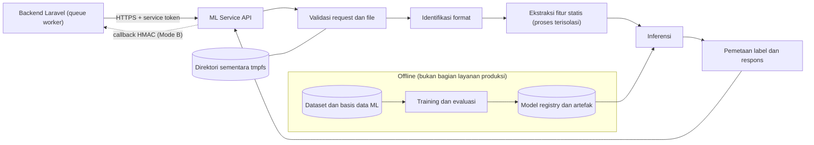
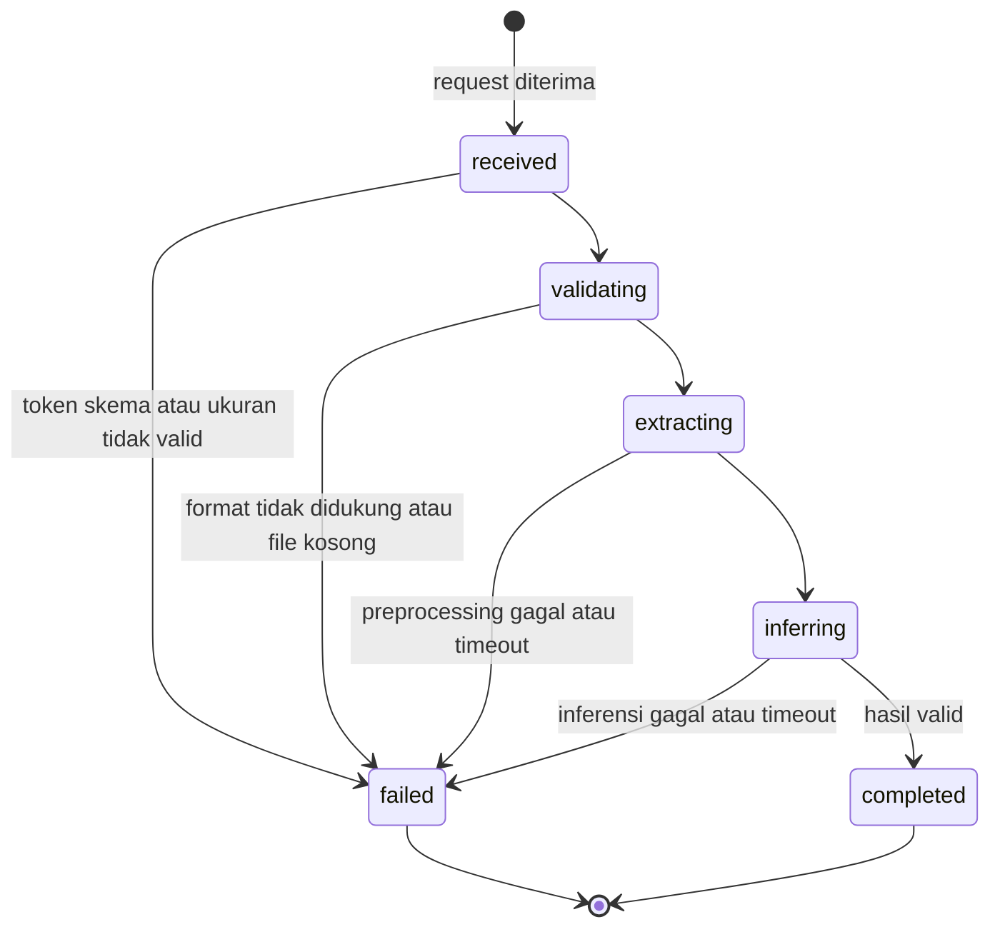
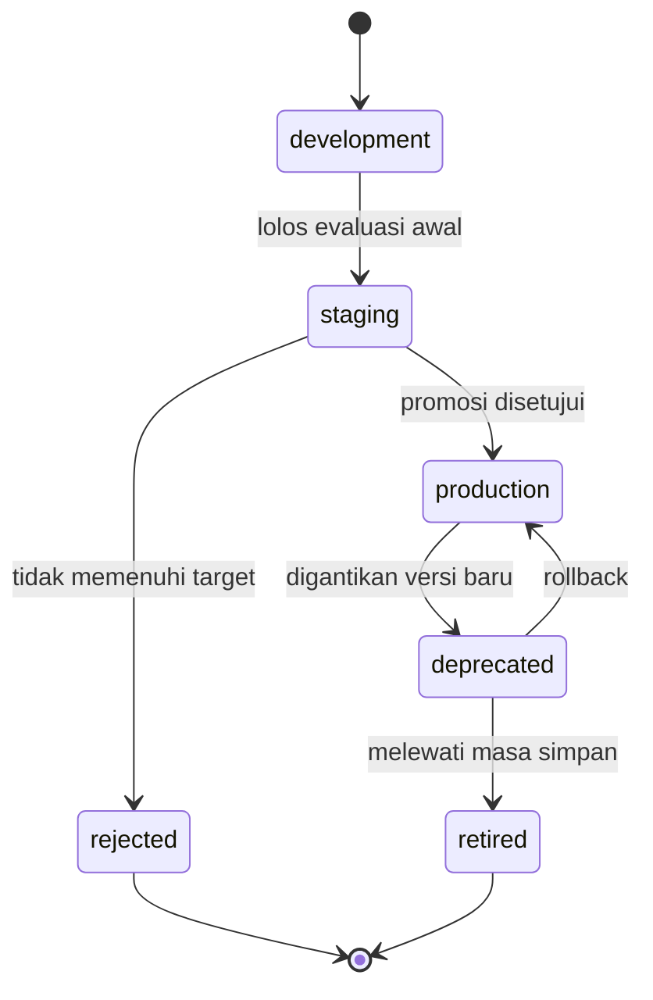
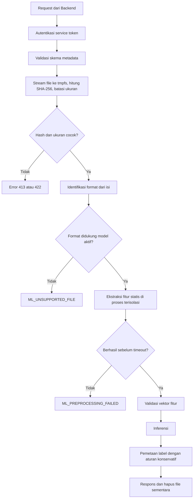
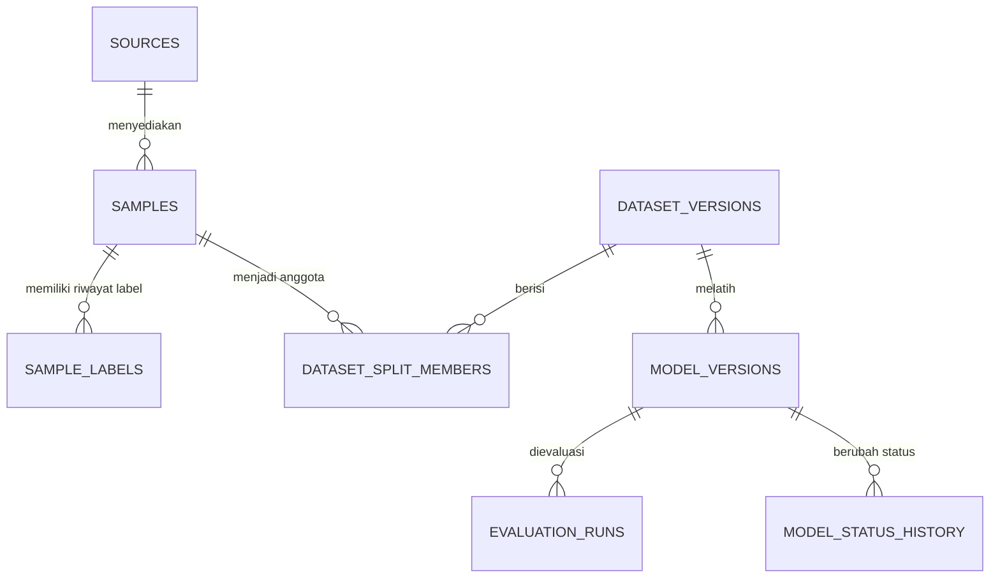

# PRODUCT REQUIREMENTS DOCUMENT (PRD)

## Machine Learning — STIKSAFE-67

| | |
|---|---|
| **Nama Produk** | STIKSAFE-67 (angka 67 merujuk angkatan 2026–2027) |
| **Jenis Produk** | Website pemindaian file berbasis Machine Learning (ML) |
| **Komponen** | ML Detection Service (layanan inferensi), dataset, dan basis data ML |
| **Pelaksana ML** | Dwi Yasa (Machine Learning Expert, Datasets & Basis Data) |
| **Mitra Integrasi** | Dedy Bhaskara (Head Project & Backend) |
| **Dokumen terpisah** | PRD Backend, PRD Frontend, PRD Pengujian, PRD Dokumentasi (lihat 0.3) |
| **Versi Dokumen** | 2.0 |
| **Status** | Draft awal (fokus tugas ML) |
| **Tanggal** | 14 November 2026 |
| **Menggantikan** | PRD ML v1.0 (nama lama produk: STIKSAFE 6769) |
| **Sinkron dengan** | PRD Backend STIKSAFE-67 v2.2 (Bagian 7, Kontrak Integrasi Backend ↔ ML) |

> **Cara membaca dokumen ini.** Setiap kebutuhan memiliki ID unik (contoh `FR-INF-03`, `BR-ML-02`, `NFR-PERF-01`) agar dapat dirujuk dalam tiket dan review. Prioritas: **P0** wajib rilis pertama, **P1** penting setelah fungsi inti stabil, **P2** pengembangan lanjutan. Angka operasional (batas, timeout, konkurensi) adalah **usulan awal** yang dikonfirmasi pada Decision Log (Bagian 23). **Target metrik model sengaja tidak ditulis sekarang**: ditetapkan setelah baseline diukur (9.6), bukan ditebak.

---

## 0. Kontrol Dokumen

### 0.1 Riwayat Revisi

| Versi | Tanggal | Perubahan |
|---|---|---|
| 1.0 | 14 Nov 2026 | Draf awal |
| 2.0 | 14 Nov 2026 | Disusun ulang mengikuti format PRD Backend v2.2: hanya tugas ML (Dwi Yasa). Kontrak diselaraskan dengan PRD Backend (endpoint `/v1/scans`, kode error `ML_*`, field respons, UTC). Ditambah siklus hidup request dan model, aturan penetapan label, sandbox, dataset dan basis data ML, registry model, konfigurasi, risiko, dan keputusan terbuka |

### 0.2 Pelaksana ML dan Pembagian Tugas

PRD ini khusus **komponen Machine Learning** dan dikerjakan oleh **Dwi Yasa**. Dedy Bhaskara menjadi mitra integrasi dari sisi backend.

| Area | Pekerjaan (usulan awal, dapat disesuaikan) | Penanggung jawab |
|---|---|---|
| **Data** | Pengumpulan dataset sah, pelabelan, deduplikasi, split, basis data ML (manifes dataset, versi, evaluasi) | Dwi Yasa |
| **Model** | Preprocessing dan ekstraksi fitur, training, tuning, evaluasi, penetapan ambang label, registry model | Dwi Yasa |
| **ML Service API** | Endpoint inferensi, validasi request dan file, sandbox, pemetaan label, penanganan error, health dan model-info | Dwi Yasa |
| **Operasional ML** | Monitoring, pembaruan dan rollback model, deployment layanan ML | Dwi Yasa (dukungan Dedy untuk jaringan privat dan secret) |
| **Kontrak ML ↔ Backend** | Spesifikasi OpenAPI ML, versioning kontrak | Dwi Yasa (pemilik), Dedy Bhaskara (reviewer) |

**Titik serah-terima dengan backend:**
- Dedy menyediakan klien ML (`HttpScanEngineClient`) dan Fake ML Server di sisi backend; Dwi menyediakan ML Service nyata yang mengikuti kontrak yang sama.
- Daftar format yang didukung model (`supported_types` pada `GET /v1/model-info`) menjadi acuan allowlist ekstensi backend (DEC-05 di PRD Backend, DEC-ML-01 di sini).
- Perubahan kontrak selalu lewat versi dan disetujui Dwi dan Dedy.

**Aturan kerja:** karena ML dikerjakan satu orang, kode API dan keamanan direview Dedy; laporan evaluasi diulas bersama Dedy sebelum model dipromosikan ke production; keputusan pada Decision Log (Bagian 23) dicatat.

### 0.3 Dokumen Terpisah (di Luar PRD Ini)

| Dokumen | Penanggung jawab | Hubungan dengan PRD ML |
|---|---|---|
| PRD Backend | Dedy Bhaskara, Arya Putra | Klien resmi ML; pemilik status scan, riwayat, notifikasi, audit |
| PRD Frontend | Arya Putra | Menampilkan hasil; tidak berinteraksi langsung dengan ML |
| PRD Pengujian | Dina | Menerima masukan area berisiko dari ML (Bagian 18) |
| PRD Dokumentasi | Nofa Ardianto | Menerima bahan model card dan catatan keterbatasan (Bagian 18) |

---

## 1. Ringkasan Eksekutif

### 1.1 Gambaran Produk

STIKSAFE-67 adalah website pemindaian file. Komponen ML adalah **layanan terpisah** yang menerima file dari backend, menganalisisnya secara **statis** (tanpa mengeksekusi file), lalu mengembalikan klasifikasi `safe`, `suspicious`, `malicious`, atau `unknown` beserta versi model. Hasil ini adalah **prediksi model**, bukan jaminan mutlak.

| Komponen | Tanggung jawab |
|---|---|
| **Backend Laravel** | Akun, otorisasi, upload dan validasi awal, penyimpanan file, antrean, retry, status scan, riwayat, dashboard, notifikasi, audit |
| **ML Service** | Menerima file dari backend, validasi teknis, preprocessing, inferensi, pemetaan label, mengembalikan hasil sesuai kontrak |
| **Frontend** | Menampilkan proses, hasil, dan riwayat lewat API backend |

ML **tidak** mengelola akun atau role, tidak menyimpan riwayat pengguna, tidak mengubah status scan, dan tidak pernah berkomunikasi langsung dengan browser.

### 1.2 Tujuan Produk

1. Menyediakan layanan analisis file statis berbasis ML yang aman dan dapat dipanggil backend.
2. Menghasilkan klasifikasi yang konsisten dan dapat ditelusuri (`model_version`, `preprocessing_version`).
3. Mengembalikan hasil terstruktur sesuai kontrak PRD Backend.
4. Menangani file tidak didukung, rusak, atau sulit dianalisis secara aman: **tidak pernah menjadi `safe`**.
5. Memungkinkan model dievaluasi dan diperbarui tanpa mengubah kontrak API.
6. Mengelola dataset secara terdokumentasi (sumber, label, lisensi, versi).
7. Mengukur kualitas model per kelas sebelum production, bukan hanya accuracy.

### 1.3 Bukan Tujuan (Non-Goals) Versi 1

- Akun, role, riwayat, antrean utama, retry utama, notifikasi (PRD Backend).
- Desain dan implementasi UI/UX (PRD Frontend).
- Rencana dan pelaksanaan pengujian (PRD Pengujian) serta dokumentasi proyek (PRD Dokumentasi).
- **Analisis dinamis**: menjalankan atau mendetonasi file untuk melihat perilakunya.
- Menggantikan antivirus endpoint atau memberi jaminan keamanan mutlak.
- Mengenali nama keluarga malware tertentu, kecuali model memang dilatih untuk itu.
- Ekstraksi arsip dan analisis rekursif (masuk pengembangan lanjutan).
- Pelatihan ulang otomatis dari file pengguna produksi (membutuhkan persetujuan eksplisit, DEC-ML-08).

### 1.4 Prinsip ML

| Prinsip | Konsekuensi teknis |
|---|---|
| **Defensive use** | Model dipakai untuk membantu deteksi, bukan untuk membuat atau memodifikasi file berbahaya |
| **No false guarantee** | `safe` berarti "tidak terdeteksi oleh model", bukan "pasti aman" |
| **Fail safely** | Error, timeout, atau output tidak valid menghasilkan error terstruktur, **tidak pernah** `safe` |
| **Static analysis only** | File hanya dibaca sebagai byte dan di-parse; tidak dieksekusi, dirender, atau di-import |
| **Konservatif** | Keraguan hanya boleh menaikkan kehati-hatian (mis. `safe` → `unknown`), tidak pernah sebaliknya |
| **Reproducibility** | Setiap hasil membawa versi model dan preprocessing; pelatihan dan evaluasi dapat diulang |
| **Data governance** | Dataset punya sumber, label, izin penggunaan, dan versi yang jelas |
| **Data minimum** | ML tidak menerima identitas pengguna atau nama file asli, dan tidak menyimpan file setelah analisis |
| **Separation of concerns** | ML hanya sumber hasil inferensi; backend sumber kebenaran status dan riwayat |

---

## 2. Ruang Lingkup

### 2.1 Termasuk dalam PRD ML

| Area | Rincian |
|---|---|
| Penerimaan request | Endpoint internal, autentikasi service, validasi metadata, penerimaan file, idempotensi |
| Validasi dan identifikasi format | Magic bytes dan struktur, daftar format didukung, penanganan file kosong/korup/terenkripsi |
| Preprocessing | Ekstraksi fitur statis di proses terisolasi, validasi vektor fitur, versi preprocessing |
| Inferensi | Memuat model, prediksi, pemetaan skor ke label, confidence |
| Respons dan error | Skema respons, kode error stabil, pesan aman |
| Registry model | Versioning, status siklus hidup, hash artefak, promosi dan rollback |
| Dataset dan basis data ML | Manifes dataset, label, split, versi, laporan evaluasi |
| Evaluasi | Metrik per kelas, analisis kesalahan, kriteria kesiapan model |
| Operasional ML | Health, model-info, log, metrik, pembersihan file sementara |
| Keamanan layanan | Sandbox, batas resource, perlindungan artefak model dan dataset |

### 2.2 Tidak Termasuk

| Bagian | Penanggung jawab |
|---|---|
| Login, registrasi, reset password, role | PRD Backend |
| Penyimpanan akun, profil, file utama, dan riwayat pengguna | PRD Backend |
| Antrean pemindaian, retry job, status scan | PRD Backend |
| Dashboard dan notifikasi | PRD Backend dan PRD Frontend |
| Desain halaman, animasi, komponen UI | PRD Frontend |
| Rencana dan pelaksanaan pengujian | PRD Pengujian |
| README, alur kerja website, dokumentasi proyek | PRD Dokumentasi |
| Pembayaran atau paket langganan | Di luar ruang lingkup awal |

### 2.3 Pengembangan Lanjutan (Belum Dikerjakan Sekarang)

Format tambahan (skrip, APK, ELF, arsip dengan ekstraksi terbatas), mode callback dan polling bila inferensi melambat, kalibrasi probabilitas, deteksi *out-of-distribution* yang lebih matang, laporan drift otomatis dan retraining terjadwal, *shadow mode* untuk model kandidat, ensemble model, akselerasi GPU, endpoint batch, penjelasan hasil (*explainability*) tingkat tinggi, dan analisis dinamis di lingkungan terpisah.

### 2.4 Asumsi

- ML dikerjakan 1 orang (Dwi Yasa) dengan review dari Dedy.
- ML Service dibuat dengan Python dan hanya dapat dijangkau lewat jaringan privat dari backend.
- Backend memakai timeout 120 detik untuk ML (PRD Backend 7.7); ML wajib selesai lebih cepat.
- Kapasitas awal mengikuti backend: ±5.000 scan/hari, puncak ±20 scan/menit, rata-rata file ±5 MB.
- Ketersediaan dataset sah menentukan format apa yang bisa didukung di versi pertama.
- Waktu pada kontrak memakai **UTC**.

---

## 3. Aktor, Peran, dan Hak Akses

### 3.1 Daftar Aktor

| Aktor | Jenis | Interaksi dengan ML Service |
|---|---|---|
| **Backend Laravel (queue worker)** | Sistem | Satu-satunya klien resmi; mengirim file, menerima hasil |
| **Admin Sistem** | Manusia | Tidak mengakses ML langsung; melihat status dan versi model lewat backend (`/admin/ml-health`) |
| **User Website** | Manusia | Tidak berinteraksi dengan ML sama sekali |
| **ML Engineer (Dwi)** | Manusia | Mengelola model, dataset, dan deployment lewat CLI/CI, bukan lewat endpoint HTTP |

### 3.2 Backend sebagai Klien Resmi

Backend: mengirim file dan metadata (`scan_id`, `request_id`, `sha256`); memakai service token; memvalidasi setiap respons (skema, `scan_id`, `request_id`, `sha256`, label, confidence); mengatur timeout, retry, dan status scan. ML tidak pernah menentukan status scan.

### 3.3 Matriks Akses Endpoint

Legenda: ✔ diizinkan · ✘ ditolak

| Endpoint | Backend (service token) | Browser/User/Admin | Publik |
|---|:--:|:--:|:--:|
| `POST /v1/scans` | ✔ | ✘ | ✘ |
| `GET /v1/scans/{request_id}` (P1) | ✔ | ✘ | ✘ |
| `GET /v1/health` | ✔ | ✘ | ✘ |
| `GET /v1/model-info` | ✔ | ✘ | ✘ |

**Aturan akses:**
1. *Deny by default*: tanpa service token valid, semua request ditolak `401`.
2. ML Service tidak diekspos ke internet; hanya dapat dijangkau dari jaringan privat (IP allowlist/security group).
3. Operasi model (promosi, rollback, reload) dilakukan lewat CLI/pipeline di sisi ML, **tidak** lewat endpoint HTTP, untuk memperkecil permukaan serangan.
4. ML tidak memanggil endpoint backend selain callback (Mode B) dan tidak mengakses database atau storage backend.

---

## 4. Arsitektur Sistem

### 4.1 Gambaran Komponen



### 4.2 Tanggung Jawab Komponen

| Komponen | Tanggung jawab | Tidak boleh |
|---|---|---|
| API Layer | Menerima request internal, mengembalikan respons | Terbuka ke publik |
| Authentication | Memverifikasi service token | Menyimpan token di source code atau log |
| Request Validator | Memeriksa skema metadata dan header | Mempercayai input tanpa validasi |
| File Validator | Ukuran, hash, file kosong/terpotong | Mempercayai ekstensi/MIME dari backend sebagai bukti tunggal |
| Format Identifier | Mengenali format dari isi file | Menebak format yang tidak dikenali |
| Feature Extractor | Ekstraksi fitur statis di proses anak terisolasi | Mengeksekusi, merender, atau meng-import isi file |
| Model Loader | Memuat artefak dari registry, verifikasi hash | Memuat artefak dari sumber tidak tepercaya |
| Inference Engine | Menjalankan prediksi | Mengubah skor secara diam-diam |
| Result Mapper | Memetakan skor ke label dengan ambang terversi | Menghasilkan `safe` saat error |
| Response Serializer | Membentuk JSON sesuai kontrak | Memasukkan isi file, path, atau stack trace |
| Idempotency Cache | Menyimpan metadata hasil per `request_id` (tanpa file) | Menyimpan file atau identitas pengguna |
| Monitoring | Health, metrik, log aman | Membocorkan konfigurasi internal |
| Model Registry | Versi, hash, status, ambang, metrik | Menimpa artefak yang sudah dirilis |

> **Prinsip utama:** file dari pengguna adalah **data tidak tepercaya** di setiap titik. ML memperlakukannya sebagai byte buram yang dibaca dan di-parse secara statis di dalam sandbox; tidak pernah dieksekusi. Training berjalan **offline**, terpisah dari layanan produksi.

### 4.3 Teknologi yang Disarankan

| Kebutuhan | Pilihan | Catatan |
|---|---|---|
| Bahasa | Python (versi yang masih mendapat dukungan keamanan) | Verifikasi versi saat kickoff |
| API | FastAPI + Uvicorn/Gunicorn, Pydantic untuk validasi skema | Hanya layanan inferensi; bukan pengganti backend Laravel |
| Model awal (baseline) | Gradient boosting (mis. LightGBM/XGBoost) atau scikit-learn pada fitur statis | Ringan, cepat, mudah dievaluasi (DEC-ML-04) |
| Model lanjutan | Jaringan saraf berbasis byte/fitur (PyTorch, ekspor ke ONNX) | Bila baseline tidak memadai |
| Parser format | Library parser per format (mis. `pefile`/`lief` untuk PE, `pypdf` untuk PDF), `libmagic` untuk identifikasi | Dijalankan di proses terisolasi dan dijaga tetap terbarui |
| Serialisasi model | ONNX atau format native booster | **Hindari `pickle`** dari sumber tidak tepercaya; artefak hanya dari registry internal dengan hash |
| Basis data ML | PostgreSQL terpisah dari DB aplikasi (SQLite untuk lokal) | DEC-ML-13 |
| Versioning data/eksperimen | Manifes dataset di basis data; DVC atau MLflow (opsional) | |
| Kontainer | Docker (non-root, filesystem read-only, tmpfs untuk temp) | Bagian 19 |
| Kualitas kode | Linter dan type check, pytest untuk test pengembang | Rencana pengujian lengkap ada di PRD Pengujian |

---

## 5. Kebutuhan Fungsional

Format: **ID — Kebutuhan — Prioritas — Kriteria penerimaan ringkas**.

### 5.1 Penerimaan Request dan File (`RCV`)

| ID | Kebutuhan | Prio | Kriteria penerimaan |
|---|---|:--:|---|
| FR-RCV-01 | Menerima `POST /v1/scans` (multipart: `metadata` JSON + `file`) hanya dari backend ber-service token | P0 | Tanpa/dengan token salah → `401` `ML_AUTH_FAILED`; tidak ada pemrosesan |
| FR-RCV-02 | Validasi skema metadata (7.4): `scan_id`, `request_id`, `sha256`, `size_bytes`, dll. | P0 | Tidak lengkap/tidak sesuai → `422` `ML_INVALID_REQUEST` |
| FR-RCV-03 | Hitung SHA-256 dari byte yang diterima (streaming) dan bandingkan dengan `metadata.sha256` | P0 | Beda → `ML_HASH_MISMATCH` (*retryable*); hash dikembalikan (*echo*) pada respons sukses |
| FR-RCV-04 | Tegakkan batas ukuran saat streaming dan cocokkan dengan `size_bytes` | P0 | Melebihi batas → `413` `ML_FILE_TOO_LARGE`; aliran dihentikan segera |
| FR-RCV-05 | Idempotensi: `Idempotency-Key`/`request_id` yang sama tidak memicu inferensi kedua | P0 | Hasil/proses yang sama dikembalikan selama TTL (default 1 jam); tanpa menyimpan file |
| FR-RCV-06 | File ditulis ke direktori sementara terisolasi (tmpfs), nama acak, izin `0600`, tanpa bit eksekusi | P0 | Dihapus di akhir request (sukses atau gagal); sweeper membersihkan sisa |
| FR-RCV-07 | Mengembalikan dan mencatat `X-Request-ID` | P0 | Header ada di setiap respons dan log |
| FR-RCV-08 | Mode callback (`202` lalu hasil dikirim) dan mode polling (`GET /v1/scans/{request_id}`) | P1 | Sesuai 7.1 dan 7.8 |
| FR-RCV-09 | Backpressure: slot inferensi penuh → tolak, bukan antre tanpa batas | P1 | `429` `ML_OVERLOADED` + `Retry-After` |

### 5.2 Validasi dan Identifikasi Format (`FMT`)

| ID | Kebutuhan | Prio | Kriteria penerimaan |
|---|---|:--:|---|
| FR-FMT-01 | Identifikasi format dari **isi** (magic bytes + struktur); ekstensi dan MIME dari backend hanya *hint* | P0 | Ekstensi palsu tidak mengubah hasil identifikasi |
| FR-FMT-02 | Format di luar daftar didukung model aktif → tolak tanpa preprocessing dan inferensi | P0 | `422` `ML_UNSUPPORTED_FILE` (*retryable=false*) |
| FR-FMT-03 | Bedakan "tidak dapat dibaca sama sekali" dari "terbaca sebagian": file kosong/terpotong total → `ML_FILE_CORRUPT`; struktur rusak sebagian → ekstraksi fitur generik + flag `PARSE_PARTIAL` | P0 | Struktur cacat tidak otomatis dianggap error karena dapat menjadi indikator (lihat 7.5) |
| FR-FMT-04 | Ketidakcocokan ekstensi–isi dicatat sebagai flag `FORMAT_MISMATCH`, bukan alasan menolak | P0 | Ditolak hanya bila format terdeteksi tidak didukung |
| FR-FMT-05 | Konten terenkripsi/berpassword dan arsip: tidak diekstrak di versi 1 | P0 | Arsip tidak didukung → `ML_UNSUPPORTED_FILE`; dokumen terenkripsi yang formatnya didukung → label `unknown` + flag `ENCRYPTED_CONTENT` |
| FR-FMT-06 | Daftar format didukung diekspos lewat `GET /v1/model-info` dan hanya berubah bersama versi model | P0 | Backend dapat menyelaraskan allowlist |
| FR-FMT-07 | Batas kompleksitas struktur (kedalaman, jumlah objek/seksi, panjang string yang diekstrak) | P1 | Terlampaui → `unknown` + flag `LIMIT_EXCEEDED`, atau `ML_PREPROCESSING_FAILED` bila timeout |

### 5.3 Preprocessing dan Ekstraksi Fitur (`PRE`)

| ID | Kebutuhan | Prio | Kriteria penerimaan |
|---|---|:--:|---|
| FR-PRE-01 | Ekstraksi **statis saja**: tidak mengeksekusi, merender, menjalankan makro, atau memanggil interpreter atas isi file | P0 | Tidak ada pemanggilan eksekusi yang melibatkan isi file |
| FR-PRE-02 | Training dan inferensi memakai **kode ekstraksi yang sama** (satu paket fitur terversi) | P0 | Tidak ada *training–serving skew* |
| FR-PRE-03 | `preprocessing_version` dicatat dan terikat pada `model_version` | P0 | Model tidak dapat dimuat dengan versi preprocessing yang tidak cocok |
| FR-PRE-04 | Ekstraksi berjalan di proses anak dengan batas CPU, memori, dan waktu | P0 | Crash atau hang parser tidak menjatuhkan service |
| FR-PRE-05 | Validasi vektor fitur sebelum inferensi (dimensi, tipe, NaN/Inf, rentang) | P0 | Tidak valid → `ML_PREPROCESSING_FAILED` atau flag sesuai aturan |
| FR-PRE-06 | Deterministik: file sama + versi sama → vektor fitur sama | P0 | Urutan dan seed tetap |
| FR-PRE-07 | Hitung *feature coverage* (proporsi fitur yang berhasil diekstrak) | P1 | Dipakai untuk penetapan `unknown` (7.5) |

### 5.4 Inferensi dan Pemetaan Label (`INF`)

| ID | Kebutuhan | Prio | Kriteria penerimaan |
|---|---|:--:|---|
| FR-INF-01 | Memuat model berstatus `production` saat startup dari registry dan memverifikasi hash artefak | P0 | Gagal muat/hash tidak cocok → service `not_ready` |
| FR-INF-02 | Model tetap di memori; inferensi dibatasi oleh jumlah slot | P0 | Tidak ada pemuatan ulang per request |
| FR-INF-03 | Pemetaan skor ke label oleh `ResultMapper` memakai ambang yang **terversi bersama model** | P0 | Ambang tidak ditulis keras di kode; aturan pada 7.5 |
| FR-INF-04 | Exception, NaN, timeout, atau output tidak valid → error terstruktur | P0 | **Tidak pernah** fallback ke `safe` |
| FR-INF-05 | `confidence` hanya dikirim bila bernilai valid 0–1; maknanya dijelaskan pada `model-info` (`confidence_type`) | P0 | Nilai tidak valid/tidak tersedia → `null`, bukan angka karangan |
| FR-INF-06 | `threat_name`/`threat_category` hanya diisi bila model benar-benar mendukung | P0 | Selain itu `null` |
| FR-INF-07 | Deteksi *out-of-distribution* sederhana (fitur di luar rentang training) | P1 | Memicu `unknown` pada kasus yang akan menjadi `safe` |

### 5.5 Respons dan Penanganan Kegagalan (`ERR`)

| ID | Kebutuhan | Prio | Kriteria penerimaan |
|---|---|:--:|---|
| FR-ERR-01 | Setiap respons mengikuti skema 7.3 dan membawa `scan_id`, `request_id`, `sha256` (echo), `model_version` | P0 | `scan_id` dikembalikan tanpa perubahan |
| FR-ERR-02 | Semua kegagalan memakai kode error stabil (7.6), `retryable`, dan pesan aman | P0 | Tanpa isi file, path internal, stack trace, atau secret |
| FR-ERR-03 | Exception tak terduga → `500` `ML_INTERNAL_ERROR` dengan `request_id` | P0 | Detail hanya di log terlindungi |
| FR-ERR-04 | Timeout internal per tahap dan total, lebih kecil dari timeout backend | P0 | `ML_INFERENCE_TIMEOUT`/`ML_PREPROCESSING_FAILED` sebelum backend menyerah |
| FR-ERR-05 | Callback gagal terkirim → retry terbatas dengan backoff; hasil tetap tersedia via polling selama TTL | P1 | Sesuai 7.8 |

### 5.6 Versioning dan Registry Model (`MDL`)

| ID | Kebutuhan | Prio | Kriteria penerimaan |
|---|---|:--:|---|
| FR-MDL-01 | Setiap model memiliki `model_version` (SemVer), `preprocessing_version`, `dataset_version`, tanggal, ringkasan metrik, **SHA-256 artefak**, status, catatan perubahan | P0 | Tercatat di tabel `model_versions` (9.5) |
| FR-MDL-02 | Perubahan model, preprocessing, atau ambang = versi baru; artefak rilis tidak pernah ditimpa | P0 | Versi lama tetap dapat dirujuk |
| FR-MDL-03 | Hanya model `production` yang melayani backend; promosi butuh laporan evaluasi (9.6) dan persetujuan | P0 | Riwayat status tercatat (`model_status_history`) |
| FR-MDL-04 | Rollback ke versi sebelumnya tanpa mengubah kontrak | P0 | Selesai ≤ 15 menit |
| FR-MDL-05 | `GET /v1/model-info`: versi aktif, format didukung, label, batas ukuran, `confidence_type`, waktu muat | P0 | Tidak membocorkan konfigurasi internal |
| FR-MDL-06 | Penggantian model tanpa downtime (reload terkontrol/*blue-green*) | P1 | Request berjalan tidak terputus |

### 5.7 Dataset dan Basis Data ML (`DAT`)

| ID | Kebutuhan | Prio | Kriteria penerimaan |
|---|---|:--:|---|
| FR-DAT-01 | Setiap sampel tercatat: ID, `sha256`, sumber, label, format, tanggal (bila ada), status validasi label, izin/lisensi, versi dataset | P0 | Lihat skema 9.3 |
| FR-DAT-02 | Basis data ML terpisah dari database aplikasi; berisi manifes dan metadata, **bukan** file pengguna produksi | P0 | Tidak ada tabel atau koneksi bersama dengan DB backend |
| FR-DAT-03 | Definisi label dan pemetaan label dataset → `safe`/`suspicious`/`malicious`/`unknown` terdokumentasi | P0 | Disetujui sebelum training (DEC-ML-03) |
| FR-DAT-04 | Deduplikasi (hash eksak; *near-duplicate* bila memungkinkan) sebelum split | P0 | Tidak ada sampel sama pada split berbeda |
| FR-DAT-05 | Split training/validation/test; test dikunci; ambang ditentukan hanya pada validation | P0 | Test set tidak dipakai untuk tuning |
| FR-DAT-06 | Distribusi kelas dan format diukur; penanganan *imbalance* dicatat | P0 | Dilaporkan pada laporan data |
| FR-DAT-07 | Sampel berbahaya ditangani di lingkungan terisolasi dengan akses terbatas | P0 | Tidak disimpan di mesin layanan produksi |
| FR-DAT-08 | Split berbasis waktu (latih data lebih lama, uji data lebih baru) bila tanggal tersedia | P1 | Mengurangi kebocoran temporal |
| FR-DAT-09 | Sampel berlabel meragukan dipisah (*disputed*), tidak dipaksa ke kelas | P1 | Tidak ikut training sampai diverifikasi |
| FR-DAT-10 | Umpan balik *false positive/negative* dari backend dapat dijadikan kandidat data **hanya** dengan persetujuan eksplisit dan dasar izin | P1 | Default: tidak dipakai (DEC-ML-08) |

### 5.8 Evaluasi Model (`EVA`)

| ID | Kebutuhan | Prio | Kriteria penerimaan |
|---|---|:--:|---|
| FR-EVA-01 | Laporan evaluasi per model: precision, recall, F1 per kelas; confusion matrix; jumlah sampel per kelas; ROC/PR-AUC; FPR pada titik operasi; waktu inferensi p50/p95; error rate | P0 | Dihitung pada test set terkunci |
| FR-EVA-02 | Fokus pada recall `malicious` dan FPR pada benign; analisis kesalahan (false negative dan false positive) | P0 | Contoh kesalahan dikelompokkan per penyebab |
| FR-EVA-03 | Hasil dapat diulang: seed, versi dataset, versi kode, dan parameter tersimpan | P0 | Menjalankan ulang menghasilkan metrik setara |
| FR-EVA-04 | Target kesiapan ditetapkan **setelah baseline** dan disepakati | P0 | Tabel 9.6 terisi sebelum promosi (DEC-ML-07) |
| FR-EVA-05 | Uji ketahanan: file terpotong, ekstensi diganti, padding, ukuran ekstrem, input tidak valid | P1 | Tidak ada crash; tidak ada `safe` pada kegagalan |
| FR-EVA-06 | Evaluasi kalibrasi bila `confidence` ditampilkan sebagai probabilitas | P1 | `confidence_type` diperbarui sesuai hasil |
| FR-EVA-07 | Pemantauan drift: bandingkan distribusi hasil production dengan baseline (tanpa menyimpan file) | P1 | Laporan berkala |

### 5.9 Operasional ML Service (`OPS`)

| ID | Kebutuhan | Prio | Kriteria penerimaan |
|---|---|:--:|---|
| FR-OPS-01 | `GET /v1/health`: `ready` bila model termuat dan direktori sementara tersedia, selain itu `not_ready` (`503`) | P0 | Tanpa konfigurasi internal pada respons |
| FR-OPS-02 | Log JSON: `request_id`, `scan_id`, durasi per tahap, `model_version`, status, kode error, ukuran, keluarga format | P0 | Tanpa isi file, token, atau secret |
| FR-OPS-03 | Pembersihan file sementara: `finally` pada setiap request + sweeper berkala | P0 | Tidak ada file tersisa > 5 menit |
| FR-OPS-04 | Metrik agregat: request sukses/gagal per kode, durasi (p50/p95), jumlah unsupported, slot terpakai, memori | P1 | Tersedia untuk monitoring |
| FR-OPS-05 | *Graceful shutdown*: menyelesaikan request berjalan sebelum berhenti | P1 | Tidak ada request terputus saat deploy |
| FR-OPS-06 | *Self-check* saat startup memakai masukan uji sintetis yang tidak berbahaya | P1 | Gagal → `not_ready` |

---

## 6. Siklus Hidup Request dan Model

### 6.1 Status Request di ML Service

Status ini bersifat **internal** dan hanya untuk observabilitas ML. Status scan yang dilihat pengguna (`queued`, `processing`, `completed`, `failed`, ...) dikelola backend.

| Status | Arti | Terminal? |
|---|---|:--:|
| `received` | Request diterima dan lolos autentikasi | Tidak |
| `validating` | Validasi metadata, hash, ukuran, dan identifikasi format | Tidak |
| `extracting` | Ekstraksi fitur statis di proses terisolasi | Tidak |
| `inferring` | Model menghitung skor dan memetakan label | Tidak |
| `completed` | Hasil valid siap dikembalikan | Ya |
| `failed` | Berhenti dengan error terstruktur | Ya |

### 6.2 Diagram Transisi Request



### 6.3 Aturan Transisi

| Dari | Ke | Pemicu | Efek samping |
|---|---|---|---|
| `received` | `validating` | Autentikasi dan skema lolos | File mulai di-*stream* ke tmpfs |
| `received` | `failed` | Token salah, skema salah, ukuran melebihi batas | Aliran dihentikan; kode `ML_AUTH_FAILED`/`ML_INVALID_REQUEST`/`ML_FILE_TOO_LARGE` |
| `validating` | `extracting` | Hash cocok, format terdeteksi dan didukung | |
| `validating` | `failed` | `ML_HASH_MISMATCH`, `ML_UNSUPPORTED_FILE`, `ML_FILE_CORRUPT` | File sementara dihapus |
| `extracting` | `inferring` | Vektor fitur valid | |
| `extracting` | `failed` | Timeout/crash parser, vektor fitur tidak valid | `ML_PREPROCESSING_FAILED` |
| `inferring` | `completed` | Skor valid dan label ditetapkan | File sementara dihapus; metadata hasil disimpan di cache idempotensi |
| `inferring` | `failed` | Timeout, exception, output model tidak valid | `ML_INFERENCE_TIMEOUT`/`ML_INFERENCE_FAILED`/`ML_INVALID_MODEL_OUTPUT` |

**Jaminan:** satu request menjalankan satu jalur proses; transisi tidak dapat mundur; request dengan `request_id` yang sama tidak membuka jalur kedua (FR-RCV-05); file sementara selalu dihapus pada kondisi terminal.

### 6.4 Siklus Hidup Model



| Status | Arti | Syarat masuk |
|---|---|---|
| `development` | Sedang dilatih/dieksperimenkan | — |
| `staging` | Dipakai untuk integrasi dan uji di staging | Laporan evaluasi awal tersedia |
| `production` | Melayani backend (satu versi aktif per keluarga format) | Laporan evaluasi lengkap (9.6), target kesiapan terpenuhi, persetujuan Dwi dan Dedy |
| `deprecated` | Digantikan, masih disimpan untuk rollback dan penelusuran hasil lama | Versi baru menjadi `production` |
| `rejected` | Tidak lolos kriteria | Hasil evaluasi tidak memenuhi target |
| `retired` | Artefak diarsipkan; metadata tetap ada | Melewati masa simpan |

Metadata model (versi, metrik, ambang) tidak pernah dihapus, agar hasil scan lama di backend tetap dapat ditelusuri lewat `model_version`.

---

## 7. Kontrak Integrasi ML ↔ Backend

> Bagian ini diselaraskan dengan **PRD Backend Bagian 7**. ML adalah pemilik kontrak dari sisi layanan; Backend adalah reviewer. Bentuk final dibekukan sebagai OpenAPI ML sebelum integrasi nyata di staging. ML **tidak mengarang** hasil: semua nilai berasal dari model dan aturan pada bagian ini.

### 7.1 Mode Integrasi

| Mode | Cara kerja | Dukungan ML | Rekomendasi |
|---|---|:--:|---|
| **A. Sinkron di dalam worker** | Backend memanggil `POST /v1/scans` dan menunggu respons `200` | P0 | **Default MVP** (selaras DEC-09 Backend) |
| **B. Asinkron + callback** | ML membalas `202`, lalu mengirim hasil ke `callback_url` | P1 | Bila inferensi lebih lama dari ±60 detik |
| **C. Asinkron + polling** | ML membalas `202`, backend polling `GET /v1/scans/{request_id}` | P1 | Fallback Mode B |

Satu pola utama dipakai per lingkungan dan dikonfigurasi di kedua sisi (`ml.mode` pada backend).

### 7.2 Autentikasi dan Transport

- Jaringan privat antar layanan; TLS wajib di produksi; mTLS opsional.
- `Authorization: Bearer <service_token>` khusus per lingkungan; ML mendukung **dua token aktif** sekaligus agar rotasi tidak menyebabkan downtime.
- ML hanya menerima koneksi dari backend (IP allowlist/security group).
- Token tidak pernah masuk log, respons, atau pesan error.

### 7.3 Endpoint, Request, dan Respons

| Method | Endpoint | Fungsi | Prio |
|---|---|---|:--:|
| `POST` | `/v1/scans` | Mengirim file untuk dianalisis (multipart: `metadata` + `file`) | P0 |
| `GET` | `/v1/scans/{request_id}` | Mengambil hasil (Mode C) atau memulihkan callback hilang | P1 |
| `GET` | `/v1/health` | Kesiapan layanan | P0 |
| `GET` | `/v1/model-info` | Versi model, format didukung, batas | P0 |

**Header request dari backend:**

| Header | Isi |
|---|---|
| `Authorization` | `Bearer <service_token>` |
| `X-Request-ID` | ID korelasi untuk tracing lintas layanan |
| `Idempotency-Key` | `request_id` (UUID); retry dengan kunci sama tidak menggandakan pekerjaan |

**Metadata request (bagian JSON `metadata`):**

| Field | Wajib | Tipe | Aturan |
|---|:--:|---|---|
| `scan_id` | Ya | string (ULID, 26 karakter) | Dikembalikan tanpa perubahan |
| `request_id` | Ya | string (UUID) | Unik per percobaan; kunci idempotensi |
| `sha256` | Ya | string (64 hex) | Dibandingkan dengan hash byte yang diterima |
| `size_bytes` | Ya | integer > 0 | Harus sama dengan ukuran aktual |
| `declared_extension` | Tidak | string | Hanya *hint*; tidak dipercaya |
| `detected_mime` | Tidak | string | Hanya *hint*; tidak dipercaya |
| `submitted_at` | Ya | ISO-8601 UTC | Untuk pelacakan |
| `callback_url` | Hanya Mode B | URL | Harus ada di allowlist host ML (7.8) |

```json
{
  "scan_id": "01JCX7Y2K9M4N6P8Q0R3S5T7V9",
  "request_id": "7f0c1d5e-4b7a-4a39-9c62-0e5a3d1b2f10",
  "sha256": "9f86d081884c7d659a2feaa0c55ad015a3bf4f1b2b0b822cd15d6c15b0f00a08",
  "size_bytes": 482113,
  "declared_extension": "exe",
  "detected_mime": "application/octet-stream",
  "submitted_at": "2026-11-14T02:00:00Z"
}
```

Prinsip **data minimum**: ML tidak menerima `user_id`, email, atau nama file asli.

**Respons sukses (`200`, Mode A):**

```json
{
  "request_id": "7f0c1d5e-4b7a-4a39-9c62-0e5a3d1b2f10",
  "scan_id": "01JCX7Y2K9M4N6P8Q0R3S5T7V9",
  "status": "completed",
  "sha256": "9f86d081884c7d659a2feaa0c55ad015a3bf4f1b2b0b822cd15d6c15b0f00a08",
  "result": {
    "label": "suspicious",
    "confidence": 0.82,
    "threat_name": null,
    "threat_category": null,
    "reason_codes": ["FORMAT_MISMATCH"]
  },
  "model_version": "stiksafe-ml-0.1.0",
  "preprocessing_version": "feat-0.1.0",
  "scanned_at": "2026-11-14T02:00:12Z",
  "duration_ms": 11840
}
```

> Nilai di atas hanya contoh format, bukan hasil model sebenarnya.

**Respons gagal (contoh `422`):**

```json
{
  "request_id": "7f0c1d5e-4b7a-4a39-9c62-0e5a3d1b2f10",
  "scan_id": "01JCX7Y2K9M4N6P8Q0R3S5T7V9",
  "status": "failed",
  "error": {
    "code": "ML_UNSUPPORTED_FILE",
    "message": "Tipe file tidak didukung oleh model.",
    "retryable": false
  },
  "model_version": "stiksafe-ml-0.1.0"
}
```

**Respons mode asinkron (`202`):** `{ "request_id": "...", "scan_id": "...", "status": "accepted" }`.

**Field tambahan** (`preprocessing_version`, `reason_codes`, `threat_category`) bersifat opsional; backend mengabaikan field yang tidak dikenal (PRD Backend 7.4 butir 9).

### 7.4 Validasi Request oleh ML

| # | Aturan | Jika dilanggar |
|---|---|---|
| 1 | Service token valid | `401` `ML_AUTH_FAILED` |
| 2 | `metadata` berupa JSON valid dan memuat field wajib dengan tipe benar | `422` `ML_INVALID_REQUEST` |
| 3 | `request_id` UUID dan `scan_id` ULID | `422` `ML_INVALID_REQUEST` |
| 4 | Bagian `file` ada dan tepat satu | `422` `ML_INVALID_REQUEST` |
| 5 | Ukuran aktual ≤ batas dan = `size_bytes` | `413` `ML_FILE_TOO_LARGE` / `422` `ML_INVALID_REQUEST` |
| 6 | SHA-256 aktual = `metadata.sha256` | `422` `ML_HASH_MISMATCH` |
| 7 | `callback_url` (bila ada) host-nya ada di allowlist | `422` `ML_INVALID_REQUEST` |
| 8 | `request_id` yang pernah diproses → kembalikan hasil sebelumnya | — (idempoten) |

### 7.5 Semantik Label dan Confidence

| Label | Arti | Catatan |
|---|---|---|
| `safe` | Model tidak menemukan indikasi ancaman dalam batas kemampuannya | **Bukan** jaminan aman mutlak |
| `suspicious` | Ada indikasi yang memerlukan kehati-hatian atau hasil belum meyakinkan | |
| `malicious` | Model mengklasifikasikan file sebagai berpotensi berbahaya | |
| `unknown` | Model tidak dapat menentukan secara andal | Hasil **sah**, bukan kegagalan |
| *(tidak ada label)* | Proses gagal | Dikembalikan sebagai error, bukan label |

**Aturan penetapan label** (nilai ambang berasal dari evaluasi dan disimpan bersama model, bukan ditulis keras di kode):

| Urutan | Kondisi | Label |
|:--:|---|---|
| 1 | Skor ≥ `T_malicious` | `malicious` |
| 2 | `T_suspicious` ≤ skor < `T_malicious` | `suspicious` |
| 3 | Skor < `T_suspicious`, **tetapi** *feature coverage* < `C_min`, atau terdeteksi *out-of-distribution*, atau konten terenkripsi, atau batas struktur terlampaui | `unknown` |
| 4 | Skor < `T_suspicious` dan tidak ada kondisi pada urutan 3 | `safe` |

**Aturan konservatif:** kondisi ragu hanya boleh menurunkan `safe` menjadi `unknown`; tidak boleh menurunkan `malicious`/`suspicious`, dan tidak pernah menaikkan ke `safe`.

**Confidence:** angka 0–1 yang menyatakan skor model terhadap label yang dikembalikan. Rumus tepat dan tipenya dicatat di `model-info` (`confidence_type`: `raw_score` atau `calibrated_probability`). Selama belum dikalibrasi, skor **tidak** disebut probabilitas. Untuk `unknown`, `confidence` bernilai `null`.

**`reason_codes` (opsional, enum tertutup):** `PARSE_PARTIAL`, `FORMAT_MISMATCH`, `ENCRYPTED_CONTENT`, `LIMIT_EXCEEDED`, `LOW_FEATURE_COVERAGE`, `OUT_OF_DISTRIBUTION`. Berisi indikator tingkat tinggi yang aman; bukan penjelasan teknis rinci.

### 7.6 Kode Error

Kode memakai awalan `ML_` agar selaras dengan PRD Backend (7.6).

| Kode | HTTP | *Retryable* | Arti | Perilaku backend (PRD Backend) |
|---|:--:|:--:|---|---|
| `ML_AUTH_FAILED` | 401/403 | Tidak | Service token tidak sah | `failed` + alert kritikal |
| `ML_INVALID_REQUEST` | 422 | Tidak | Request tidak sesuai kontrak | Kegagalan permanen + alert (bug kontrak) |
| `ML_FILE_TOO_LARGE` | 413 | Tidak | Melebihi batas ukuran | `failed` |
| `ML_HASH_MISMATCH` | 422 | Ya | Hash file yang diterima tidak sama dengan metadata (transfer korup) | Retry terbatas |
| `ML_UNSUPPORTED_FILE` | 422 | Tidak | Format tidak didukung model aktif | `failed` (pesan aman ke user) |
| `ML_FILE_CORRUPT` | 422 | Tidak | File kosong atau tidak dapat dibaca sama sekali | `failed` |
| `ML_PREPROCESSING_FAILED` | 500 | Ya (terbatas) | Ekstraksi gagal, timeout, atau vektor fitur tidak valid | Retry terbatas |
| `ML_MODEL_UNAVAILABLE` | 503 | Ya | Model belum siap/gagal dimuat | `ML_UNAVAILABLE` (hitung ke circuit breaker) |
| `ML_INFERENCE_TIMEOUT` | 504 | Ya | Inferensi melewati batas waktu | `ML_TIMEOUT` (retry) |
| `ML_INFERENCE_FAILED` | 500 | Ya (terbatas) | Inferensi gagal | Retry terbatas |
| `ML_INVALID_MODEL_OUTPUT` | 500 | Ya (terbatas) | Output model tidak valid (NaN, di luar rentang) | Retry terbatas + alert bila berulang |
| `ML_OVERLOADED` | 429 | Ya | Slot inferensi penuh; sertakan `Retry-After` | Retry setelah jeda |
| `ML_INTERNAL_ERROR` | 500 | Ya (terbatas) | Kesalahan internal tak terduga | Retry terbatas |

Kode error **tidak pernah** dipakai sebagai label, dan label tidak pernah dipakai sebagai kode error. Backend harus membaca `error.code` dan `retryable`, bukan hanya status HTTP.

*Pemetaan dari v1.0:* `UNSUPPORTED_FILE_TYPE` → `ML_UNSUPPORTED_FILE`; `CORRUPTED_FILE` → `ML_FILE_CORRUPT`; `INVALID_REQUEST` → `ML_INVALID_REQUEST`; `UNAUTHORIZED_SERVICE` → `ML_AUTH_FAILED`; `FILE_NOT_FOUND` tidak dipakai lagi (file dikirim langsung, bukan referensi).

### 7.7 Timeout dan Konkurensi (Usulan)

| Parameter | Default | Keterangan |
|---|---|---|
| Timeout backend: koneksi / request | 5 dtk / 120 dtk | Dari PRD Backend 7.7 |
| `service.total_deadline_sec` | 100 dtk | Batas total ML per request; **harus < 120 dtk** |
| `extract.timeout_sec` | 30 dtk | Ekstraksi fitur |
| `infer.timeout_sec` | 10 dtk | Inferensi |
| `service.max_concurrent` | 4 slot | Dimensi awal; lihat NFR-CAP-01 |
| `idempotency.ttl_sec` | 3600 | Cache metadata hasil |
| Callback: percobaan | 3 dengan backoff | Mode B |

Backend membatasi panggilan paralel ke ML **tidak melebihi** jumlah slot ML (middleware `RateLimited('ml')` di backend).

### 7.8 Keamanan Callback (Mode B)

- ML mengirim `POST` ke `callback_url` hanya bila host-nya ada di **allowlist** konfigurasi ML (`callback.allowed_hosts`). URL tidak dipercaya begitu saja (mencegah SSRF dari sisi ML).
- Header: `X-Stiksafe-Timestamp` dan `X-Stiksafe-Signature` = `HMAC-SHA256(secret, timestamp + "." + raw_body)`; secret dari secret manager, dibagi dengan backend (`ml.callback_secret`).
- Kirim ulang terbatas (3 kali, backoff); bila tetap gagal, hasil tetap tersedia lewat polling selama TTL.
- Callback tidak membawa isi file atau identitas pengguna.

### 7.9 Yang Diminta dari Backend

| # | Permintaan | Alasan |
|---|---|---|
| 1 | Selalu mengirim `sha256`, `size_bytes`, `request_id`, `scan_id` yang benar | Verifikasi integritas dan idempotensi |
| 2 | Retry hanya untuk kode `retryable=true`, dengan backoff | Hindari beban sia-sia |
| 3 | Membatasi panggilan paralel ≤ jumlah slot ML | Hindari `ML_OVERLOADED` |
| 4 | Menyelaraskan allowlist ekstensi dengan `supported_types` dari `model-info` | Hindari `ML_UNSUPPORTED_FILE` yang bisa dicegah (DEC-ML-01) |
| 5 | Tidak mengirim data pribadi atau nama file asli | Data minimum |
| 6 | Menyimpan `model_version` pada setiap hasil | Penelusuran hasil lama |
| 7 | Tidak menganggap HTTP `200` berarti valid; tetap validasi skema dan `sha256` | Sesuai PRD Backend 7.4 |
| 8 | Fake ML Server di backend mengikuti kontrak yang sama | Konsistensi pengembangan |
| 9 | Mengabari bila batas ukuran atau timeout backend berubah | Menjaga `total_deadline_sec` < timeout backend |
| 10 | Menampilkan disclaimer bahwa hasil adalah prediksi model | Mencegah salah paham `safe` |

### 7.10 Perubahan Kontrak

Versi `/v1` bersifat stabil: penambahan field opsional tidak dianggap *breaking*; perubahan yang memutus kompatibilitas memakai `/v2` dengan masa transisi. Setiap perubahan disetujui Dwi dan Dedy dan dicatat di Decision Log.

---

## 8. Penanganan File dan Format yang Didukung

### 8.1 Pipeline Penerimaan dan Analisis



### 8.2 Lapisan Validasi

| # | Pemeriksaan | Aturan | Kode error |
|---|---|---|---|
| 1 | Autentikasi | Service token valid | `ML_AUTH_FAILED` |
| 2 | Skema metadata | Field wajib, tipe, format UUID/ULID/hex | `ML_INVALID_REQUEST` |
| 3 | Ukuran | `0 < size ≤ max_file_size`; sama dengan `size_bytes` | `ML_FILE_TOO_LARGE`, `ML_INVALID_REQUEST`, `ML_FILE_CORRUPT` (file kosong) |
| 4 | Integritas | SHA-256 aktual = `metadata.sha256` | `ML_HASH_MISMATCH` |
| 5 | Format | Dikenali dari isi (bukan ekstensi/MIME) dan ada di daftar model aktif | `ML_UNSUPPORTED_FILE` |
| 6 | Keterbacaan | Fitur minimum dapat diekstrak; bila tidak sama sekali → error, bila sebagian → flag | `ML_FILE_CORRUPT` / flag `PARSE_PARTIAL` |
| 7 | Batas struktur | Kedalaman, jumlah objek, panjang string | Flag `LIMIT_EXCEEDED` atau `ML_PREPROCESSING_FAILED` |
| 8 | Vektor fitur | Dimensi, tipe, NaN/Inf, rentang | `ML_PREPROCESSING_FAILED` |

### 8.3 Format yang Didukung (Usulan Awal)

Prinsip: satu format baru **hanya** didukung bila memenuhi empat syarat: (1) dataset memadai dan sah, (2) parser aman tersedia, (3) evaluasi per format memenuhi target kesiapan, (4) daftar disepakati dengan backend. Disarankan **satu model per keluarga format** dengan router berdasarkan hasil identifikasi format.

| Keluarga format | Contoh ekstensi | Status usulan | Catatan |
|---|---|:--:|---|
| Windows PE | `exe`, `dll` | P0 (kandidat utama) | Dataset publik relatif banyak; fitur statis matang |
| PDF | `pdf` | P1 | Perlu parser PDF yang aman |
| Office OOXML | `docx`, `xlsx`, `pptx` | P1 | Struktur berbasis arsip; ekstraksi sangat terbatas dan aman |
| Office lama (OLE) | `doc`, `xls`, `ppt` | P2 | |
| Skrip | `js`, `ps1`, `vbs`, `bat`, `sh`, `py` | P2 | |
| Android | `apk` | P2 | Berbasis arsip |
| ELF/biner lain | `elf`, `bin` | P2 | |
| Arsip | `zip`, `rar`, `7z`, `tar`, `gz` | P2 | Tidak diekstrak di versi 1 |
| Gambar, teks biasa | — | Tidak didukung | Di luar tujuan produk |

Keputusan final ada pada DEC-ML-01; daftar aktif diekspos lewat `GET /v1/model-info`.

### 8.4 Batas Resource (Usulan)

| Batas | Default | Konfigurasi |
|---|---|---|
| Ukuran file maksimum | 25 MB (selaras backend, DEC-04) | `service.max_file_size_mb` |
| Waktu ekstraksi | 30 dtk | `extract.timeout_sec` |
| Memori proses ekstraksi | 1 GB | `extract.max_memory_mb` |
| Waktu inferensi | 10 dtk | `infer.timeout_sec` |
| Total per request | 100 dtk | `service.total_deadline_sec` |
| Slot inferensi paralel | 4 | `service.max_concurrent` |
| Objek/seksi maksimum per file | Ditetapkan per format | `extract.max_objects` |

### 8.5 Penyimpanan Sementara dan Isolasi

- Direktori sementara berupa **tmpfs**, nama acak, izin `0600`, tanpa bit eksekusi (mount `noexec` bila memungkinkan).
- Proses ekstraksi berjalan sebagai **proses anak** dengan batas CPU, memori, dan waktu; layanan berjalan sebagai pengguna non-root, filesystem read-only, tanpa akses jaringan keluar (kecuali callback ke allowlist), dengan profil seccomp bawaan kontainer.
- File tidak pernah di-`import`, di-`exec`, dirender, atau diteruskan ke perintah shell. Bila memanggil proses luar, argumen disusun sebagai daftar (bukan string shell) dan nama file tidak berasal dari input pengguna.
- File dihapus pada akhir request (blok `finally`) dan oleh sweeper berkala.
- Isi file tidak pernah masuk log, pesan error, atau cache.

### 8.6 Retensi di Sisi ML

| Data | Retensi | Catatan |
|---|---|---|
| File yang dianalisis | Dihapus segera setelah respons; batas mutlak 5 menit (sweeper) | Tidak disimpan untuk training |
| Cache idempotensi (metadata hasil) | 1 jam | Tanpa file, nama file, atau identitas pengguna |
| Log operasional | 30 hari | Tanpa isi file dan secret |
| Metadata model dan evaluasi | Permanen | Untuk penelusuran |

---

## 9. Data, Dataset, dan Model Registry

### 9.1 Konvensi

- Basis data ML **terpisah** dari database aplikasi STIKSAFE dan tidak menyimpan file pengguna produksi.
- Sampel diidentifikasi dengan `sha256`; file sampel disimpan di penyimpanan dataset terisolasi, basis data hanya menyimpan manifes dan metadata.
- Versi dataset bersifat **immutable**: perubahan = versi baru.
- Timestamp UTC; ID internal ULID/UUID; PostgreSQL terpisah untuk staging/production (SQLite untuk lokal, DEC-ML-13).

### 9.2 Diagram Relasi



### 9.3 Tabel Dataset

| Tabel | Kolom utama | Keterangan |
|---|---|---|
| `sources` | `id`, `name`, `type` (`public_dataset`\|`vendor`\|`internal`\|`synthetic`), `reference`, `license_note`, `usage_allowed`, `verified_by`, `verified_at` | Asal data dan izin penggunaan; sampel tanpa sumber terverifikasi tidak boleh dipakai |
| `samples` | `id`, `sha256` (UNIQUE), `size_bytes`, `format_family`, `detected_type`, `source_id`, `first_seen_at` (NULL), `collected_at`, `storage_ref`, `is_quarantined`, `created_at` | Satu baris per file unik |
| `sample_labels` | `id`, `sample_id`, `label_raw`, `label_mapped` (`safe`\|`suspicious`\|`malicious`\|`unknown`\|`unlabeled`), `family_name` (NULL), `label_source`, `status` (`verified`\|`unverified`\|`disputed`), `labeled_by`, `labeled_at` | Riwayat label dipertahankan; label meragukan ditandai `disputed` |
| `dataset_versions` | `id`, `dataset_name`, `version`, `description`, `class_counts` (JSON), `split_strategy`, `seed`, `frozen`, `manifest_hash`, `created_at` | `frozen=true` sebelum dipakai melatih |
| `dataset_split_members` | `dataset_version_id`, `sample_id`, `split` (`train`\|`validation`\|`test`) | PK gabungan `(dataset_version_id, sample_id)`; indeks `(dataset_version_id, split)` |

### 9.4 Persyaratan Dataset

| Aturan | Alasan |
|---|---|
| Setiap sampel punya sumber, label, format, dan catatan izin/lisensi | Penelusuran dan kepatuhan |
| Tidak menyimpan data pribadi yang tidak diperlukan | Privasi |
| Pemetaan label dataset → 4 label keluaran terdokumentasi | Konsistensi dengan kontrak |
| Sampel berlabel meragukan dipisah, tidak dipaksa masuk kelas | Mencegah label noise |
| Deduplikasi sebelum split (hash eksak; *near-duplicate* bila memungkinkan) | Mencegah *data leakage* |
| Test set dipisah dan dikunci; tidak dipakai untuk tuning atau penentuan ambang | Evaluasi tidak bias |
| Distribusi kelas dan format diukur; metrik per kelas, bukan hanya accuracy | Menangani *imbalance* |
| Split berbasis waktu bila tanggal tersedia | Mengurangi kebocoran temporal |
| Dataset eksperimen dipisah dari yang dipakai untuk model production | Reproduksibilitas |
| Prosedur penghapusan data tersedia bila sumber mencabut izin | Tata kelola |

**Sumber data.** Kandidat sumber dicatat dan **lisensinya diverifikasi sebelum dipakai** (DEC-ML-02): dataset publik untuk riset deteksi (mis. EMBER atau SOREL-20M untuk fitur PE; koleksi sampel publik untuk riset) serta sampel benign dari rilis perangkat lunak/dokumen sah berlisensi terbuka. Sebaiknya utamakan **dataset berisi fitur yang sudah diekstrak** agar penanganan biner berbahaya minimal. Konsekuensinya, ekstraktor di service harus **identik** dengan ekstraktor dataset; bila tidak, terjadi *training–serving skew*. Sampel berbahaya (bila diperlukan) hanya ditangani di lingkungan terisolasi tanpa jaringan dan tidak pernah dijalankan (DEC-ML-14).

### 9.5 Tabel Model dan Evaluasi

| Tabel | Kolom utama | Keterangan |
|---|---|---|
| `model_versions` | `id`, `model_version` (UNIQUE, SemVer), `preprocessing_version`, `dataset_version_id`, `algorithm`, `hyperparameters` (JSON), `artifact_uri`, `artifact_sha256`, `thresholds` (JSON: `T_suspicious`, `T_malicious`, `C_min`), `supported_types` (JSON), `confidence_type`, `status`, `code_commit`, `created_at`, `promoted_at` | Satu baris per rilis; artefak tidak ditimpa |
| `evaluation_runs` | `id`, `model_version_id`, `dataset_version_id`, `split` (`validation`\|`test`\|`robustness`), `metrics` (JSON), `confusion_matrix` (JSON), `report_uri`, `seed`, `created_at` | Laporan yang dapat diulang |
| `model_status_history` | `id`, `model_version_id`, `from_status`, `to_status`, `reason`, `changed_by`, `changed_at` | Jejak promosi, rollback, dan penolakan |

### 9.6 Evaluasi dan Kriteria Kesiapan Model

Model tidak boleh dinyatakan siap hanya karena dapat menghasilkan prediksi.

**Metrik minimum:**

| Metrik | Tujuan |
|---|---|
| Precision, Recall, F1 per kelas | Kualitas per kelas, bukan rata-rata saja |
| Confusion matrix | Pola kesalahan antar kelas |
| ROC-AUC / PR-AUC | Kualitas pemisahan skor independen dari ambang |
| FPR pada titik operasi | Seberapa sering file benign ditandai berbahaya |
| Tingkat `unknown` dan `suspicious` | Seberapa sering model ragu |
| Waktu inferensi p50/p95, error rate | Kelayakan operasional |

Recall pada `malicious` penting karena *false negative* membuat file berbahaya lolos; precision/FPR penting untuk mengurangi *false positive*. Keduanya dianalisis bersama. Untuk **setiap keluarga format** laporan dibuat terpisah.

**Prosedur penetapan ambang:** `T_suspicious`, `T_malicious`, dan `C_min` dipilih pada **validation set** berdasarkan trade-off recall/FPR yang disepakati; test set dipakai untuk laporan akhir dan tidak untuk memilih. Jika test set berulang kali dipakai untuk memilih model, diperlukan test set baru.

**Target kesiapan** (diisi setelah baseline; tidak ditulis sebelum ada pengukuran):

| Metrik | Cakupan | Target | Cara penetapan |
|---|---|---|---|
| Recall `malicious` | Per keluarga format | *Ditetapkan setelah baseline* | Disepakati Dwi dan Dedy (DEC-ML-07) |
| FPR pada benign | Per keluarga format | *Ditetapkan setelah baseline* | Sama |
| Precision `malicious` | Per keluarga format | *Ditetapkan setelah baseline* | Sama |
| Tingkat `unknown` maksimum | Per keluarga format | *Ditetapkan setelah baseline* | Sama |
| Waktu inferensi p95 (file ≤ 5 MB) | Layanan | ≤ 20 dtk (usulan, NFR-PERF-01) | Dari kebutuhan backend |
| Gagal menjadi `safe` | Semua | 0 kasus | Aturan mutlak |

**Model dinyatakan siap production bila:** laporan evaluasi tersedia dan dapat diulang; performa per kelas dan per format telah diperiksa; *false positive* dan *false negative* telah dianalisis; waktu inferensi sesuai batas; pipeline preprocessing konsisten antara training dan layanan; versi dan hash tercatat; integrasi dengan backend berhasil; keterbatasan model didokumentasikan (model card, 13.4).

### 9.7 Integritas Data

1. Artefak model dan versi dataset **tidak pernah ditimpa**; perubahan = versi baru.
2. Hash artefak diverifikasi saat model dimuat (BR-ML-15).
3. Basis data ML dan DB aplikasi tidak berbagi tabel atau kredensial.
4. Perubahan label dicatat sebagai baris baru pada `sample_labels`, bukan ditimpa.

---

## 10. Spesifikasi API ML Service

Detail request, respons, dan kode error ada pada Bagian 7. Bagian ini merangkum konvensi dan perilaku endpoint.

### 10.1 Konvensi Umum

| Aspek | Ketentuan |
|---|---|
| Base path dan versi | `/v1`; perubahan *breaking* → `/v2` (7.10) |
| Akses | Hanya jaringan privat; seluruh endpoint butuh service token |
| Format | JSON; upload memakai `multipart/form-data` |
| Waktu | ISO-8601 **UTC** (`2026-11-14T02:00:12Z`) |
| ID | `scan_id` ULID (26 karakter), `request_id` UUID |
| Penamaan field | `snake_case` |
| Tracing | `X-Request-ID` dikembalikan di header setiap respons |
| Pesan error | Bahasa Indonesia, tanpa detail internal; `error.code` stabil dan tidak diterjemahkan |
| Keamanan respons | Respons dibentuk dari model Pydantic eksplisit (*allowlist field*); tidak pernah mengembalikan objek internal mentah |
| Header tambahan | `Retry-After` pada `429` dan `503` |

### 10.2 Daftar Endpoint

| Method | Endpoint | Fungsi | Akses | Prio | Sukses |
|---|---|---|---|:--:|:--:|
| POST | `/v1/scans` | Analisis file (Mode A) atau terima untuk analisis (Mode B/C) | Backend | P0 | 200 / 202 |
| GET | `/v1/scans/{request_id}` | Ambil hasil untuk `request_id` | Backend | P1 | 200 (selesai) / 202 (berjalan) / 404 |
| GET | `/v1/health` | Kesiapan layanan | Backend | P0 | 200 (`ready`) / 503 (`not_ready`) |
| GET | `/v1/model-info` | Informasi model aktif | Backend | P0 | 200 |

### 10.3 Contoh Health dan Model Info

**`GET /v1/health`:**

```json
{
  "status": "ready",
  "model_loaded": true,
  "model_version": "stiksafe-ml-0.1.0",
  "active_requests": 1,
  "max_concurrent": 4,
  "stub": false
}
```

Respons tidak memuat path, versi library, atau konfigurasi internal. Bila model gagal dimuat: `503` dengan `"status": "not_ready"`.

**`GET /v1/model-info`:**

```json
{
  "model_version": "stiksafe-ml-0.1.0",
  "preprocessing_version": "feat-0.1.0",
  "dataset_version": "ds-1.0.0",
  "status": "production",
  "labels": ["safe", "suspicious", "malicious", "unknown"],
  "supported_types": ["exe", "dll"],
  "max_file_size_bytes": 26214400,
  "confidence_type": "raw_score",
  "loaded_at": "2026-11-14T01:00:00Z"
}
```

> Nilai di atas hanya contoh format. `supported_types` pada produksi mengikuti keputusan DEC-ML-01 dan hasil evaluasi.

**`GET /v1/scans/{request_id}` (Mode C):** `200` dengan respons identik Bagian 7.3 bila selesai; `202` dengan `"status": "processing"` bila masih berjalan; `404` bila `request_id` tidak dikenal atau sudah melewati TTL.

### 10.4 Kontrak Perilaku Penting

1. `POST /v1/scans` Mode A mengembalikan `200` **hanya** bila status `completed`; kegagalan bisnis dikembalikan dengan HTTP 4xx/5xx dan body error terstruktur (7.3).
2. Backend wajib membaca `error.code` dan `retryable`, bukan hanya status HTTP.
3. Request dengan `request_id` yang sama mengembalikan hasil yang sama selama TTL; tidak ada inferensi kedua.
4. `model-info` hanya berubah ketika model aktif berganti.
5. Tidak ada endpoint untuk mengubah model, ambang, atau konfigurasi lewat HTTP.
6. Spesifikasi OpenAPI dibangkitkan dari skema Pydantic agar sama dengan implementasi.

---

## 11. Aturan Bisnis ML

| ID | Aturan |
|---|---|
| BR-ML-01 | ML hanya melayani backend; tidak ada akses langsung dari browser, User, atau Admin. |
| BR-ML-02 | Kegagalan, timeout, atau output tidak valid **tidak pernah** menghasilkan label `safe` (selaras BR-08 PRD Backend). |
| BR-ML-03 | Label `safe` bukan jaminan keamanan; hasil adalah prediksi model dan harus disertai disclaimer oleh backend/frontend. |
| BR-ML-04 | Aturan konservatif: kondisi ragu hanya menaikkan kehati-hatian (`safe` → `unknown`); tidak pernah sebaliknya. |
| BR-ML-05 | Ambang label diversikan bersama model; mengubah ambang berarti versi model baru. |
| BR-ML-06 | File tidak pernah dieksekusi, dirender, di-import, atau diteruskan ke shell. |
| BR-ML-07 | File tidak disimpan setelah analisis dan tidak dipakai untuk training tanpa persetujuan eksplisit (DEC-ML-08). |
| BR-ML-08 | Setiap hasil membawa `model_version` dan `sha256` yang sama dengan hash file yang diterima. |
| BR-ML-09 | Request dengan `request_id` sama menghasilkan hasil identik selama TTL (idempoten). |
| BR-ML-10 | Format yang tidak didukung ditolak dengan `ML_UNSUPPORTED_FILE`; format tidak ditebak. |
| BR-ML-11 | `threat_name` dan `threat_category` hanya diisi bila model benar-benar mendukungnya. |
| BR-ML-12 | Hanya model berstatus `production` yang melayani backend, dengan satu versi aktif per keluarga format; promosi membutuhkan laporan evaluasi dan persetujuan. |
| BR-ML-13 | Test set tidak dipakai untuk tuning atau penentuan ambang. |
| BR-ML-14 | Sampel dataset hanya berasal dari sumber dengan izin penggunaan tercatat. |
| BR-ML-15 | Artefak model hanya dimuat dari registry internal dan hash-nya diverifikasi saat dimuat. |
| BR-ML-16 | Kode error tidak dipakai sebagai label, dan label tidak dipakai sebagai kode error. |
| BR-ML-17 | Perubahan kontrak API melalui versi baru dan persetujuan Dwi dan Dedy. |

---

## 12. Keamanan

### 12.1 Kontrol Keamanan Wajib

**Akses dan autentikasi**
- ML tidak diekspos sebagai API publik; hanya jaringan privat dengan IP allowlist.
- Service token disimpan di secret manager/environment, dirotasi, dan mendukung dua token aktif.
- Komunikasi produksi memakai TLS.

**Input dan file**
- Semua request dan file divalidasi (Bagian 8.2); file adalah data tidak tepercaya.
- Batas ukuran, waktu, dan memori diterapkan pada setiap tahap.
- Format diidentifikasi dari isi; nama file, ekstensi, dan MIME dari backend tidak dipercaya.

**Sandbox dan eksekusi**
- Analisis hanya statis; tidak ada eksekusi, rendering, atau pemuatan makro dari isi file.
- Parser berjalan di proses anak terbatas; layanan berjalan non-root, filesystem read-only, tmpfs untuk temp, tanpa jaringan keluar (kecuali callback ke allowlist).
- Tidak ada pemanggilan shell yang memuat data dari file atau nama file.

**Model dan data**
- Artefak model hanya dari registry internal dengan verifikasi SHA-256; hindari `pickle` dari sumber tidak tepercaya (pakai ONNX/format native).
- Akses ke dataset dan artefak model dibatasi (prinsip *least privilege*).
- Lingkungan development, staging, dan production dipisah.

**Dependensi dan proses**
- Dependensi dikunci versinya dan dipindai kerentanannya berkala; library parser dijaga tetap terbarui karena menjadi permukaan serangan utama.
- Kode API dan keamanan direview Dedy.
- Callback hanya ke host allowlist dan ditandatangani HMAC (7.8).

**Risiko khusus ML**

| Ancaman | Kontrol |
|---|---|
| Parser dieksploitasi lewat file yang dibuat khusus | Proses terisolasi, batas resource, non-root, tanpa jaringan, update library |
| Penghindaran deteksi (*evasion*) oleh file yang sengaja dimodifikasi | Evaluasi ketahanan (FR-EVA-05), tidak menjanjikan jaminan, evaluasi berkala |
| Artefak model dirusak atau diganti | Hash artefak, registry internal, akses terbatas |
| Data poisoning pada dataset | Verifikasi sumber, pencatatan label, review perubahan label |
| Ekstraksi model lewat query berulang | Hanya backend yang dapat memanggil; tidak ada endpoint publik; hasil dibatasi pada label dan skor yang diperlukan |
| DoS lewat file besar/kompleks | Batas ukuran, waktu, konkurensi; `ML_OVERLOADED`; antrean utama di backend |

### 12.2 Keamanan Log

- Log JSON terstruktur dengan `request_id`; daftar redaksi: token, `authorization`, secret, isi file, path internal sensitif.
- Log hanya mencatat metadata: ukuran, keluarga format, durasi, versi model, status, kode error.
- Akses log dibatasi; retensi 30 hari (8.6).

---

## 13. Tata Kelola Data dan Privasi

> Bagian ini adalah panduan teknis dan **perlu ditinjau pihak yang berwenang** untuk kesesuaian dengan regulasi yang berlaku (antara lain UU No. 27 Tahun 2022 tentang Pelindungan Data Pribadi) serta lisensi dataset. Dokumen ini bukan nasihat hukum.

### 13.1 Data Produksi (File Pengguna)

1. ML hanya memproses file selama permintaan berlangsung dan menghapusnya segera (8.6).
2. ML tidak menerima identitas pengguna dan tidak menyimpan nama file asli.
3. File pengguna produksi **tidak dipakai** untuk training, evaluasi, atau tuning tanpa dasar izin dan kebijakan eksplisit yang disepakati terpisah (DEC-ML-08).
4. Umpan balik false positive/negative dari backend baru dapat menjadi kandidat data setelah persetujuan tersebut.

### 13.2 Tata Kelola Dataset

- Catat sumber, versi, lisensi, dan status verifikasi untuk setiap dataset (`sources`).
- Batasi akses ke dataset dan artefak model.
- Sediakan prosedur penghapusan bila sumber mencabut izin.
- Pisahkan dataset eksperimen dari dataset untuk model production.
- Setiap perubahan label tercatat dan dapat ditelusuri.

### 13.3 Penanganan Sampel Berbahaya

- Utamakan dataset berisi fitur yang sudah diekstrak.
- Bila sampel biner diperlukan: simpan di lingkungan terisolasi tanpa jaringan, tidak pernah dijalankan, diberi nama netral berbasis hash, dan akses dibatasi.
- Sampel berbahaya tidak disimpan di mesin tempat ML Service produksi berjalan.

### 13.4 Model Card dan Keterbukaan Keterbatasan

Setiap `model_version` memiliki *model card* berisi: tujuan dan penggunaan yang dimaksud, format didukung, ringkasan dataset (sumber, versi, distribusi), metrik per kelas dan per format, arti `confidence`, ambang label, keterbatasan yang diketahui (mis. jenis file/keluarga yang lemah), dan penggunaan yang tidak sesuai (mis. dipakai sebagai jaminan keamanan). Model card menjadi bahan bagi PRD Dokumentasi dan teks disclaimer di frontend.

---

## 14. Kebutuhan Non-Fungsional

> Angka adalah **target awal** berdasarkan asumsi kapasitas pada 2.4 dan divalidasi di staging.

| ID | Kategori | Kebutuhan | Target / ukuran |
|---|---|---|---|
| NFR-PERF-01 | Performa | Waktu ekstraksi + inferensi per file ≤ 5 MB, p95 | ≤ 20 dtk (usulan) |
| NFR-PERF-02 | Performa | Batas total per request | 100 dtk, **lebih kecil** dari timeout backend (120 dtk) |
| NFR-PERF-03 | Performa | Waktu startup (memuat model) | ≤ 60 dtk; model tidak dimuat ulang per request |
| NFR-CAP-01 | Kapasitas | Beban puncak ±20 scan/menit | Konkurensi ≈ laju × durasi = (20/60) × 20 dtk ≈ **7 inferensi paralel**; siapkan 8–10 slot, atau turunkan durasi. Dimensi awal 4 slot dinaikkan bila hasil load test menunjukkan antrean di backend |
| NFR-CAP-02 | Kapasitas | Memori | Memori per proses ekstraksi dibatasi (default 1 GB); total memori layanan ≥ model + slot × batas ekstraksi |
| NFR-REL-01 | Keandalan | Kegagalan satu request tidak menghentikan layanan | Crash/hang parser terisolasi |
| NFR-REL-02 | Keandalan | Model gagal dimuat | Health `not_ready`; tidak melayani prediksi |
| NFR-REL-03 | Keandalan | Rollback model | ≤ 15 menit tanpa mengubah kontrak |
| NFR-REL-04 | Keandalan | Ketersediaan layanan | Mengikuti target backend (≥ 99,5% fase awal); kegagalan ditangani circuit breaker backend |
| NFR-DET-01 | Konsistensi | Input sama + versi sama → output sama | Dalam toleransi numerik |
| NFR-REP-01 | Reproduksibilitas | Training dan evaluasi dapat diulang | Seed, versi dataset, versi kode, parameter tersimpan |
| NFR-SEC-01 | Keamanan | Seluruh kontrol Bagian 12 | Diterapkan dan ditinjau silang oleh Dwi dan Dedy |
| NFR-PRV-01 | Privasi | File dihapus setelah request | ≤ 5 menit (mutlak), biasanya segera |
| NFR-MNT-01 | Maintainability | Pisahkan API, preprocessing, model, mapping; konfigurasi untuk batas operasional | Linter dan type check lulus |
| NFR-MNT-02 | Maintainability | Dependensi dan versi library terdokumentasi dan terkunci | Berkas lock tersedia |
| NFR-OBS-01 | Observability | Log, metrik, alert | Bagian 16 |

---

## 15. Eksekusi, Konkurensi, dan Operasional

### 15.1 Model Eksekusi

- Antrean utama ada di **backend**; ML tidak memiliki antrean tak terbatas.
- API menerima request secara asinkron dan menjalankan ekstraksi/inferensi di **pool proses** berukuran `service.max_concurrent`.
- Bila semua slot terpakai, request baru ditolak `429 ML_OVERLOADED` + `Retry-After` (FR-RCV-09); backend yang menjadwalkan ulang.
- Ekstraksi di proses anak; inferensi memakai model yang tetap di memori.

| Parameter | Default | Alasan |
|---|---|---|
| Slot paralel | 4 | Dinaikkan sesuai NFR-CAP-01 |
| Deadline total | 100 dtk | < timeout backend |
| Timeout ekstraksi | 30 dtk | Menahan file yang sulit di-parse |
| Timeout inferensi | 10 dtk | Model ringan |
| TTL cache idempotensi | 3600 dtk | Retry aman |
| Percobaan callback | 3 | Mode B |

### 15.2 Tugas Terjadwal

| Tugas | Frekuensi | Fungsi |
|---|---|---|
| `tmp-sweeper` | 5 menit | Hapus file sementara yang tersisa |
| `idempotency-prune` | Tiap jam | Hapus entri cache kedaluwarsa |
| `model-selfcheck` | Tiap jam | Uji inferensi dengan masukan sintetis tidak berbahaya |
| `log-retention` | Harian | Hapus log > 30 hari |
| `drift-report` (P1) | Mingguan | Bandingkan distribusi hasil production dengan baseline |

### 15.3 Prosedur Pembaruan Model

| Langkah | Pekerjaan | Pelaksana |
|:--:|---|---|
| 1 | Latih model kandidat pada versi dataset yang dibekukan | Dwi |
| 2 | Evaluasi pada validation dan test; susun laporan dan model card | Dwi |
| 3 | Daftarkan di registry berstatus `staging` (versi, hash, ambang, metrik) | Dwi |
| 4 | Uji integrasi di staging bersama backend | Dwi + Dedy |
| 5 | Persetujuan promosi (target kesiapan terpenuhi) | Dwi + Dedy |
| 6 | Promosi ke `production` (reload terkontrol), versi lama menjadi `deprecated` | Dwi |
| 7 | Pantau error rate, latensi, dan distribusi label | Dwi |
| 8 | Rollback ke versi `deprecated` bila ada masalah | Dwi |

Hasil scan lama di backend tetap valid karena menyimpan `model_version`.

---

## 16. Logging dan Monitoring Minimum

- **Log** berformat JSON dengan field: `timestamp`, `level`, `request_id`, `scan_id`, `route`, `status`, `error_code`, `model_version`, `format_family`, `size_bytes`, durasi per tahap (`validate_ms`, `extract_ms`, `infer_ms`, `total_ms`). Aturan redaksi pada 12.2.
- **Health endpoint:** `GET /v1/health` dan `GET /v1/model-info` (7.3, 10.3). Backend menampilkannya pada `/admin/ml-health`.
- **Metrik minimum:** jumlah request per status dan kode error, durasi (p50/p95) per tahap, jumlah `ML_UNSUPPORTED_FILE`, slot terpakai, penggunaan memori/CPU, distribusi label hasil (agregat, tanpa data pengguna).

| Alert minimum | Kondisi |
|---|---|
| Layanan tidak siap | Health `not_ready` > 2 menit |
| Inferensi lambat | p95 total > batas NFR-PERF-01 selama 10 menit |
| Error rate tinggi | Proporsi `failed` (selain unsupported/corrupt) melewati ambang selama 10 menit |
| Anomali distribusi hasil | Lonjakan mendadak label `safe` atau `unknown` dibanding baseline |
| Integritas | `ML_HASH_MISMATCH` berulang |
| Resource | Memori mendekati batas, proses ekstraksi sering di-*kill*, tmpfs hampir penuh |
| Keamanan | Banyak `ML_AUTH_FAILED` dari sumber tak dikenal |

---

## 17. Konfigurasi

Nilai operasional disimpan sebagai konfigurasi (environment/secret manager untuk rahasia; registry untuk hal yang melekat pada model). Tidak ada angka tetap tersebar di kode.

| Kunci | Tipe | Default usulan | Sumber | Efek |
|---|---|---|---|---|
| `service.max_file_size_mb` | int | 25 | ENV | Batas ukuran file (selaras backend) |
| `service.max_concurrent` | int | 4 | ENV | Jumlah slot inferensi paralel |
| `service.total_deadline_sec` | int | 100 | ENV | Batas total per request (< timeout backend) |
| `extract.timeout_sec` | int | 30 | ENV | Timeout ekstraksi |
| `extract.max_memory_mb` | int | 1024 | ENV | Batas memori proses ekstraksi |
| `extract.max_objects` | int | per format | ENV | Batas kompleksitas struktur |
| `infer.timeout_sec` | int | 10 | ENV | Timeout inferensi |
| `idempotency.ttl_sec` | int | 3600 | ENV | Retensi cache hasil |
| `tmp.dir` | path | tmpfs | ENV | Lokasi file sementara |
| `tmp.sweep_interval_sec` | int | 300 | ENV | Interval pembersihan |
| `auth.service_tokens` | secret (maks 2 aktif) | — | Secret manager | Autentikasi backend |
| `callback.secret` | secret | — | Secret manager | HMAC callback (Mode B) |
| `callback.allowed_hosts` | daftar | — | ENV | Allowlist tujuan callback |
| `callback.max_retries` | int | 3 | ENV | Percobaan kirim ulang |
| `ratelimit.retry_after_sec` | int | 5 | ENV | Nilai `Retry-After` saat penuh |
| `log.level` | enum | `info` | ENV | Tingkat log |
| `model.active_version` | string | — | Registry | Versi `production` yang dimuat |
| `model.thresholds` (`T_suspicious`, `T_malicious`, `C_min`) | angka | **Diisi dari evaluasi** | Registry (terikat versi model) | Penetapan label; tidak dapat diubah terpisah dari versi model |
| `model.supported_types` | daftar | Dari model | Registry | Format didukung |
| `service.stub_mode` | bool | `false` | ENV | Hanya non-produksi (18) |

---

## 18. Dukungan ML untuk Pengujian dan Dokumentasi

Rencana pengujian dan dokumentasi proyek dikerjakan dalam **PRD terpisah** (PRD Pengujian oleh Dina, PRD Dokumentasi oleh Nofa Ardianto). **Evaluasi performa model tetap bagian PRD ini** (9.6), bukan PRD Pengujian. ML menyediakan hal berikut agar kedua pekerjaan itu dapat berjalan:

| Kebutuhan | Yang disediakan ML |
|---|---|
| Menguji integrasi sebelum model siap | **Mode stub** (`service.stub_mode`) yang mengembalikan hasil deterministik sesuai kontrak. Hanya untuk non-produksi: `model_version` diberi sufiks `-stub`, `health` menampilkan `"stub": true`, dan layanan menolak start dalam mode stub di production |
| Data uji | Himpunan berkas uji **aman** (sintetis/benign) untuk kasus: ukuran melebihi batas, file kosong, terpotong, ekstensi palsu, format tidak didukung, hash tidak cocok. **Tanpa malware nyata** |
| Melacak error | `request_id` pada setiap respons dan log; kode error stabil (7.6) |
| Acuan kontrak | OpenAPI ML yang dibangkitkan dari skema |
| Bahan dokumentasi | Model card (13.4), contoh request/respons (Bagian 7 dan 10), daftar keterbatasan model, laporan evaluasi |

**Masukan area berisiko untuk PRD Pengujian:**
1. Kegagalan tidak pernah menjadi `safe` (BR-ML-02).
2. Autentikasi service: request tanpa/dengan token salah ditolak.
3. Validasi request dan file: kosong, terlalu besar, hash tidak cocok, format tidak didukung, ekstensi palsu.
4. Idempotensi `request_id` dan perilaku saat `ML_OVERLOADED`, timeout.
5. File tidak dieksekusi, dihapus setelah request, dan tidak muncul di log atau pesan error.
6. Konsistensi preprocessing antara training dan layanan; determinisme output.
7. Reproduksibilitas evaluasi model.
8. Keamanan callback (HMAC, allowlist host) bila Mode B dipakai.

Dwi tetap menulis test pengembang untuk validasi request, preprocessing, pemetaan label (termasuk aturan konservatif), validasi output model, dan pemetaan kode error.

---

## 19. Deployment (Ringkas)

| Lingkungan | Tujuan | Catatan |
|---|---|---|
| Local | Pengembangan | Docker; mode stub atau model kecil; dataset contoh kecil |
| Staging | Integrasi dengan backend nyata | Model berstatus `staging`; jaringan privat; data sintetis |
| Production | Melayani backend | Model berstatus `production`; mode stub dilarang |

- **Kontainer:** non-root, filesystem read-only, tmpfs untuk temp, batas CPU dan memori, tanpa jaringan keluar (kecuali callback ke allowlist).
- **Artefak model:** dimuat dari registry internal secara read-only dan diverifikasi hash; tidak dibangun ke dalam image agar versi model dapat berganti tanpa membangun ulang layanan.
- **Secret:** dari environment/secret manager; tidak ada di repositori.
- **Langkah deploy:** build image → deploy staging → cek `health` dan `model-info` → uji integrasi dengan backend → promosi → pantau.
- **Rollback:** kembali ke versi model `deprecated` atau image sebelumnya (NFR-REL-03).
- **Backup:** basis data ML dan manifes dataset (terenkripsi); file sampel sesuai kebijakan dataset. File pengguna tidak ada yang perlu di-backup.
- **PIC:** Dwi Yasa, dengan dukungan Dedy untuk jaringan privat, secret, dan koneksi dengan backend.

---

## 20. Kriteria Selesai ML

ML versi pertama dianggap memenuhi PRD bila:

### API dan Integrasi
- [ ] Layanan menerima request hanya dari backend ber-service token; request lain ditolak `401`.
- [ ] Request membawa `scan_id`, `request_id`, `sha256`, dan `size_bytes`; hasil mengembalikan `scan_id` yang sama dan `sha256` yang cocok.
- [ ] Respons mengikuti skema Bagian 7.3 dan dapat divalidasi dan disimpan oleh backend.
- [ ] Kode error mengikuti katalog 7.6 dan field `retryable` benar.
- [ ] `GET /v1/health` dan `GET /v1/model-info` tersedia; `supported_types` sama dengan allowlist backend.
- [ ] Endpoint tidak dapat dipakai langsung oleh pengguna website.

### Analisis dan Label
- [ ] Format diidentifikasi dari isi file; format tidak didukung menghasilkan `ML_UNSUPPORTED_FILE`.
- [ ] Ekstraksi fitur statis berjalan di proses terisolasi dengan batas waktu dan memori.
- [ ] Label keluaran hanya `safe`, `suspicious`, `malicious`, atau `unknown` dengan aturan konservatif 7.5.
- [ ] `confidence` hanya dikirim bila valid; `threat_name` hanya bila model mendukung.
- [ ] Kegagalan atau output tidak valid **tidak pernah** menghasilkan `safe`.
- [ ] Request dengan `request_id` sama tidak memicu inferensi kedua.

### Keamanan dan Operasional
- [ ] Tidak ada file yang dieksekusi; file sementara dihapus segera; tidak ada isi file atau secret di log.
- [ ] Artefak model diverifikasi hash saat dimuat; layanan `not_ready` bila gagal.
- [ ] Waktu proses per request (p95) dan total deadline sesuai batas yang disepakati dengan backend.
- [ ] Rollback model dapat dilakukan tanpa mengubah kontrak.

### Data dan Evaluasi
- [ ] Dataset punya sumber, lisensi, label, dan versi terdokumentasi; training, validation, dan test dipisah tanpa duplikasi.
- [ ] Laporan evaluasi mencakup precision, recall, F1, confusion matrix, ROC/PR-AUC, FPR, dan waktu inferensi, **per kelas dan per format**.
- [ ] Target kesiapan (9.6) telah ditetapkan dan terpenuhi; performa `malicious` diperiksa khusus.
- [ ] Model card dan keterbatasan model terdokumentasi.
- [ ] *(P1)* Mode callback/polling, metrik agregat, dan laporan drift tersedia sesuai kapasitas.

---

## 21. Rencana Pengembangan Bertahap

> Estimasi kasar mengikuti sprint backend (2 minggu); pelaksana ML: Dwi Yasa. Dikonfirmasi ulang setelah keputusan DEC-ML prioritas dan ketersediaan dataset.

| Tahap | Sprint | Prio | Pekerjaan Dwi | Dukungan Dedy / Backend | Kriteria keluar |
|---|:--:|:--:|---|---|---|
| **0. Penyiapan** | 0 | P0 | Repositori ML, struktur proyek, kontrak v0 dan OpenAPI ML, basis data ML (skema awal), keputusan DEC-ML prioritas | Review kontrak; kerangka klien dan Fake ML Server di backend | DEC-ML-01, 02, 03, 05, 06 diputuskan; kontrak v0 disepakati |
| **1. Data** | 1–2 | P0 | Kumpulkan dataset sah, verifikasi lisensi, pemetaan label, deduplikasi, split, laporan distribusi | Daftar format diselaraskan dengan allowlist backend (DEC-05) | Dataset v1 dibekukan; laporan data selesai |
| **2. Model Baseline dan Evaluasi** | 2–3 | P0 | Paket ekstraksi fitur, training baseline, evaluasi per kelas, penetapan ambang di validation, registry (`staging`) | Menyepakati target kesiapan (DEC-ML-07) | Laporan evaluasi baseline; target kesiapan terisi |
| **3. ML Service API** | 2–3 (paralel) | P0 | Endpoint, autentikasi, validasi, sandbox, mapping label, error, health, model-info, mode stub | Backend uji dengan mode stub | Kontrak terpenuhi; layanan stub siap diintegrasikan |
| **4. Integrasi dengan Backend** | 3–4 | P0 | Model nyata di staging, penyesuaian timeout dan slot, perbaikan temuan integrasi | Klien ML dan alur upload → hasil di backend; uji retry dan timeout | Alur upload → hasil berjalan dengan ML nyata di staging |
| **5. Hardening dan Rilis Model** | 5–7 | P0 | Uji ketahanan, model card, review keamanan, rollback drill, promosi `production` | Konfigurasi produksi, jaringan privat, secret | Model `1.0.0` siap production; target kesiapan terpenuhi |
| **6. Peningkatan** | Pasca rilis | P1/P2 | Format tambahan, mode callback/polling, kalibrasi, laporan drift, retraining terkontrol | Sesuai kebutuhan | Per fitur |

**Prioritas:** seluruh P0 wajib. Bila waktu atau dataset terbatas, **kurangi jumlah format** (mulai dari satu keluarga format) dan pakai model baseline sederhana, jangan menambah format dengan evaluasi yang tidak memadai. Pengembangan lanjutan (2.3) masuk backlog setelah rilis.

**Dependensi kritis:** dataset sah dan lisensi terverifikasi sebelum Sprint 2; kontrak v0 sebelum Sprint 1 selesai; staging dengan jaringan privat sebelum Sprint 3; daftar format final sebelum backend menetapkan allowlist.

---

## 22. Risiko dan Mitigasi

Skala: Probabilitas dan Dampak = Rendah (R) / Sedang (S) / Tinggi (T).

| ID | Risiko | Prob. | Dampak | Mitigasi | Pemilik |
|---|---|:--:|:--:|---|---|
| R-01 | Dataset berlabel salah atau tidak jelas izin/lisensinya | S | T | Verifikasi sumber dan lisensi, status label, review perubahan label | Dwi |
| R-02 | Dataset terbatas atau tidak seimbang (format/kelas sedikit) | T | T | Batasi format v1, evaluasi per kelas dan per format, penanganan imbalance | Dwi |
| R-03 | *Data leakage* (duplikat, kebocoran temporal) | S | T | Deduplikasi sebelum split, split berbasis waktu, test set dikunci | Dwi |
| R-04 | *False negative*: file berbahaya terdeteksi `safe` | S | T | Fokus recall `malicious`, kategori `suspicious`, aturan konservatif, disclaimer, batas model terdokumentasi | Dwi |
| R-05 | *False positive* tinggi pada file normal | S | S | Evaluasi FPR, ambang dari validation, kanal umpan balik lewat backend | Dwi |
| R-06 | *Training–serving skew* | S | T | Satu paket ekstraksi untuk training dan layanan; uji paritas fitur | Dwi |
| R-07 | Artefak model diganti/dirusak atau memuat kode berbahaya | R | T | Hash artefak, registry internal, format aman (hindari `pickle` tidak tepercaya) | Dwi |
| R-08 | Parser dieksploitasi lewat file khusus | S | T | Proses terisolasi, batas resource, non-root, tanpa jaringan, library terbarui | Dwi + Dedy |
| R-09 | Inferensi lambat sehingga antrean backend menumpuk | S | S | Profiling, batas ukuran, model ringan, slot dan timeout, `ML_OVERLOADED` | Dwi + Dedy |
| R-10 | Kontrak API tidak sinkron dengan backend | S | T | OpenAPI bersama, versioning, mode stub, review Dedy | Dwi + Dedy |
| R-11 | *Evasion* dan *concept drift* menurunkan kualitas setelah rilis | S | S | Evaluasi ketahanan, laporan drift berkala, retraining terkontrol, model card keterbatasan | Dwi |
| R-12 | File pengguna tersimpan atau terekspos tidak sengaja | R | T | tmpfs, hapus segera, log tanpa isi file, sweeper | Dwi |
| R-13 | Ketergantungan pada satu orang (*bus factor*) untuk seluruh ML | S | T | Registry dan manifes terdokumentasi, hasil dapat diulang, review kode oleh Dedy | Dwi + Dedy |
| R-14 | Sampel berbahaya ditangani tidak aman | R | T | Prioritaskan dataset fitur, lingkungan terisolasi tanpa jaringan, tidak dijalankan | Dwi |
| R-15 | Kapasitas komputasi terbatas untuk training/inferensi | S | S | Model ringan, subset data, batas durasi, tambah slot bertahap | Dwi |

---

## 23. Keputusan Terbuka (Decision Log)

Setiap keputusan memiliki rekomendasi default agar pengembangan tidak terhenti; keputusan akhir dicatat. Item DEC-ML-01 dan 06 berhubungan langsung dengan DEC-05, DEC-04, DEC-09 pada PRD Backend.

| ID | Pertanyaan | Opsi | **Rekomendasi default** | Pemilik | Batas waktu |
|---|---|---|---|---|---|
| DEC-ML-01 | Format file yang didukung versi 1 | Satu keluarga / beberapa | **Mulai satu keluarga format** (kandidat Windows PE) sesuai ketersediaan dataset; PDF/Office P1 | Dwi + Dedy | Sprint 0 |
| DEC-ML-02 | Sumber dataset dan lisensi | Publik / sendiri / campuran | Dataset publik berlisensi jelas untuk riset + benign dari rilis sah; lisensi diverifikasi tertulis | Dwi | Sprint 1 |
| DEC-ML-03 | Definisi label dan pemetaan | — | Model biner (benign vs malicious) + dua ambang (`safe`/`suspicious`/`malicious`) + aturan `unknown` (7.5) | Dwi | Sprint 1 |
| DEC-ML-04 | Algoritma baseline | Gradient boosting / jaringan saraf byte | **Gradient boosting pada fitur statis**; jaringan saraf bila baseline tidak memadai | Dwi | Sprint 1 |
| DEC-ML-05 | Pola komunikasi dan pengiriman file | Sinkron / callback / polling; multipart / referensi | **Sinkron + multipart** (selaras DEC-09 Backend); callback/polling P1 | Dwi + Dedy | Sprint 0 |
| DEC-ML-06 | Batas ukuran, timeout, slot paralel | — | 25 MB; deadline 100 dtk; 4 slot (naikkan sesuai NFR-CAP-01) | Dedy + Dwi | Sprint 1 |
| DEC-ML-07 | Target metrik kesiapan | — | **Ditetapkan setelah baseline** per format (9.6); tidak ditulis sebelum diukur | Dwi + Dedy | Sprint 3 |
| DEC-ML-08 | Pemakaian file/umpan balik pengguna untuk retraining | Tidak / dengan persetujuan eksplisit | **Tidak**, kecuali ada persetujuan eksplisit dan dasar izin terpisah | Dwi + Dedy | Sebelum rilis |
| DEC-ML-09 | Makna dan format `confidence` | `raw_score` / terkalibrasi | `raw_score` awal; kalibrasi (P1) bila akan ditampilkan sebagai probabilitas | Dwi | Sprint 2 |
| DEC-ML-10 | Kebijakan file sementara | — | tmpfs, hapus segera, batas 5 menit, cache metadata 1 jam | Dwi | Sprint 1 |
| DEC-ML-11 | Lokasi deployment dan autentikasi service | — | Jaringan privat + service token (dua token aktif); mTLS opsional | Dedy + Dwi | Sprint 1 |
| DEC-ML-12 | Pembaruan model tanpa merusak hasil lama | — | SemVer + registry; backend menyimpan `model_version`; rollback ≤ 15 menit | Dwi | Sprint 2 |
| DEC-ML-13 | Penyimpanan basis data ML | SQLite / PostgreSQL | PostgreSQL terpisah di staging/production; SQLite lokal | Dwi + Dedy | Sprint 1 |
| DEC-ML-14 | Penanganan sampel berbahaya | — | Utamakan dataset fitur; VM terisolasi tanpa jaringan bila perlu biner | Dwi | Sprint 1 |

---

## 24. Definition of Done (ML)

Sebuah pekerjaan ML dianggap selesai bila:
- Sesuai kebutuhan dan aturan bisnis dalam PRD; aturan konservatif dan kegagalan-bukan-`safe` tidak dilanggar.
- Kontrak (skema, kode error, field) sama dengan Bagian 7 dan OpenAPI ML; perubahan kontrak dikomunikasikan ke Dedy.
- Preprocessing identik antara training dan layanan; `preprocessing_version` dan `model_version` tercatat.
- Model baru terdaftar di registry dengan hash artefak, ambang, dan metrik; laporan evaluasi dan model card tersedia.
- Tidak ada isi file, token, atau secret di log; file sementara dihapus.
- Test pengembang untuk validasi, preprocessing, pemetaan label, dan pemetaan error lulus.
- Direview Dedy (kode API/keamanan) dan diuji di staging bersama backend.
- Catatan teknis dan keterbatasan diberikan ke tim dokumentasi; fitur siap diuji oleh tim pengujian.

---

## Lampiran A — Glosarium

| Istilah | Arti |
|---|---|
| **Inferensi** | Proses model menghitung prediksi dari fitur sebuah file |
| **Ekstraksi fitur statis** | Mengambil ciri file hanya dengan membaca byte dan struktur, tanpa menjalankannya |
| **Skor / confidence** | Angka 0–1 dari model; belum tentu probabilitas terkalibrasi |
| **Ambang (threshold)** | Batas skor untuk menetapkan label; dipilih dari validation set |
| **Kalibrasi** | Penyesuaian skor agar mencerminkan peluang sebenarnya |
| **Feature coverage** | Proporsi fitur yang berhasil diekstrak dari sebuah file |
| **Out-of-distribution (OOD)** | Input yang polanya jauh di luar data training |
| **Data leakage** | Informasi test bocor ke training sehingga evaluasi terlalu optimistis |
| **Training–serving skew** | Perbedaan cara membuat fitur antara training dan layanan |
| **False negative / positive** | File berbahaya yang lolos / file normal yang ditandai berbahaya |
| **Recall / Precision / FPR** | Kemampuan menemukan kelas / ketepatan prediksi kelas / proporsi benign yang salah ditandai |
| **Model registry** | Catatan versi model, hash, ambang, metrik, dan status |
| **Model card** | Dokumen ringkas tujuan, data, metrik, dan keterbatasan sebuah model |
| **Concept drift** | Perubahan pola data produksi yang menurunkan kualitas model |
| **Sandbox** | Lingkungan terbatas tempat file diproses tanpa dapat merusak sistem |
| **Idempotensi** | Pengulangan request yang sama tidak mengubah hasil melebihi pelaksanaan pertama |
| **Backpressure** | Menolak pekerjaan baru saat kapasitas penuh |
| **SSRF** | Serangan yang membuat server mengakses alamat tujuan atas pilihan penyerang |

---

## Penutup

PRD ML STIKSAFE-67 v2.0 menjadi acuan awal pengembangan komponen Machine Learning oleh **Dwi Yasa**, dengan Dedy Bhaskara sebagai mitra integrasi backend. Fokus versi pertama: pipeline preprocessing dan inferensi **statis** yang dapat dievaluasi, API internal yang aman, kontrak yang sinkron dengan PRD Backend, dan dataset yang terdokumentasi. Prinsip yang tidak boleh dikompromikan: kegagalan tidak pernah tampil sebagai "aman", file pengguna tidak pernah dieksekusi atau disimpan, dan keterbatasan model dinyatakan terbuka sebelum hasilnya dipakai pengguna.

Langkah berikutnya: (1) putuskan DEC-ML prioritas di Sprint 0 (format v1, sumber dataset, definisi label, pola komunikasi), (2) sepakati kontrak v0 dengan Dedy dan konfirmasikan daftar format ke allowlist backend, (3) mulai Tahap 1 (data).
